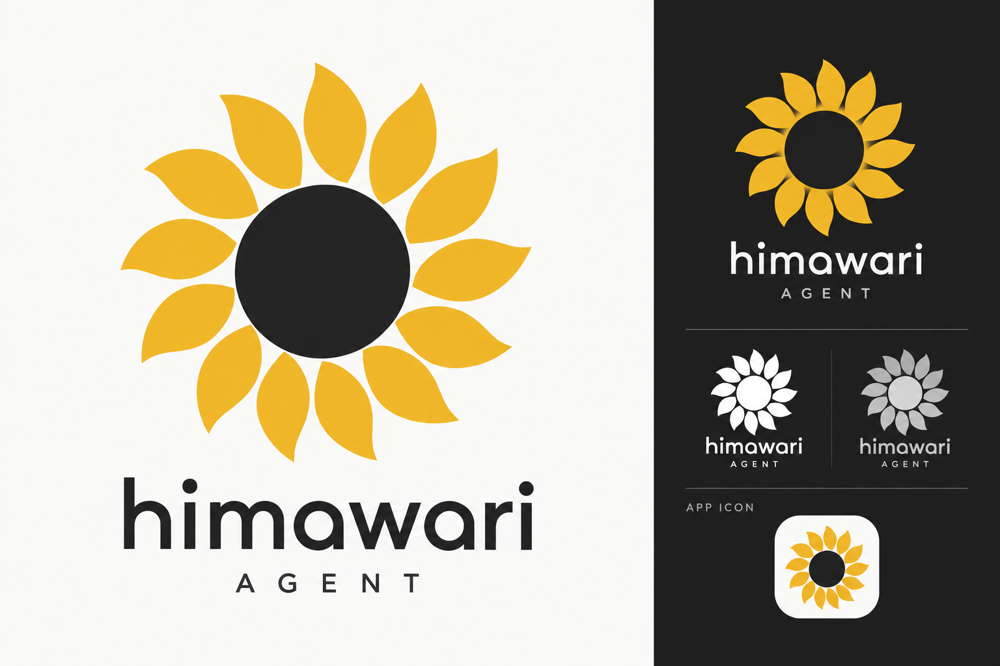

# Himawari Agent Logo

当前界面使用 `v4/` 的 55 粒“生长”葵盘标志（2026-11-15 用户选定，[ADR 0283](../../../docs/adr/0283-sunflower-mark-keeps-55-seeds-and-apps-get-icons.md)）；`v3/` 是 2026-10-30 选定的 233 粒版本（[ADR 0126](../../../docs/adr/0126-sunflower-mark-grows-233-seeds.md)），保留作历史参照；`v2/` 是 2026-10-26 选定的 96 粒葵盘，保留作历史参照；`v1/` 是 2026-09-10 确认的原始 PNG，保留作历史参照，不再被界面引用。

## v4 生长葵盘（当前）

| 文件 | 用途 | 格式与边界 |
| --- | --- | --- |
| [logo-sunflower-disc.svg](v4/logo-sunflower-disc.svg) | 独立图标，透明底 | 矢量 SVG，55 粒种子按 137.508° 黄金角排布，画布 48×48；第 n 粒距中心 `19.7/√55 × √年龄`，半径 `0.8 + 1.33 × √(年龄占比)`，颜色从最新的亮白金色经深褐、琥珀过渡到金色 |

界面里的标志由 `apps/control-center/src/components/brand-seeds.ts` 里的 `seedsAt` 画出，`brand.tsx` 只负责显示和动画；所有尺寸都是 55 粒。`v4` 的 SVG、4 张网页应用图标（`apps/control-center/public/icons/` 下 3 张 PWA 图标和 `public/apple-touch-icon.png`）和苹果三端的桌面图标（`clients/apple/App/Brand.xcassets` 里的 `AppIcon`、`WatchAppIcon`）都由 `node scripts/render-brand-assets.mjs` 生成（需要 Chromium，可用环境变量 `CHROMIUM_PATH` 指定）；`npm run check:brand` 检查 SVG 和代码一致。

## v3 生长葵盘（历史参照）

[logo-sunflower-disc.svg](v3/logo-sunflower-disc.svg)：233 粒种子的版本，2026-10-30 到 2026-11-15 在用，小尺寸下看不清，改成了 `v4`。

## v2 葵盘（历史参照）

| 文件 | 用途 | 格式与边界 |
| --- | --- | --- |
| [logo-sunflower-disc.svg](v2/logo-sunflower-disc.svg) | 独立图标，透明底 | 矢量 SVG，96 粒葵花籽按 137.508° 黄金角排布，第 n 粒距中心 2.16×√n、半径 0.82+0.78×n/96（画布 48×48）；颜色取浅色主题的 12 档黄 |

2026-10-30 起界面不再画这 96 粒葵盘，这张图只作历史参照。

## v1 原始 PNG（历史参照）

`v1/` 保存用户于 2026-09-10 确认的 Logo 原始 PNG。设计来自用户提供的向日葵照片：以金黄色花瓣、深色花心和简洁的放射轮廓表达 Himawari（日语“向日葵”的罗马音）。

| 文件 | 用途 | 格式与边界 |
| --- | --- | --- |
| [logo-symbol-light.png](v1/logo-symbol-light.png) | 独立图标原图 | 1254 × 1254，RGB PNG，自带浅色背景，不是透明底 |
| [logo-identity-board.png](v1/logo-identity-board.png) | 品牌设计展示图 | 1536 × 1024，RGB PNG；包含字标、深浅背景、单色与应用图标的设计示意 |

以上文件逐字节保留已确认的生成结果。展示图中的不同应用方式仍是整张图片的一部分，尚未拆成独立透明图标或 SVG。不要将棋盘格背景的失败生成稿、旧稿或重新生成的近似图形加入此版本。

完整外观、交互和版本维护说明见 [Web 与 Logo 设计基准](../../../docs/execution/specs/2026-09-10-control-center-visual-baseline-design.md)。品牌金色与聊天界面可切换的主题色分别管理；`v1/` 留作原始参照，后续衍生资源另存并说明用途。
