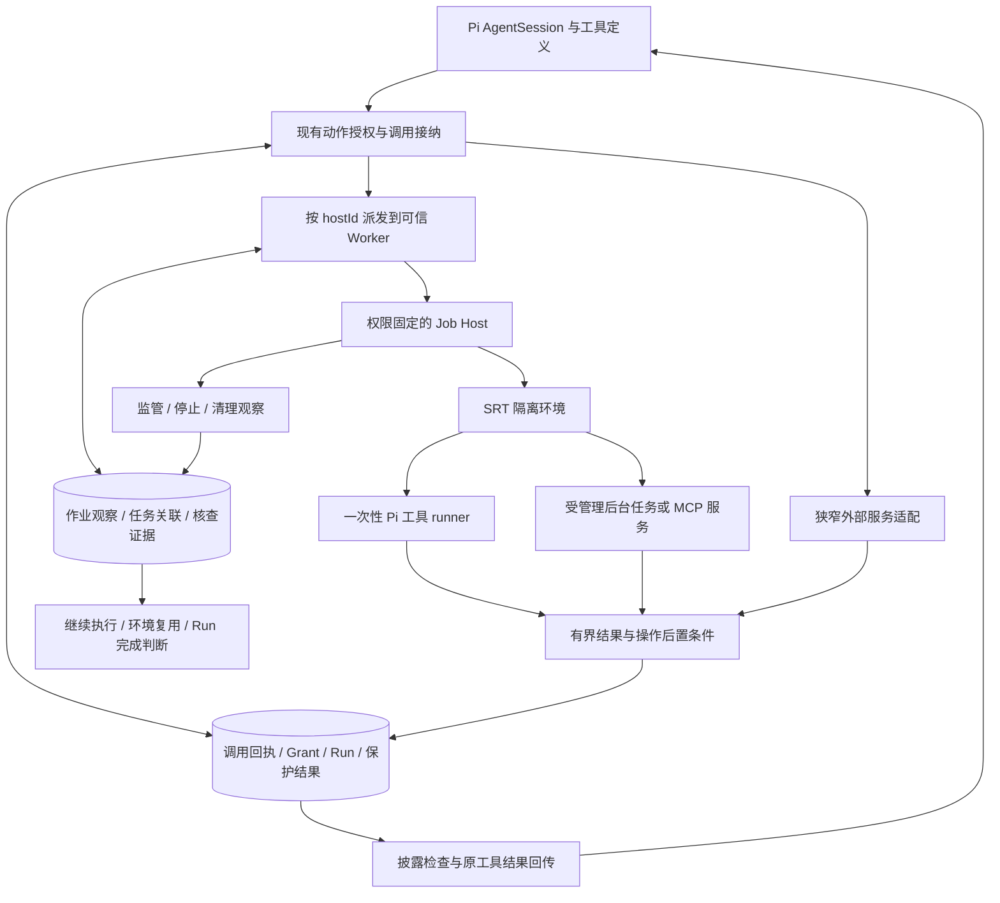
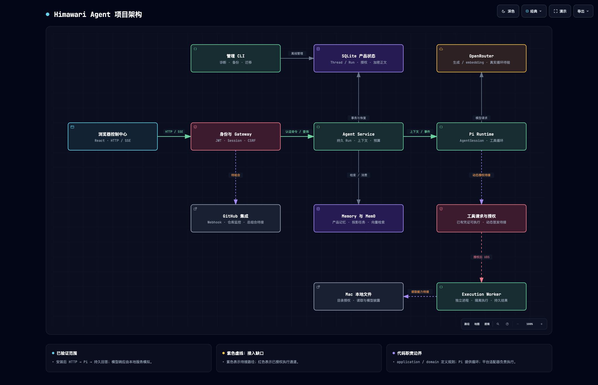

# Himawari Agent Architecture v0.1

## 执行架构：当前实现与已采纳设计

### 任务级隔离执行的已采纳变更（2026-09-24，待实施）

[ADR 0031](adr/0031-isolated-tool-execution.md) 已固定 Control Plane 与 Effectful Execution Plane 分离、任务级环境共享和环境停止证明后释放 lease 的目标架构，并部分修正 ADR 0025/0026。以下 SRT / Job Host 描述仍是已有实现及其时间限定，不是新目标已经交付：当前准入代码仍以 invocation 派生多个 job/environment 绑定，尚不能将这些绑定直接称为多工具共享的任务环境。具体差距见[新 Spec 的源码核查](execution/specs/2026-09-24-isolated-tool-execution-design.md#baseline)，迁移顺序见[新 Plan](execution/plans/2026-09-24-isolated-tool-execution-plan.md)。2026-09-25 的 [ADR 0032](adr/0032-original-directory-disk-and-sensitive-file-limits.md) 又部分修正 0031：新路径的原目录模式（把用户目录直接挂进容器）改用非硬性磁盘保护，并只遮挡创建环境时已存在的敏感文件；这同样是目标设计，尚未实现。

本轮只增加架构决定与设计文档，未改运行路径；现有 Mac 未知清理和 Linux namespace 证据保持原含义，不能推定已取得新容器资格。ADR 0030 的持久释放事实继续保留，新环境级 lease 与 proof 尚待接入。[SOURCE: docs/adr/0031-isolated-tool-execution.md]

2026-09-26 的 [ADR 0033](adr/0033-process-sandbox-default-and-optional-containers.md) 再次部分修正 0031：macOS 和 Linux 默认都用 SRT 模式（每次调用一个 Job Host 进程，在 SRT 限制下运行工具），进程组全部消失即释放目录并标明“停止未经严格确认”；上面的任务级容器环境只在配置里明确打开 `taskEnvironments` 后的严格模式下使用。新的释放规则、删除旧未确认记录的管理命令和界面状态说明尚未实现，见[新 Spec 的两种执行模式](execution/specs/2026-09-24-isolated-tool-execution-design.md#modes)。[SOURCE: docs/adr/0033-process-sandbox-default-and-optional-containers.md]

### 控制中心展示与执行选择（2026-09-10）

控制中心采用已确认的侧栏、聊天阅读区、固定输入和按需详情；Light/Dark 与六种主题色保存在客户端界面偏好中，三语与管理模块入口继续保留。原始品牌/原型资源不覆盖。

`ThreadExecutionProjection` 从 Owner/Agent/Thread/Run 归属校验后的持久化 Trace 提取受限展示字段，经现有 Thread Gateway 查询返回。原始 JSON、未标记为可展示摘要的 thinking、签名与 provider 元数据不开放。Trace 追加事务同时发布 Thread 事件通知，浏览器重连读取持久化投影，不另建流式协议。

当前生产组合还提供独立的 `thread.execution_state` / `thread.execution_state_snapshot` 查询。浏览器仅在配置声明 `executionStateAvailable` 时使用它，原 `thread.execution` 记录查询的严格合同保持不变。后端从归属校验后的全部 Trace 分页与 Run 版本生成阶段、原因、操作结果、现有 Stop/审批/清理动作、真实审查与工具执行区间的并集、稳定内容 revision 和最后观察时间；读取期间 Run revision 或资源清单变化时丢弃本次结果并从头重读，最多 3 次（含第一次），仍不一致、分页停滞或超出有限读取预算时不返回部分结论。工具行与整体状态保留每个操作的未知结果，已成功操作不因其他操作失败而丢失；解密失败不能当作空的成功结果。页面断线提示与该持久结论分开，客户端不再用墙钟估算新查询中的工具执行时长。

此投影只汇总目前已有的持久 Run/Trace 事实，`effectSummary` 表达操作 outcome，不构成文件已回滚、资源已释放或整个任务树已停止的证明。已选择会话的红点与可用动作使用匹配 Run revision 的状态；其他会话仍使用原待审批查询。资源 journal 的停止/核验/清理、队列等待、文件发布细节、其他阶段计时与全部会话统一注意状态仍待接入，见[统一状态实施记录](archive/plans/2026-09-16-workspace-authorization-lifecycle-plan.md#p6-unified-state)。即使所有工具已经返回，单独的 `Run.cancelled` 也只证明取消决定已保存；缺少资源证明时统一状态仍为“结果未确认”，保留已知成功操作及原有再次停止/清理入口。本批不改变 Pi 工具协议，不升级数据库，也不增加执行或重放入口。

用户提交仍对应产品 Turn/Run，Pi 内部 turn 是轮内执行步骤。可选模型由已配置、允许 private 数据的 generation descriptor 与 Pi 1.5.0 能力共同决定；`thread.message.submit_configured` 在 migration 0030 的 `runs.model_selection_json` 保存本次选择，后续仍由 RunExecutionInputService 冻结策略并执行原预算/披露/授权检查。界面中的下一轮选择不会改变活动 Run。停止复用 RunCoordinator；文本附件经既有 private Payload 发送，仅“执行”模式可用。

本轮实际验收按用户要求限于本机版本；真实服务与真实模型资格需单独取得。具体设计见 [SOURCE: docs/archive/specs/2026-09-10-control-center-product-refactor-design.md]。

### 当前实现基线（2026-09-09）

Pi `1.5.0` 管理模型与工具循环，模型侧工具执行委托现有 `RuntimeToolPort` 和 Worker。产品权威保存在调用回执、Grant/Handle、Run checkpoint、受保护 Payload 和 SQLite 作业观察中；没有独立的第二套工具身份或权限数据库。

SRT `0.0.81` 已集中在 `packages/runtime-sandbox`，版本号只在 `packages/execution-contracts/src/sandbox-runtime-version.ts` 定义；Linux 上启动前必须用上锁定的 seccomp 小程序（按系统调用拦截的过滤器），否则拒绝启动（[ADR 0156](adr/0156-srt-0-0-81-with-a-locked-seccomp-helper.md)）。独立 Job Host、原子准入/启动 CAS、scope 解析、主机与运行产物复核、认证 Payload UDS、正式 Worker 组合以及启动恢复核查均有实现。scope 已支持文件 inspect/read 工作流及从现有 Grant targets 取得通用工具范围；Pi 七工具前台 runner 已接入显式合同，后台执行仍待后续阶段，MCP 不在本次交付范围。

能力安装声明的 sandbox binding 在加载时按平台核算 `privateRoot` 的 UTF-8 字节预算。SRT 0.0.81 只在 Linux 建 HTTP/SOCKS 网络桥，最紧的 SOCKS 路径 `privateRoot/<44 字节任务编号>/claude-socks-<16 位>.sock` 多 80 字节，受 107 字节限制，因此根目录至多 27 字节。Linux 和 Mac 都建 `srt-mux-<pid>-<36 进制序号>.sock`；PID 分别预留 7 / 5 位；每个 Job Host 为新进程，只接受一次 prepare、初始化一次 SRT，因此 mux 序号为 `0`、占 1 字节。Mac 的 mux 路径多 66 字节，受 103 字节限制，根目录至多 37 字节。Job Host 控制路径 `privateRoot/control-<20 位>/control.sock` 的 100 字节限制更宽。本产品设置的是上游 `parentProxy`，仍会启动本地 mux；不启用 `tlsTerminate` 和 SRT 日志监视套接字。加载器取实际启用套接字的最紧预算，超长时以 `CAPABILITY_DEPLOYMENT_INVALID_VALUE` 拒绝，消息包含实际字节数、上限和决定预算的套接字；配置格式不变。Mac 依据来自固定版本源码阅读，未在 Mac 上验证。各路径与可变字段依据见[套接字预算核算](backlog/BL-20261002-002-生-产-privateroot-超-过-27-字-节.md#socket-budget)。

Job Host 在动态加载 SRT 及策略编译模块之前，先注册原 IPC 处理器并回应通过会话、序号与年龄校验的准备消息；2026-10-12 起这两个模块只在 SDK 工作线程里加载，主线程只收发消息和心跳，每次心跳带上逐步耗时记录，见[第三轮：主线程只管心跳](execution/specs/2026-09-28-sandbox-preparation-control-recovery-design.md#main-thread-heartbeat-only)。消息年龄按到达时判断；加载期间继续受原 1.5 秒监督窗口、30 秒准备上限及任务总期限约束，心跳不代表 ready 或启动授权。2026-10-22 起，Job Host 进程启动（Node 启动和静态模块加载）单独计时：Worker 收到它第一条认证消息之前不执行 1.5 秒窗口、不发心跳，只等最长 10 秒且不超过任务期限的启动期限（一次性路径超时诊断 `JOB_HOST_STARTUP_TIMEOUT`，常驻会话路径按 `host_failure` 结束会话、不生成父进程诊断）；Job Host 发出第一条回复之前接受 10 秒内的父进程消息；之后恢复 1.5 秒窗口，见[第四轮：Job Host 启动单独计时](execution/specs/2026-09-28-sandbox-preparation-control-recovery-design.md#startup-window)。Worker 只用任务期限回调判断绝对期限；任务期限早于或等于准备上限时，不再为同一期限安排第二个准备回调，诊断为 `JOB_HOST_EXECUTION_DEADLINE`。独立的 30 秒准备上限更早时才报告 `JOB_HOST_PREPARATION_TIMEOUT`；取消或结束后不再追加超时分类。加载失败走 `host_failure`，阶段为 `dependencies`；未加载或未完成 reset 时不报告清理成功，原签名终态要求不变。合同及验证边界见[依赖加载期间的启动监督](execution/specs/2026-09-28-sandbox-preparation-control-recovery-design.md#startup-supervision)及[期限诊断分类](execution/specs/2026-09-28-sandbox-preparation-control-recovery-design.md#deadline-classification)。

R8 在 Job Host 内增加每作业认证 HTTP 上游，复用 SRT `parentProxy` 汇集 HTTP/CONNECT/SOCKS。冻结的 hostname:port 同时限定 Grant、主机上界与策略；解析后检查全部地址并按数字 IP 建连。停止先关闭出口和连接，迟到 DNS 不能触发连接；出口拒绝、连接与关闭计数通过原认证 IPC 返回。SRT 继续负责 OS 隔离及客户端代理协议，Pi Operations 不变。该实现不证明系统 DNS 绝对零外联，也不扩大 Mac 清理保证。设计依据见 [SOURCE: docs/adr/0026-job-scoped-network-egress.md]；真实资格范围见配套 Plan。

零费用 GET 的只读网络重试由 Himawari 能力运行时负责，最多两次发送且共享原调用期限。决定重试时以 `performance.now()` 固定最早发送时刻，等待提前返回则补等；每次等待都检查原总期限并使用同一中止信号，取消、过期、撤权或秘密句柄失效仍阻止再次发送。Pi 的模型提供商重试参数不承担这一能力 endpoint 合同。具体边界见[只读 HTTP 重试时刻](execution/specs/2026-09-24-isolated-tool-execution-design.md#readonly-http-retry)。

现有 `sandbox-execution.v1` 把正常完成与清理/副作用确认绑定；正式 Job Host 适配对已启动任务仍报告 cleanup/effect unknown。因此受控 Mac 组合能保存输出并隔离未知作业，不能据此声称正式文件总结成功、环境已清理或全部工具可用。v2 `reconcile` 已通过原 Job Host 的认证控制端口和受保护终态证据核查；Mac 已启动任务仍保持清理未知，Linux 只有原 PID namespace 消失、任务外层进程组满足原释放规则、Host 自身进程组为空且退出证据完整时才允许释放。已跑历史验证及具体限制归配套 Plan，不把合成资格当作安装主机资格。

R1 已新增 `sandbox-execution.v2` 严格合同、`SandboxExecutionPortV2` 类型端口以及共享的 `projectSandboxExecution` / `projectSandboxRunCompletion` 纯判断函数。结果、效果和资源观察独立表达；结果已知时可以保留展示，监管丢失仍禁止续接和环境复用。判断需要由可信 Payload/资格/效果读者核验的证据，并检查调用、策略、sequence 与时效。生产组合已接入显式声明的 v2 foreground 固定读取/命令路径及真实证据读者；后台/服务与 UI 消费仍需后续工作。v1 与 v2 按原合同分别处理，不隐式降级。

R2 已在现有产品 SQLite 追加 migration 0028，通过 `SandboxExecutionJournalPort` 保存 v2 创建调用、环境及 task/service 资源关联。准入复用原 Handle/Grant 消费事务，首次启动 CAS 固定策略摘要；资源 sequence 与操作结果 revision 分开追加。目录占用使用可信主机提供的 device/inode 祖先链，写环境存活期间排斥相交操作，监管丢失后也阻止相交读取。该链不是授权来源，R3 已增加真实根目录及 device/inode 祖先解析，通用范围的正式准入组合与真实 UDS/SQLite 授权验收已完成。经 Owner 批准的 migration 0029 进一步区分未准备的 `reserved` 与固定运行绑定的 `bound`，既有记录保留 `legacy_bound`；预留和目录占用同事务保存，Worker 准备后由首次 `bindAndStart` CAS 固定真实策略/监督身份，不以占位值提前冻结。当前 Agent 与 Worker 已组合 v2 foreground：准备后登记原监督器，首次绑定 CAS 赢家才可启动；后台/服务模式明确拒绝。目标主机仍需独立资格，不能仅凭新增合同启用。 Agent 开放准入前会用当前权威失效 v2 旧监督观察，保留已知结果、效果及目录占用，不按旧 PID 接管。Job Host 与 Worker 使用双向、带序号和时限的私有 IPC 心跳，单端卡住也触发停止；这些机制仍不构成完整任务树清理证明。

派发意图在事务中核对最新观察、Run 和执行 fence，派发前再次检查；未确认回执的派发跨重启保留为不确定，不能因资源已经清理而消失。结果、资源占用和派发回执一起决定是否解除占用。v1 记录保持原文；未结束或缺少清理事实的旧记录保留主机级占用，缺少主机身份时保守阻止所有主机的新准入。未解决占用不能随 Run 删除。SQLite 仍由现有 state-root 锁和单一 Worker 管理，不新增数据库权威或 Task 状态机。

本次执行 Spec/Plan 的交付范围已按 Owner 指令移出本地/远程 MCP 接入和 GitHub 已有 commit 推送，相关产品需求与长期架构方向保留。下方目标图不表示两项属于本批验收；当前任务和验收集合以配套 Spec/Plan 为准，R1 的通用 service/remote 合同不回退。

R4 核查使用既有受保护 Run trace 保存控制引用与签名观察。控制端口只接受 inspect/stop，原会话、boot、进程启动标记、目录 inode 和策略摘要必须匹配；当前 Agent 权威可以核查旧 Worker 的原环境，旧 Worker 凭证不能取得新启动权。证据过期、身份变化、停止失败或控制失联保持隔离；核查超时后的迟到结果不能改写账本。Linux 在用户代码启动前捕获固定 SRT PID namespace 的 init 身份，启动握手保留二进制 stdin；Mac 不从主进程退出推导全树释放。

Linux 的 Host 和任务属于两个不同的进程组。Host 是自己组和会话的首进程，SRT 创建的桥接代理继承 Host 的组；任务另开外层组和 PID namespace。Host 在 SRT 初始化前启动一个同组 Node 清理进程，核对双方 PID、启动时间、父子关系、PGID 和 SID 后才允许创建代理。正常收尾继续复用 SRT `cleanupAfterCommand()/reset()`；清理进程保持到原 Host 退出；原 Host 仍在运行时不发组信号。IPC 断开后，只有原身份消失，或准确匹配的原 Host 为僵尸且 PGID/SID 仍归属原组，清理进程才在原 `cleanupTimeoutMs` 内结束自己所在的组。它在发信号前再次核对 Host 和自身身份，不等待父进程收尸才回收代理。它自己的组成员身份阻止组编号被系统复用，Agent 不按历史数字发送信号。Agent 每个正向释放分支都在判定候选之后独立读回确认 Host 组零成员，防止 Host 在两次进程探测之间退出而跳过组检查；僵尸仍算成员，身份或权限读错保持未确认。可信退出和组清理的过渡使用已有 `cleanup_pending`，共享原恢复期限。没有新持久字段、迁移、对外状态或 Pi 协议；Mac 路径保持原保证，本轮未验证。设计与范围见[Host 组清理](execution/specs/2026-09-24-isolated-tool-execution-design.md#linux-host-group)。 Hermes 候选编译代码 20 次测得新增准备耗时中位数 60.7 毫秒、P95 75.4 毫秒、最大 82.9 毫秒，占原 10 秒预算 0.61%、0.75%、0.83%；闲置 RSS 中位数 47.4 MiB、最大 47.7 MiB。此结果使用预热文件页和新 Node 进程，不证明冷盘、并发或生产成本，完整边界见[清理进程成本](execution/specs/2026-09-24-isolated-tool-execution-design.md#linux-host-guardian-cost)。

Agent Service 仅允许导入 `@himawari-agent/runtime-sandbox/control` 的 Node 控制客户端，它不加载 SRT、不编译策略、没有启动 API；依赖检查拒绝根入口和其他深层导入。SRT 初始化与实际工具执行仍属于 Worker/Job Host。

Job Host 在自己的进程内使用一个工作线程执行有状态 SRT manager API，主线程继续管理心跳、控制端口、网络授权、工具进程和原期限。依赖检查、初始化、包装和清理中的 SDK 同步调用不占用心跳线程；SDK 状态及代理仍只属于同一个实例。正常释放要求 SDK reset 成功回答及线程自然退出代码 0，线程意外退出不能替代清理证明。原 `job-host.v2`、1500 ms 双向监督和唯一 start 授权保持，策略模块加载与 Worker 主线程停顿的边界见[启动监督](execution/specs/2026-09-28-sandbox-preparation-control-recovery-design.md#startup-supervision)。[SOURCE: docs/execution/specs/2026-09-28-sandbox-preparation-control-recovery-design.md]

Agent Service 在已通过握手、当前权威和原调用检查的准备诊断入口，校验 `sandboxPreparationDiagnosticSchema` 后向原服务诊断输出写入 `sandbox.preparation.failed`。日志只保存阶段、原因、宿主阶段、系统码与 hostDetail 的固定枚举，以及既有诊断时间、固定组件/事件和原身份摘要形成的 `controlRef`；原身份、路径、用户正文、秘密、SDK 原始错误及细节计时均不复制。固定字段日志先于原 restricted Trace 的读取和保存；日志写入同步抛错时仍尝试执行原 Trace 保存流程，已有第一份 Trace 不覆盖。握手或权威检查未通过时不生成这条日志；重复日志不代表重复执行，也不构成释放证明。完整字段与读取边界见[准备失败的安全服务日志](execution/specs/2026-09-28-sandbox-preparation-control-recovery-design.md#preparation-safe-log)。[SOURCE: docs/execution/specs/2026-09-28-sandbox-preparation-control-recovery-design.md#preparation-safe-log]

2026-10-15 起（R2-T10），作业宿主在放行用户命令前失败时会在停止前发一条 `stage: launch` 的启动失败诊断：主机失败码说明是门超时（`JOB_HOST_NAMESPACE_GATE_TIMEOUT`，2026-10-23 起门握手时限为 10 秒，原为 1500 毫秒，R2-D27）、`spawn` 失败（`JOB_HOST_LAUNCH_SPAWN_FAILED`）还是门输出/格式无效（`JOB_HOST_NAMESPACE_GATE_INVALID`）；`systemCode` 只从以 `bwrap: ` 开头的宿主标准错误行映射，`spawn` 用 `error.code`。原始说明放在 `hostDetail.text`（去控制字符、UTF-8 截到 512 字节），只进受保护诊断记录；写入前用 `scanMachineSecrets` 扫描，命中置 null，安全日志不含它。Worker 在前台、宿主 `taskStarted=false`、`exitCode=null` 且尚无结果时，用签名 `final.json` 核对未启动并确认释放，再写 `SANDBOX_TOOL_NOT_STARTED` 失败结果交回模型；不满足则保持 `SANDBOX_EXIT_UNKNOWN` 继续对账。只覆盖本机 SRT 前台调用。2026-10-24 起（R2-D31），带 `resourceLimits` 的任务启动后，资源观察器每次 `ps` 快照的超时为 5 秒，拿不到快照先重试，自上次成功样本起连续 10 秒拿不到才以 `host_failure` 停止，停止前发 `JOB_HOST_RESOURCE_OBSERVATION_FAILED` 诊断；快照无效或超过容量仍立即停止。[SOURCE: docs/execution/specs/2026-09-28-sandbox-preparation-control-recovery-design.md#目标与来源]

新建 SRT 计划冻结 `launch-or-block.v2`；已有 `register-before-host.v1` 或无字段计划不升级。准备控制登记确认返回后，Worker 先检查取消、关闭及原期限；期限已到时不发布启动决定，Agent 仍能禁止启动并认证释放占用。Worker 在原私有控制目录内竞争唯一的启动决定，只有本次发布成功才可以创建 Host；申请返回后再检查相同条件。Agent 的 control 入口只可以写禁止启动或读回决定，不导出申请启动入口；原绑定、目录 inode 和 HMAC 检查仍保护决定。停止先赢时，Agent 用独立读回的受保护 Artifact 生成 `preparation_launch_blocked`，SQLite 在原释放事务内核对其归属、摘要及无 main Host 登记后释放占用，沿用一次“工具未启动”交付。启动先赢而缺少 Host 证明时仍保留 UNKNOWN。机制及验收见[准备启动仲裁设计](execution/specs/2026-10-04-sandbox-preparation-launch-arbitration-design.md) [SOURCE: docs/execution/specs/2026-10-04-sandbox-preparation-launch-arbitration-design.md]。

R3 的通用范围、版本匹配和启动前复核已完成验收。资源输出分页读取账本绑定的受保护快照；页和游标沿用 Run artifact，游标绑定原调用/资源/输出摘要，数据库重开继续读回不会重新执行。尚无已知输出返回 null，真实空输出返回零字节页；流式后台输出由 R6 的连续受保护片段补充。Pi 工具的完整实现继续复用 runtime-pi 内的上游定义和 Operations，R3 不新增模型侧工具协议。

R5 使用安装树中的 `pi-coding-main.js` 执行 Pi 七种前台工具。Worker 只为 `pi-coding-tool` 版本 `1` 的匹配操作构造 `pi-runner.v1` 输入；目录、主机、调用和期限来自既有 scope，模型参数仍是原冻结 Payload。`host-file-read-main.js` 保留文件元数据/正文双阶段。Pi 定义只在 runtime-pi 内提取，模型侧执行仍经过产品端口；新增 runner 不自动注册未授权工具。目标安装目录中的 `pi-tools/bin/{bash,rg,fd}` 是普通可执行文件，纳入原 runtimeDigest，禁止软链接和 Pi 自动下载，这些 Pi 工具只从该固定目录取得。`bash` 工具执行的子命令另用一份 PATH：在该固定目录之后依次加入 `/usr/local/bin`、`/usr/bin`、`/bin`，可使用系统自带程序；系统程序不计入 runtimeDigest，能否实际运行由沙箱只读放行列表决定（见 [ADR 0055](adr/0055-bash-uses-system-commands-in-sandbox.md)）。

2026-10-14 起，Linux 上沙箱启动参数里因禁读而挂上的内存文件系统（tmpfs，包括 `/tmp`）会在分隔符 `--` 之前按原顺序加上 `--remount-ro`，这些目录因此只读。目的路径如果是符号链接，并且后面另有挂载盖住它解析后的真实目录，就不再对这条路径加 `--remount-ro`。Ubuntu 上 `/sbin` 指向 `/usr/sbin`，后面的 `/usr` 挂载会盖住它；若仍重挂 `/sbin`，bubblewrap（Linux 上隔离进程的程序，命令名是 bwrap）会去重挂已经被盖住的目标并报 `Invalid argument`，命令在启动前退出。被盖住的那一层不再可写。`/tmp` 这类真实目录仍改为只读。授权工作目录和本次调用的私有目录以外的写入会以只读错误失败，命令以非零状态退出；工作目录在授权包含写入时、以及私有目录，仍按后面的重新绑定保持可写。2026-10-27 起产品路径里 bash 的目录授权包含 read、create、update，命令可以写工作目录，每条命令前后由主进程对比工作目录并留档（见 [ADR 0097](adr/0097-bash-writes-workspace-with-change-ledger.md)）；只读错误的主机回读文件仍放在私有目录。`TMPDIR` 继续指向私有目录。这一修正只在 Linux 上做，代码在 `packages/runtime-sandbox/src/bwrap-read-only-tmpfs.ts`，由 `packages/runtime-sandbox/src/job-host-main.ts` 的任务启动和就绪探测包装调用。Mac 未改。写入范围的决定仍是 [ADR 0055](adr/0055-bash-uses-system-commands-in-sandbox.md) 的第 3 条，这里不改那条决定。[SOURCE: docs/adr/0055-bash-uses-system-commands-in-sandbox.md]

R6 在同一 RuntimeToolPort 上注册四个管理扩展，start 沿用冻结命令授权，status/output/cancel 只定位本 Run 的资源。Job Host 区分准备、实际进程启动与结束；Worker 返回不可变 started 回执后继续监督。运行输出按连续编号保存为受保护 Run artifact，分页与恢复读取均不产生执行。服务就绪来自安装声明的 Unix HTTP 探针和受保护监督证据；探针与测试服务只能访问任务私有目录内指定的 socket，策略不开放通用本地 TCP 或其他 Unix socket。Run Coordinator 在正常结束前停止后台资源，未确认释放进入原核查状态，SQLite 完成事务再次阻止未释放资源遗漏。后台/服务须由 Worker、安装声明和对应资格共同声明，不由新增接口自动启用。


编辑与写入复用 ConstrainedHostFileSystem 的独占创建、原内容核对、备份和安全替换；Shell 的部分写权限不能推断出删除等任意副作用权限。工具结果、来源、截断与完整输出保存到同一受保护结果中，输出文件须在本作业私有目录、属当前进程用户且为无链接普通文件，模型不会取得原 fullOutputPath。Shell 无退出码视为失败；非零退出及输出保留。前台 Shell 失败（非零退出、超时、超过命令输出上限）时，Pi 保留的输出结尾经机器秘密扫描、披露检查和大小截断后交给模型，并在前面提醒命令可能已改动工作区、效果尚未核实；输出含机器秘密（包括只剩开头行或结尾行的私钥片段）时只交出说明和真实退出码，不交正文（见 [SRT 统一执行设计的 R5 实现说明](execution/specs/2026-09-07-srt-unified-execution-design.md#r5-实现说明2026-09-09)）。合同版本 1 的编辑与写入失败时，runner 报告有没有开始改目标文件：还没开始时效果记为已核实，模型拿到 Pi 自己的错误；已经开始或无法核实时按有界失败提醒模型文件可能已被修改、请先读取，这一轮不再重放同一次调用；结果含疑似密钥时只交出不含正文的固定说明。Mac 任务树清理未知及正式主机资格限制继续生效。

### 已采纳、待实施的职责划分

2026-09-09 Owner 已批准 [SOURCE: docs/adr/0025-pi-tools-and-managed-execution-lifecycles.md]，替代 ADR 0024 的统一作业表达。保留 SRT 本地主机路线、原目录默认模式以及原首批能力；分离工具结果、受管理任务/服务与执行环境的生命周期。目标合同及验收见 [SOURCE: docs/execution/specs/2026-09-07-srt-unified-execution-design.md]，执行次序见 [SOURCE: docs/execution/plans/2026-09-07-srt-unified-execution-plan.md]。下图是目标设计，不是已实现状态。



| 责任 | 所有者与边界 |
|---|---|
| 工具定义与行为 | Pi 工厂、Agent loop、参数/结果语义；Himawari 通过 `runtime-pi` 薄适配复用 |
| 执行权威 | 既有 Agent Service/Capability/SQLite；固定身份、输入、Grant 和期限，准入及启动复核 |
| 实际工具 I/O | Worker 管理的受限 runner；Pi 路径探测、搜索器和临时输出也必须在边界内，Operations 不是唯一隔离层 |
| 持续资源 | Worker 监督的任务/服务，以创建 invocation 和冻结 scope 为根；每个后续调用仍独立授权 |
| 平台隔离 | SRT 后端与主机资格；一次性环境独占，持续环境只在同 Run/同授权范围内使用，不跨 Grant 累积权限 |
| 输出和副作用 | 已有保护结果库及操作适配的核查证据；命令退出不等于远端业务效果确认 |
| 清理与恢复 | 原作业账本扩展；监管丢失阻止依赖动作，未知不重放；逻辑隔离不宣称已终止 OS 进程 |

历史工具结果以已持久保存的产品 outcome 为依据：`failed` 或 `result_unknown` 不因旧 Pi 记录的 `isError=false` 或缺少错误码变为完成。确定未派发的 `FILE_VERSION_CONFLICT` 显示“尚未派发”；若同时存在结果未知证据，或产品成功与未派发标记相互矛盾，优先保留“结果未确认”，不能据此推断没有写入。原输出内容与事件序号保持不变，不补造执行时长，也不重放工具。

工具结果落库、模型披露、后续动作准入、环境复用和 Run 完成分别判断。受管理任务可以在调用返回句柄后运行；首批以原 Run 和授权期限为上限，Run 结束要停止其资源，不默认跨 Run 续命。失联后的输出可作为带限制的事实展示，不能触发未经核实的后续副作用或伪造整体成功。详细判定只由 Spec 定义，避免架构文档维护另一套状态机。

当前资源恢复沿用 SQLite 中的有期限任务。核验观察的写入与任务的 owner、revision 和运行状态在同一事务内比较；旧任务被接管或结束后不能继续写入释放证明。超时后的后端返回不再触发新校验或写入，仍持有处理权的任务只能记录无结论并保留相交资源保护。恢复结束前重新读取资源与操作事实，保留同期收到的工具结果和永久释放记录。这些约束属于 Himawari 的持久恢复职责，继续复用 Pi 的工具及取消信号，不证明宿主进程与后代已退出。实现进度与本地验证见[工作区授权计划的恢复尝试隔离记录](archive/plans/2026-09-16-workspace-authorization-lifecycle-plan.md#p1-recovery-fencing)。

资源恢复只保存固定安全原因码，区分权限拒绝、宿主不可用、身份与证据变化、控制连接超时和整体核查到期；后端无结论不能抹去具体原因。原始错误经既有受保护 Trace 保存，关联原 Job、环境、动作与失败阶段，不进入公共资源事实。并发释放得到充分证明时，恢复终点以最新持久事实为准。已绑定资源（`bound`）仍沿用原单次有期限 inspect/stop 和暂停规则；未知结果不能变成工具重试。

Schema 43 扩展原 `recovery_json`，记录待核查的 `scheduledAt/nextAttemptAt`；进入检查后才增加次数并保存真实开始、期限和结束时间。现有生产 Run 循环有独立、单次并行的资源扫描，不等待资源核查才继续扫描无关 Run。它按页发现终态或结果待核实 Run、过期执行、lost/reconciling 资源和 released 残留保护，在原权威事务内重新比较资源序号、恢复版本与 Run 状态，再选择原宿主的 inspect/stop。没有宿主身份的预约先持久禁止启动，只有原宿主“从未启动且已退出”的证明才能释放。常驻 SRT 环境和容器环境的预约按环境已释放的证明释放，Run 没有结束时也可以按“绑定已被停止标记挡住”的证明释放，见 [ADR 0054 第 4 层发现的缺口](adr/0054-readonly-tools-in-host-and-reused-task-sandbox.md#resident-fixes)。

未绑定预留（`reserved`）需要停止时，原宿主或控制套接字暂时不可达不再阻止独立核验已保存的释放证明。若本次仍无充分证明，预留继续占用工作区。暂时不可用、控制未确认、控制超时、整体核查超时、中断或无结论的 stop 核查会在原事务内重新排定，按上次实际结束时间退避 1、2、4、8、16、30 秒，之后每次等待 30 秒；每次尝试仍受原 30 秒核查期限约束。身份、目录、签名、受保护证据或权限错误暂停自动尝试。重启保留次数、恢复版本和最早尝试时间，不授予新 start，也不重放原工具。只有原释放事务接受充分证明后才解除占用；原结果交付和 Run 结束仍分别受现有权限及期限约束。具体原因码与证明边界见[未启动预留的持续清理核查](execution/specs/2026-09-28-sandbox-preparation-control-recovery-design.md#reserved-retry)。[SOURCE: docs/execution/specs/2026-09-28-sandbox-preparation-control-recovery-design.md]

严格模式中的未绑定容器预约另沿用环境级停止证明：恢复读取原 Owner/Agent 的权威 Run，只有 completed/failed/cancelled 才补调现有同 Run 环境停止，再独立读回认证环境释放回执并进入原预约释放事务。活动及结果待核实 Run 不因进入候选清单就停止环境。停止失败或证明不匹配继续保留占用；暂时失败适用上述 reserved 核查退避，身份、签名及权限错误仍暂停，不重放模型或工具，原每次恢复期限不变。具体边界见[未绑定容器的终态恢复](execution/specs/2026-09-28-sandbox-preparation-control-recovery-design.md#container-unbound-recovery)。[SOURCE: docs/execution/specs/2026-09-28-sandbox-preparation-control-recovery-design.md]

管理 CLI 另提供 `sandbox inspect-reservation` 与 `sandbox confirm-reservation-cleanup`，仅针对当前配置归属下单个前台 SRT Run 的已停止未绑定预约。预览只列 Job/Run/Thread/环境身份、停止标记、四个 revision、摘要和固定三项声明的 confirmation；摘要绑定其他相关资源快照，不输出资源统计；不解密 control，不核查 final 或进程。确认命令在 Agent/Worker 停止并取得 state-root 独占锁后，记录运维对原宿主组不存在、原 final 缺失、相关进程不存在的声明与现场报告 SHA-256。Schema 50 的独立 `sandbox-admin-reservation-release.v1` 回执以 `administrator_confirmed_cleanup` 标明来源，保存管理员声明引用与实际本机 `{uid, account, hostname}`，不冒充认证 Host proof。同事务保存回执、审计、占用释放、Run/checkpoint 失败、原执行租约结算与 Thread 持久事件，重复处置读回同一历史；旧 writer 拒绝 Schema 50。工具结果与效果仍未确认，管理员 basis 不属于 never-started，不能生成工具结果交付或 Pi 续跑。详细合同与操作边界见[管理员处置](execution/specs/2026-09-28-sandbox-preparation-control-recovery-design.md#admin-reservation-disposition)及[专门 Runbook](runbooks/sandbox-reservation-administrative-disposition-runbook.md)。[SOURCE: docs/execution/specs/2026-09-28-sandbox-preparation-control-recovery-design.md]

扫描使用现有 Run 并发上限；暂停或其他宿主的记录不会使后续页饥饿。失败有明确终点，不自动重试未知副作用；后续新增停止义务与新的矛盾事件可形成新的有限核查。服务关闭取消核查，恢复 owner、revision 和期限比较拒绝旧回调接纳证明。旧迁移记录仅补 `nextAttemptAt=null`，不重新授权或推断释放。已配置沙箱子系统的服务均接入资源扫描：Web 模式复用生产 Run 循环，无 Web 模式在启动登记和 Worker 就绪之后启动仅处理资源的循环，不创建 Run 或模型执行服务。每次扫描先复核当前权威，关闭或失去权威时立即取消扫描，再使用同一次有限等待结束恢复任务；不会在 close 阶段重新开始等待期限。明确 stop 可接替正在等待的 inspect，恢复 revision 隔离旧检查的迟到写入；正在执行的 stop 不重复派发。未配置沙箱后端或缺少可信宿主身份时，不能宣称后台已完成清理。

Schema 42 在原工作区保护表增加资源矛盾事件：永久释放后，只有同一冻结环境和原进程身份的新鲜、宿主核验通过的运行证据才能建立新保护。原资源观察、释放凭据与占用的释放时间不回退；保护复用原精确文件或目录 claim，不扩大到无关资源。事件保存证据和接纳权威，并使原有有限恢复任务进入明确的 unresolved 状态；新停止证明必须晚于事件且匹配原资源身份，才能单独解除保护。结果未知、旧证据重放和一般错误不建立这类保护；执行授权过期不免除有限清理和风险记录职责，也不恢复执行权。迁移保留旧保护，旧 writer 不得写入 Schema 42。

SRT 继续用于本机授权目录；Gondolin/容器/远端沙箱是有独立资格的可选后端方向，当前未启用且不构成自动 fallback。Git push 继续使用 Pi Bash 意图、产品内部专用动作和标准 Git，冻结仓库/ref/OID，凭据只由专用传输使用；本地兼容实验不等于真实 GitHub 验收。

现有 SQLite preparations 端口新增内部 `readRunInventory`：同一只读事务返回一个 Owner/Agent/Run 的 v2 预约/绑定记录、完整队列历史、本 Run 的任务环境调用登记和执行租约及旧格式未释放资源标记；身份异常或任一集合超过 10,000 条会拒绝整个读取。它不推进队列、不消费额度、不刷新旧权限，也不触发宿主核验。当前尚未接入网页状态查询，空记录不能作为资源已停止证明，见[资源快照基础](archive/plans/2026-09-16-workspace-authorization-lifecycle-plan.md#p6-resource-inventory)。

## 架构总览图

下图是保留的 2026-09-07 组件快照，不描述上述新生命周期或最新 SRT 接线；当前执行边界以上文和配套 Spec 为准。图中记录当时的主要组件和接入状态，箭头表示主要调用方向，省略响应回传和部分共享依赖。绿色主线表示消息执行路径；紫色虚线表示尚未接通的路径；红色表示已授权执行通道。



[打开交互式架构图](assets/architecture/system-overview.html) · [图表源文件（Archify JSON）](assets/architecture/system-overview.json)

交互版为独立 HTML，下载后可在浏览器中打开，支持缩放、搜索、主题切换和导出。静态预览用于直接阅读文档；更新图表时应同步维护源文件、交互版和预览图。

图中的 OpenRouter 表示已有接口接线，不表示真实模型读取 Mac 文件的完整场景已通过验收。当前安装进程验证使用本地模拟模型响应；动态工具请求到授权签发、Mac 文件能力及 GitHub 总组合仍有接入缺口。Pi 负责模型交互与工具循环，Himawari 负责产品权限、预算、持久状态和 Worker 集成。

## Current System

仓库当前实现是一个私有 npm workspace monorepo 基础。根工具链要求 Node.js `>=22.22.3`，以 npm `11.8.0` 管理锁文件，以 TypeScript `5.9.3` 做 strict、`erasableSyntaxOnly` 类型检查，以 Biome `2.3.5` 做格式和 lint，并以 Vitest `4.1.9` 提供 unit、contracts、integration、e2e、Pi compatibility、browser、admin CLI、Node services 和 workspace scaffold 九个可独立选择的测试项目。

当前代码包含十五个 workspace。`packages/domain` 实现不可变身份、所有权规则、Run 状态机、Agent 权威租约，以及 deployment/fence、Thread 生命周期、消息/检查点、产品 session/device、后台 job/occurrence、Memory generation/lifecycle、GitHub receipt/coverage gap、恢复点/transfer 和 health 状态；两类基础 contracts 保留 `gateway.v1`/`gateway.v2` 与 `execution.v1`/`execution.v2`，Thread 扩展使用独立 `gateway.thread.v3`；`packages/application` 实现产品端口、v1/v2 Gateway、认证 Thread Gateway、Thread command/query/Fork/deletion 组合、最小 Context Formation、Run/Worker 编排、可靠事件、Trace、授权、产品 Memory/projection、增量自动 Memory、Thread 稳定检查点与候选提炼、模型、调度、Attention 和外部结果对账；`packages/platform-node` 已实现可信模型 Provider 边界、Payload envelope encryption、host secret source、严格配置、state-root layout、health/lifecycle coordinator、无私人标签的运行指标、`execution.v2` HTTP/JSON over UDS、同源 v1/v2/Thread v3 HTTP/SSE Gateway、浏览器正文读取/opaque search admission 与身份入口，`packages/runtime-pi` 实现 Pi Agent Runtime 适配器及闭合的产品模型绑定；`packages/testing` 提供 conformance suites、内存参考适配器、牛肉餐厅夹具、故障注入器，以及 v0.2 canonical scope 与 evidence harness。`packages/persistence-sqlite` 已实现规范 schema、二十三项不可变 migration、专用 SQLite execution context、state-root lock、持久 deployment/lease、原子 Product State transaction、主要产品 repository、可恢复 Outbox、持久 Gateway Read Model、身份 binding/session/device、产品 Memory/projection job、敏感 Memory 审批元数据、Thread 生命周期/消息/lineage/opaque search projection/durable Gateway event、Thread 摘要/派生候选/provenance、治理 mutation receipt、受保护 Payload envelope metadata、受治理删除、GitHub monitor history retain/delete 状态机、加密同机恢复点 create/verify/restore，以及停机 authority transfer；`packages/memory-mem0` 已实现显式配置、单记录投影、检索、清理与产品 ID round-trip 的 Mem0 adapter，并提供把严格配置的 Vercel AI Gateway embedding descriptor 映射到 Mem0 3.3.1 既有 OpenAI-compatible embedder 的生产组合；`packages/integration-github` 已实现只读 permission boundary、host-secret/短期 installation token 边界、raw-byte HMAC webhook admission、SQLite receipt/occurrence 去重、bounded mirror、relevance/Attention/coverage-gap、`gateway.v2` monitor enable/pause/revoke handler 和 capability deny 断言。该 handler 已校验 Owner/Agent scope、安装状态、CAS revision、模型/仓库/分类披露，并按撤销顺序同步 scheduler、删除 mirror 后调用 history policy port；SQLite durable adapter 已提供 retry/readback 组合点，最终 Agent Service/Gateway 总组合仍由对应后续 Tasks 验收。

`apps/agent-service` 现有可编程的本地前台组合根、严格 `gateway.v1` in-process transport、production `execution.v2` UDS client、可安装 `main`，以及从严格配置创建并在启动/关闭生命周期中管理的 production Model/Pi 与 Mem0 composition；支持的 Vercel AI Gateway 配置会把独立 embedding descriptor 交给 Mem0，deterministic fixture 只报告显式 descriptor，不创建任何 Pi、Mem0 或隐式模型路径。`apps/execution-worker` 同时保留确定性的 `execution.v1` in-process test profile，并实现验证 authority fence、adapter registry、resource ceiling、去重、cursor、取消与对账的 production Worker runtime。两项服务均有可重定位 Node runtime、稳定诊断/退出码和信号 drain，公开模式的最终 `main` 已组合 HTTP、身份、持久 Run、Pi、Memory consumer 与已授权 Worker 工具；GitHub 总组合和结构化 Worker subtask adapter 仍待完成。`apps/control-center` 已实现 browser-only React/Vite 控制中心基础、typed Gateway client、v2/Thread v3 SSE 恢复、native History typed routes、11 入口响应式三栏/单栏 Shell、`react-intl` 三语 runtime 和 native-first 语义组件；Thread、Approval、Capabilities/Adapters 与 Authorizations/Grants surface 已接通严格权威 read model 和 mutation contract，Task、Inbox、Memory、Trace、Session/Device、Health 仍为 `baseline_only`，Settings 保持 `blocked`，因此全入口仍不等于全业务操作面已接通。`apps/admin-cli` 已实现可执行 doctor、只读 db status 和受 offline lock/confirm 保护的 migration 入口。

已关闭 Foundation Spec 的 Task 1 至 Task 20 已按确定性参考配置实现并验证：[SOURCE: docs/archive/specs/2026-08-25-agent-foundation-design.md] [SOURCE: docs/archive/plans/2026-08-25-agent-foundation-plan.md] 当前 portable durable web-agent Plan 的 Task 20–27 已有代码与确定性资格证据，其中真实 GitHub/Cloudflare、跨主机 transfer、完整浏览器矩阵和最终 Agent Service 生产组合仍按各自证据保持未验证。Task 20 的受保护 transport、配置路由、Pi模型绑定及4096维Mem0组合已接入Agent Service。当前配置按[ADR 0048](adr/0048-vercel-ai-gateway-replaces-openrouter.md)使用Vercel AI Gateway：文本只用`deepseek/deepseek-v4.1-flash`，嵌入用`alibaba/qwen3-embedding-8b`，删除GLM备用。历史OpenRouter的primary/fallback及旧Mem0资格只证明对应旧版本，不能证明本次迁移。日期化catalog版本用于冻结产品身份，不是上游不可变版本。[SOURCE: docs/adr/0048-vercel-ai-gateway-replaces-openrouter.md]

## Boundaries

允许的 workspace 依赖方向是：

```text
agent-service → application + contracts + selected adapters + runtime-pi
execution-worker → application + execution-contracts + selected adapters
control-center → gateway-contracts + browser-only UI dependencies
admin-cli → application + approved offline/admin adapters
persistence-sqlite → application + domain + product contracts
memory-mem0 → application + domain
integration-github → application + domain + product contracts
platform-node → application + domain + contracts
runtime-pi → application/runtime-port + @earendil-works/pi-coding-agent + @earendil-works/pi-ai
application → domain + product contracts
contracts → no internal dependency
domain → no internal dependency
testing → application + domain + product contracts
```

`scripts/check-boundaries.mjs` 从根和各 workspace 的 `package.json` 及 TypeScript import 构建依赖图，检查非精确直接外部依赖、非法方向、循环、未声明依赖和逃出 workspace 根的相对 import。任何 `@earendil-works/pi-*` 依赖或 import 只能位于 `packages/runtime-pi`；`@anthropic-ai/sandbox-runtime` 只由 `packages/runtime-sandbox` 直接依赖或导入；domain、contracts、application 和 browser-only workspace 不能直接 import `node:` 模块，browser-only workspace 也只能声明或导入明确允许的浏览器依赖。控制中心当前逐项允许 React、React DOM、`react-intl`、Vite/Vitest 与类型/构建配套，不把 browser-only 放宽为任意 npm 包；`test/integration/workspace/workspace-boundaries.test.ts` 会为依赖图的每个非法 workspace 方向以及 Node、browser、Pi 和本地路径规则运行 negative probe。

根构建可以分别验证 Node 图、两类 contracts、两个服务、browser bundle 和 admin CLI。`build:browser` 在 Vite production build 后执行 `scripts/check-control-center-build.mjs`，机械验证外部 CSS/JS、en/ja locale code splitting、无 source map、无 inline script/style、无动态代码求值，以及 entry/总 gzip 预算；Fastify `GET /*` 只对非 `/api`、非 `/assets` 且 `Accept` 包含 `text/html` 的路径返回同源 SPA shell，未知 API 与非 HTML 请求仍为 404。`scripts/generate-artifact-manifest.mjs` 会在构建后生成 machine-readable manifest，固定根 manifest/lock SHA-256、每个 workspace 的内容 checksum，以及当次 browser artifacts 的路径、大小和 SHA-256；生成物位于忽略提交的 `dist/`，脚本和 checksum contract 才是当前受版本控制的稳定入口。

`packages/runtime-pi` 直接固定 `@earendil-works/pi-coding-agent` 与 `@earendil-works/pi-ai` `1.5.0`；提交的 manifest 和 lockfile 不引用相邻的 `../pi-mono`。它只能从 `@himawari-agent/application/runtime-port` 导入 Agent Runtime request/event 类型，不能通过 application 根入口获得 Memory、Permission、Capability Registry 或持久化写端口。Pi 的发布声明图（0.84.2 时发现）在 TypeScript `NodeNext` 下包含上游 JSON import-attribute 与 optional provider 声明问题，因此本仓库启用 `skipLibCheck` 仅跳过第三方声明文件检查；Himawari 自有源码仍由 strict TypeScript 完整检查，并以 published package compatibility test 补足运行时证据。该隔离边界落实了产品自有 Pi 适配层决策：[SOURCE: docs/adr/0001-pi-runtime-adapter.md]

## Data Model

领域层以不同的 branded string 类型表示 Owner、Agent、Thread、Session、Run、Turn、Trigger、幂等键、权威 holder 和权威 lease。工厂只接受 1–128 个字符的机器标识，不生成标识，也不依赖数据库、传输或 Node.js API。

实体的所有权链如下：

```text
Owner
  └── Agent
        ├── Thread
        ├── Session ── optional Thread
        └── Trigger ── optional Thread + IdempotencyKey
              Session + Trigger ── ownership check → Run
                                                    └── Turn
```

所有实体是冻结的只读值。Session 和 Trigger 只能关联同一 Owner/Agent 的 Thread；Run 要求 Session 与 Trigger 的 Owner/Agent 相同，且 Trigger 显式指定 Thread 时必须与 Session Thread 相同。没有 Thread 的 Trigger 可以在接纳过程中关联到新建 Session 的 Thread。

Run 从 `accepted` 开始，当前合法转换为：

```text
accepted → building_context | failed | cancelled
building_context → running | failed | cancelled
running → awaiting_approval | reconciling_external_result | completed | failed | cancelled
awaiting_approval → running | failed | cancelled
reconciling_external_result → completed | failed | cancelled
completed | failed | cancelled → no next state
```

因此 `running → awaiting_approval → running` 可以重复，而 `completed`、`failed` 和 `cancelled` 是不可再转换的终态。

Agent 权威租约的领域模型是纯单槽位规则。同一 Agent 的同一 lease/holder 重申是幂等的；不同 lease 或 holder 同时声明会返回冲突；释放必须匹配当前 lease ID。时间、到期、续租和 fencing token 不进入纯领域实体，由 Authority Lease 端口及参考适配器处理；Task 5 的产品状态提交要求每个新写命令携带并匹配当前 lease ID 与 fencing token。

持久 Web 基础新增的产品状态使用独立 branded IDs，供应商 identity 只作为 metadata：Mem0 provider record、外部身份 subject 和 GitHub delivery ID 都不能替代产品 Memory、Session 或 receipt ID。Deployment 只允许 `inactive_ready → active → retired_pending_transfer → retired`，激活必须提高 authority epoch 并使用正 fencing token；任何非 active、deployment 不匹配、epoch 不匹配或 token 不匹配都会返回 `DOMAIN_STALE_AUTHORITY_FENCE`。Thread checkpoint 重试保留同一 job/generation identity；job、occurrence、Memory generation/lifecycle、GitHub receipt/gap、recovery point 和 transfer 均有显式终态，不允许从完成、删除或 retired 状态复活。

## Wire Contracts

`packages/gateway-contracts` 发布 `gateway.v1` 产品协议。它包含统一 Trigger admission，Thread 创建和关闭、Run 取消、语义审批响应，Thread/Run 快照查询、Trace 分页查询、可恢复事件订阅，Thread/Run 快照和有序流事件。Run 只能由统一 Trigger admission 启动；Gateway 不提供绕过触发接纳的新建 Run 命令。

Owner Thread 产品聚合在 `packages/domain/src/thread.ts` 中持有 active/archived/trashed/deletion 状态、title revision/source、pin order、answer locale、message watermark 与不可变 Fork lineage；正文、标题、summary 和命令结果只通过受保护 Payload reference 关联。`ThreadCommandService` 以稳定幂等语义驱动 SQLite fenced transaction：Owner message admission 在一次事务中创建 Message、Trigger、Run、Turn、Thread revision、receipt 与 Outbox，最终 assistant commit 只把 committed message 加入历史。SQLite 的正文与标题搜索只保存授权方生成的 opaque token，查询固定 projection version、Owner/Agent、生命周期、时间和关联任务状态；投影可重建且不成为权威。Fork 只接受已提交 Turn/watermark，不复制 Task、Approval、Grant 或长期 Memory；来源永久删除后只保留不可解析 lineage marker。

根据 2026-09-12 所有者确认的语言范围，控制中心只保留浏览器 UI locale；生产 Run policy 不读取 Thread answer locale 或注入语言策略，新 Fork 不附加语言 policy reference。既有字段及历史命令继续可读取，本次不迁移 schema；模型依据对话要求选择回答语言。

Gateway 信封携带消息标识、schema 版本、相关关系、可空因果关系、数据等级、Owner/Agent scope 和 actor。所有改变状态的命令另带幂等键。流事件以 `messageId` 作为事件标识，并携带 cursor、Session、可选 Thread/Turn、Run、父事件、严格正数 Run 内序号、事件时间、写入时间、事件类型和可空 Payload 引用。

`packages/execution-contracts` 发布 `execution.v1` Worker 协议。请求覆盖工作执行、取消和外部结果对账；事件覆盖进度、结果、取消确认和对账结果。所有请求包含幂等键，所有消息包含相关和因果标识、Owner/Agent/Run/Worker Run scope 及数据等级。工作执行只携带输入、委派上下文、短期能力句柄和秘密引用；结果和错误正文也通过引用或稳定机器码表达。

由于 v1 parser 会拒绝未知字段和消息类型，持久 Web 扩展没有暗改 v1，而是分别发布 `gateway.v2` 与 `execution.v2` 和独立 JSON fixtures。`gateway.v2` 覆盖 Thread message/checkpoint、approval、task、inbox、Memory、Trace、product sessions/devices、health、collection snapshot 和 durable stream event；`execution.v2` 覆盖 Worker handshake/readiness、cursor replay、deadline、cancellation、resource ceiling、result 和 reconciliation。两个 v2 信封都携带 deployment/authority epoch/fence、数据等级、风险和授权引用；高风险或关键 mutation 缺授权、零 epoch/fence、不支持版本、未知字段或不匹配 outcome 一律 fail closed。正文、Worker 输入输出和秘密仍只通过 Payload/secret reference 传递。

Worker 正文传输另用严格的 `payload-broker.v1`，不把明文加入上述业务事件。此协议只在认证的本机 Unix socket 上传输有界正文；请求携带 opaque handle、invocation 和进程身份，不接受 Worker 自报 Owner、Agent、Run 或任意输入正文引用。双方核对启动身份、authority epoch/fence 与本次请求的响应关联，输出确认只返回引用和重放标记，不回显正文。认证、大小限制、目录与 socket 权限以及绝对截止时限由两个本机协议共享的传输层实现。

两类协议使用零外部依赖的运行时 schema，同时导出从 schema 推导的 TypeScript 类型。解析器要求精确字段、规范 UTC 毫秒时间戳、受限枚举和有界整数；未知字段、未知消息类型及不受支持的版本会返回带固定 `CONTRACT_VALIDATION_ERROR` code 和字段路径的错误。`public`、`private`、`sensitive`、`restricted` 是当前四个数据等级。v1 JSON 兼容性夹具固定首版 wire shape；在 v1 中添加未知字段不会被静默接受。

## Application Ports and Reference Adapters

`packages/application` 当前公开以下产品端口，不包含任何具体供应商、数据库、传输或 Pi 类型：

```text
StateStore          ReliableEvent      ProductStateRepository
ReliableEventSink   TraceStore         PayloadStore       AuditLedger
PayloadProtector    SessionDeletionState/Target
AuthorizationStore
CapabilityRegistry/ExecutionHandle
Memory              Model              AgentRuntime       RuntimeTool
Capability          WorkerRun          Secret              Scheduler
Attention           AttentionState     Delivery            AuthorityLease
GatewayAccess       GatewayControlPlane                     GatewayReadModel
ExternalActionReconciliation
Clock               IdGenerator
Configuration       PersistenceLifecycle     DeploymentAuthorityState
ThreadMessage       ThreadCheckpoint         ProductMemoryState/Projection
IdentityAssertion   SessionDeviceState       BackgroundWorkState
GitHubIntegration/Read                      RecoveryPoint/AuthorityTransfer
HealthState         GatewayV2ControlPlane/ReadModel          ExecutionTransport
```

端口值使用领域 branded identity、产品数据等级、稳定引用、JSON 值、`Uint8Array` Payload 和产品事件。`ApplicationPortError` 提供固定 `PORT_*` 错误码，使冲突、缺失、重复、非法操作、非权威写入、已撤销句柄和测试注入故障可以由应用层稳定分类。Secret Port 只签发与 Owner、Agent、Run、用途、scope 和期限绑定的 opaque handle；Agent Runtime、Model 和 Capability 事件只传 Payload 引用与机器错误码。

`packages/testing` 的 `./conformance` 子路径导出可复用 Vitest suite。每个 suite 接收 adapter harness，所以未来数据库、供应商或远程适配器可以用自己的 setup/teardown 重跑同一行为契约。当前内存参考实现覆盖全部端口，并在读写边界做防御性复制；它们是确定性测试替身，不是生产持久化或安全边界。

测试控制包括 `ManualClock`、按 namespace 递增的 `DeterministicIdGenerator` 和按命名 checkpoint/调用次数触发的 `DeterministicFailureScheduler`。Authority Lease 参考适配器使用注入时钟处理到期、续租和单一 live lease，并在每次新 claim 时递增 fencing token。故障调度在 mutation 之前触发，使失败后的状态保持未写入并可确定性重试。

### Product state commit and reliable publication

`RunCoordinator` 通过 `RunLifecyclePort` 读取和推进 Run，不再依赖具体状态提交服务。参考组合中的 `RunStateCommitCoordinator` 仍使用 `ProductStateRepositoryPort`，以 `run:<RunId>` 状态键提交下一版状态、幂等命令结果和业务事件。这个参考存储不是 Thread 消息接纳创建的关系型 `runs` 表，不能在生产中为同一 Run 再建立一份状态。

`SqliteProductStateRepository.runLifecycle(ownerId, agentId, authority)` 提供关系型实现，直接读取 Thread 接纳事务创建的 `runs`。状态转换在原有专用 SQLite execution context 中验证作用域、当前 deployment/lease/fence、revision 和领域状态机，并原子写入 Run、命令结果和可靠事件，不镜像写入 `product_state_records`。普通状态转换拒绝直接把 Thread Run 标为 `completed`。`completeRun` 在同一 SQLite 事务中解析接纳时的产品 Turn、检查最终正文的活动范围/媒体类型/分类，并复用原助手消息提交：assistant、Turn、Run、Thread、命令回执和可靠事件一起成功或回滚。内部助手回执使用独立派生幂等键，不与 Run completion 回执争用身份。完成期间重命名 Thread 不丢弃答案，归档或 Trash 仍拒绝普通提交。这个端口不等于已完成生产入口接线；持久领取任务、生产上下文投影与 HTTP/Pi 总组合仍须继续验证。

领域包的源码内部相对导入使用真实 `.ts` 扩展名，供 Node 原生类型擦除环境中的 SQLite Worker 复用同一个领域状态机；Node 构建通过 `rewriteRelativeImportExtensions` 转成 `.js`。不为 Worker 复制一套合法状态转换表，也不增加只为绕过源码加载错误的平行领域入口。

参考 Product State Repository 在一个无 `await` 的 mutation 边界内同时写入 State revision、命令结果和 pending Reliable Event，提供内存 transaction/outbox 等价语义。提交前会完成以下检查：

1. Owner、Agent 和 idempotency key 作用域内是否已有相同 command type/fingerprint；相同命令返回原提交结果，不同命令返回冲突。
2. 当前 Authority Lease 是否与命令携带的 lease ID 和 fencing token 完全一致；仅回放已经提交且不再写状态的命令可以在租约变化后返回原结果。
3. State expected revision、事件 ID 唯一性及事件 idempotency key 是否与命令一致。

通过检查后，预提交故障不会留下 State、命令结果或 Event 的任一部分。并发相同命令会在 authority 查询后的第二次幂等检查处收敛为一次提交。

`ReliableEventPublisher` 分批读取 pending 事件，交给 `ReliableEventSinkPort` 后再标记 published。发布前失败保留 pending 事件；Sink 已接收但 published 标记失败时会按同一 event ID 重投，Sink 返回 `duplicate` 而不产生第二次可见交付。新建协调器和发布器只需复用同一 Product State Repository 即可恢复 Run 和 outbox，不读取 Pi Session 文件。

内存参考适配器继续为所有端口提供可复用 conformance，但只代表确定性产品语义，不代表跨进程耐久性。Product State、Reliable Event、deployment authority、lease、Trace、Payload metadata、Audit、Authorization、Capability Registry/Handle、Scheduler、Attention/Delivery state 和删除状态的相同 conformance 已直接在真实 SQLite harness 上通过。Gateway Read Model 的 scope、cursor、retention 与 restart 行为另有真实文件集成测试；生产 Memory、模型、Secret、Capability 隔离和正式服务组合仍属于后续 Plan 任务。

### SQLite schema and immutable migrations

`packages/persistence-sqlite` 现在以三十一个连续 SQL migration 建立 81 个登记表，包含产品状态与内部治理表。产品表规范化保存 Owner/Agent、deployment/authority、Thread/Run、session/device/外部 subject binding、approval/Grant、capability、Product State、command result/outbox、Trace/audit、Task/Attention、Gateway Read Model、Memory、GitHub、删除、恢复点与存储健康状态；foreign key、唯一键、revision、authority epoch/fencing token 和稳定幂等键在 schema 层形成第一道约束。第九个 migration 扩展后台 occurrence 与 Run checkpoint 恢复字段，第十个 migration 增加唯一 Owner 外部身份 binding 和产品 session authentication reference，第十一至十三个 migration 增加 Memory projection reliability、敏感候选审批和 Thread distillation；第十四个 migration 增加 GitHub history policy 的 durable retry/readback 状态，第十五个 migration 增加 Thread lifecycle、opaque Message/title search projection 与删除 task binding，第十六个 migration 增加 cursor-ordered committed Thread Gateway event，第十七个 migration 增加不保存 command body 的治理 mutation receipt；第十八个 migration 将旧 JSON 协调检查点迁入 Run 归属表和 Worker 结果引用表，并禁止旧通用状态入口重新写入协调检查点。第十九个 migration 增加 Run 正文归属与语义操作回执，并以复合作用域外键保护 Run 和 Payload 的关系。第二十个 migration 增加作用域内唯一的 Capability 调用回执，冻结任务语义和首次执行的进程身份、deployment fence 与租约。第二十一个 migration 增加 Run 执行租约，保存领取者、唯一执行身份、当前权威关联、单调 revision 和释放时间；该表不复制 Run 的业务状态。第二十二个 migration 建立前台 Run 与后台 occurrence 共用的模型预算账户和逐调用分配。第二十三个 migration 建立持久模型调用身份，以 `Run + logical slot + sequence` 固定物理尝试、模型与价格、预算分配、authority 和执行租约；数据库约束阻止同一身份换租约、换模型或跳过合法状态。第二十四个 migration 允许 Run 模型调用身份记录 embedding 来源；第二十五个 migration 让 Memory projection job 使用同一预算账户，并在重建账户约束时保留已有账户、逐调用分配与模型身份。`schemaCatalog` 为每个表固定产品端口、生命周期、加密或 Payload 引用分类、删除关系和 migration owner，不能用供应商表替代产品权威状态。

迁移 ledger 持久化连续 `sequence`、`name`、`phase`、SQL SHA-256 与应用时间。loader 验证定义连续性和 digest；启动会拒绝历史内容不匹配、ledger 空洞、未知已应用 migration、未来 schema 及过旧 writer。`expand → backfill → verify → contract` 是受检查的单向 change-set 阶段，系统不提供自动数据库 downgrade。

真实文件连接固定 `foreign_keys=ON`、本地 WAL、`synchronous=FULL`（只有过程记录的写入在提交时临时切到 `NORMAL`，见 [ADR 0088](adr/0088-process-records-skip-disk-sync.md)）、5000 ms busy timeout 和 1000 页自动 checkpoint，并要求 SQLite 至少为 `3.51.3` 且 `quick_check` 成功。已有 schema 执行下一 migration 前必须提供由 SQLite backup API 创建、完整性检查通过、绑定当前主机、源路径、schema sequence 和文件 digest 的同机 snapshot；fresh create、连续升级、重复运行、并发 contention、损坏 ledger、未来 schema 与旧 writer 已由真实 SQLite 文件契约测试覆盖。`SqliteProductStateRepository.open()` 在取得 state-root lock 后调用该引擎，再把 current schema 交给专用 execution context。[SOURCE: docs/adr/0018-sqlite-product-state-authority.md]

### Encrypted same-host recovery points

`SqliteRecoveryPointAdapter` 实现 `RecoveryPointPort`，把 SQLite online backup 和数据库实际引用的 content-addressed Payload ciphertext 作为唯一 allowlist；`runtime/`、`cache/`、lock、socket、日志、secret 与 orphan ciphertext 不进入恢复点。每个文件用随机 DEK 和独立 nonce 执行 AES-256-GCM，DEK 由配置声明的 host `backup-encryption` KEK 包装，canonical manifest 另以 HMAC-SHA256 认证；产品状态只保存 manifest reference、digest、状态与时间，不保存 key material。

create 在最终 rename 前自动解密到权限受限 staging，并核对 manifest authentication、ciphertext/plaintext digest、schema sequence、SQLite quick/full integrity、foreign key、全表 row counts、Payload envelope authentication 和可靠事件 Outbox continuity。restore 只接受配置中的同一 state root、精确确认词和可独占 state-root 管理锁；验证完成后先把当前 `data/` 移到唯一 previous 路径，再原子放入新 data，任一切换阶段失败都恢复 previous。manifest 固定 30 天 `retainUntil`，`purgeExpired()` 删除到期加密副本与恢复点记录；这只是同机逻辑恢复，不改变 authority，也不是 off-host disaster recovery。[SOURCE: docs/runbooks/backup-restore-runbook.md]

### SQLite execution, authority and atomic product commits

`SqliteProductStateRepository` 在取得显式 state root 的进程独占锁后启动专用 Worker 线程；只有 Worker 持有 `better-sqlite3` connection。主 Agent Service event loop 通过结构化消息异步等待，所有读写按同一消息队列排序。锁以原子目录和主机/PID/token owner record 表达；只有同机 PID 已确认死亡时才原子回收专用 stale lock，正常关闭会核对 token 后释放。

每个 Product State mutation 在一个 `BEGIN IMMEDIATE` transaction 内依次验证幂等 command、当前 active deployment、未释放且未过期 lease、authority epoch/fencing token、expected revision、command fingerprint 和 Event identity，然后共同写入 `product_state_records`、`command_results` 与 pending `reliable_events`。相同 command 并发收敛为一次 commit 和一次 replay；相同 idempotency key 的不同 fingerprint、inactive/retired deployment、stale epoch/token/lease 和旧进程消息均 fail closed。`AuthorityLeasePort` 与 `DeploymentAuthorityStatePort` 共享同一 execution context，持久化单 live lease、续期/过期、单调 fencing token 和不可复活的 retired lifecycle。

运行状态报告 writer queue 深度、最后 transaction duration、busy timeout、WAL bytes 与文件系统 free bytes；低于配置水位时进入 write restriction。checkpoint 只允许受控 `PASSIVE` 或 `TRUNCATE`。真实文件测试覆盖主线程 timer 在同步 driver stall 期间继续运行、并发重复命令、live state-root lock、20 ms `SQLITE_BUSY`、长 reader 下 bounded checkpoint、配置磁盘水位、由 `max_page_count` 触发的真实 `SQLITE_FULL`，以及子进程在 state/result/event 写入后被杀死的逐点 rollback。COMMIT 后回包前被杀死会在重启后返回原提交，不重复副作用；每次重启都通过 WAL、`quick_check` 与 foreign-key recovery。[SOURCE: docs/adr/0018-sqlite-product-state-authority.md]

### SQLite durable repositories, Outbox and Read Model

Trace、Payload metadata、Audit、Authorization/Grant、Capability Registry/Handle、Scheduler、Attention/Delivery、Identity 与 Session 删除适配器复用同一 `SqliteExecutionContext`，只有专用 Worker 持有连接。完整产品记录使用 JSON 列保存精确端口值，owner、agent、run、status、revision、时间和 Payload reference 同时进入规范化列与索引；作用域敏感而原端口未携带 scope 的读取，由构造适配器时固定的 Owner/Agent 约束。Payload adapter 只持久化调用方已经提供的 ciphertext、算法、key reference、digest、content type 和分类；正式写前加密、外部 ciphertext store 与 host secret source 已由 platform-node 适配器提供，全部正文路径的最终组合仍未完成。

Reliable Event 有 `pending → claimed → published` 生命周期。Publisher 在一个即时事务中回收已到期 claim、按稳定顺序认领有界批次，并只接受匹配 `claim_id` 的 acknowledgment。若 sink 已接收而进程在 acknowledgment commit 前退出，下一实例会回收 claim、重放同一 event ID；consumer receipt 以 `(consumer_id, event_id)` 唯一键把重复交付收敛为一次处理。传统 `ReliableEventPort` 仍保留同内容 append 幂等语义。

Gateway Read Model 分开保存单调 revision 的 Thread/Run snapshot、全局持久 cursor sequence、scope 列和 retained stream event。查询必须同时匹配 Owner/Agent 及 Session/Thread/Run filter；subscription cursor 也必须属于相同 scope。进入 Trash 的 Thread 即使投影行尚在，也会由与权威 `threads.status` 的联表条件从 Thread/Run snapshot、Trace query 和 subscription 中隐藏。Thread snapshot 最多保存 1000 个 Session 和 1000 个 Run 引用，同 revision 不允许改写不同内容。Retention watermark 只能单调前移且不能越过最新 cursor，水位以下事件被删除，旧 cursor 返回明确错误而不是静默跳过。

S2 Thread repository 的列表路径把 lifecycle 与 pin 过滤下推到 SQLite，并按“已置顶组、`pin_order`、`updated_at DESC`、`ThreadId`”做 keyset 分页；cursor 引用的 Thread 不存在时 fail closed，要求客户端重新取得 snapshot。opaque Message/title search projection 同样在 SQL 内完成 Owner/Agent、projection version、lifecycle、时间与 task status 过滤，再按 `ThreadId` 分页；查询端口不接收明文正文。Thread 专项资格在 10,000 个同时间戳 Thread、200,000 条初始 Message、8,000 active/1,000 archived/1,000 trashed 上完整枚举列表与搜索，无重复或遗漏；active list/search/pin/Fork/projection rebuild 的 p95 为 2.811/8.835/3.215/1.262/0.646 ms，repository 正常关闭重开为 357.85 ms。100 个 rebuild 目标删除旧 projection version 后保留 10,000 条 current 行且 stale 行为 0。数据只存在临时本地 SQLite，并不构成生产容量、跨主机或 soak 证明。

`SqliteProductStateRepository.open()` 只取得 state-root 锁、执行受治理 migration 并启动专用 SQLite execution context，不再隐式执行产品恢复写。冷启动恢复是独立的显式操作，调用方必须提交 Owner、Agent、当前 deployment fence 与 authority lease；SQLite writer 在同一个即时事务内重验归属、epoch、fencing token、租约到期和释放状态后才允许写入。过期 Outbox claim 回到 `pending`，中断的 `delivering` 以新 revision 回到 `pending` 并记录 `PROCESS_RESTARTED`；恢复报告枚举 pending event、未终结 Run/checkpoint、pending approval/delivery/deletion、到期 work lease、可安全重试 occurrence、可见 blocker、`MODEL_BLOCKED` 和未知外部结果。只读 `recoverySnapshot()` 不改变状态。当前 Agent Service 兼容入口在 Worker handshake 前读取当前租约并显式请求恢复；最终生产组合仍须由该进程先取得并持续持有自己的 authority lifecycle，不能把读取到另一个 holder 的租约当作完整启动资格。恢复只重新暴露或 claim 可恢复工作，不回答 Owner 审批、不重放未知外部副作用，也不把旧 authority fence 变成当前权威。

### Session Trace, protected Payload and deletion propagation

`SessionTraceRecorder` 生成 `trace.v1` 信封并由 Trace Store 强制校验 Run 内严格连续序号、稳定 Run scope、父事件归属及已有因果事件的相关关系。事件正文不内嵌模型输入、工具结果或审批快照，而是在写入前转换为产品 JSON、遮盖、交给 `PayloadProtectorPort`，最后只保存 Payload 引用。无法确认安全转换的负载不会写入 Payload；Trace 改写为不含原文的 `trace.redaction_failed`，并留下最小失败审计记录。

正文首次保存使用绑定 Owner/Agent、当前 deployment 与有效租约的 `RunPayloadArtifactPort`。保护器先在 SQLite 事务外生成内联密文，再由单一 writer 把正文与 Run 归属、用途、稳定操作身份回执一起提交。相同操作按明文摘要、分类和媒体类型回读原引用，不比较随机密文；异义重试拒绝覆盖。已有回执在 Run 终态仍可读取和同义重放，新建非审计正文要求 Run 尚未终结，这不构成执行动作的授权；终态审计正文仍可保存，Run 删除后不能复活归属。Trace 追加失败不会把已保存正文变成孤儿，两条治理删除路径都先收集归属引用，再回收没有存活引用的正文。正文已保存不等于助手消息已发布。

当前调用方迁移覆盖 `SessionTraceRecorder`。新 port 已具备 context、final answer 和 Worker result 的用途类型，但对应生产生成方及正文代理尚待接线；类型存在和直接调用端口的测试不能替代完整生产链路。

记录下一条 Trace 前，记录器按最多 1,000 条的有界页读取已有序号，拒绝不前进或超过安全整数容量的序列；不再向 SQLite 请求无限量历史。序号写入仍由 Store 校验，读取与追加不是一个事务，并发冲突会被拒绝而不是静默覆盖。

Payload 端口的持久化输入是 ciphertext、算法标识、key reference、内容 digest 和分类元数据，不接收明文语义字段。`packages/testing` 的 `test-xor-v1` 只用于证明“写前遮盖、保护后存储、引用组装”的接口顺序和防御性复制，不是生产密码学实现，也不能成为部署配置。

`SessionDeletionCoordinator` 继续为 Session 删除提供四目标 conformance。`ThreadDeletionCoordinationService` 与 SQLite Thread repository 先在同一权威 writer 中查询稳定 task binding，并以独立、带 revision/fence/idempotency 的 pause、cancel 或 rebind 命令收敛 active task；归档和恢复不修改 Task、Approval 或 Grant。active task 未解决时 Trash 与永久删除原子拒绝，永久删除还要求逐次 authorization reference 与 recent-auth。真实离线物理管理路径由 `SqliteGovernedDeletionAdapter` 承担：Thread、task 与 Memory 进入 7 天 Trash 时立即退出普通读取、调度或检索，但适配器不替 Owner 自动选择 task 动作；`himawari delete trash|restore|inspect|purge|purge-expired` 要求 stopped service、state-root 独占锁和精确确认词，Thread mutation plan 同时显示受影响 task IDs。

永久删除在一个 SQLite 即时事务中级联 Thread/message、Run/checkpoint、Approval、Trace、inbox 和投影行；已经独立暂停、取消或重新绑定的 Task 保留自身定义与历史，来源 Thread binding 失效时变为 `null`，不会随 Thread 被静默删除。保留的长期 Memory 只把 provenance 标为 `source_deleted` 并清空 `source_thread_id`。未被其他行引用的 Payload metadata 与受管 ciphertext file 随后删除；search/cache/archive 使用 state root 内的确定性受管 artifact 路径并逐项回读。每个目标的 attempts、稳定失败码和验证时间保存在 `deletion_tombstones.record_json`，物理目标失败时保持 `deletion_pending`，重试只处理尚未验证的目标。已发布或待发布的外部副作用内容被移除后，只增加 SHA-256 引用的最小 Audit 墓碑，不保存原正文。带 provider projection 的 Memory 先持久进入 `deletion_pending`，必须由既有 durable Memory projection cleanup 到 `deleted_verified` 后才允许产品行与 Payload 最终清除。

SQLite 运行状态公开 `normal`、`warning`、`write_restricted` 三档，并记录 database/WAL/free bytes、writer queue、Outbox、background job、Memory projection、deletion 与 retained SSE 计数。严重 headroom 不足会让普通 repository write fail closed，但认证只读、离线删除、恢复点/transfer 管理路径不依赖该 admission gate；系统没有自动删除 Owner 内容的代码路径。`RuntimeMetricsRegistry` 只接受固定低基数指标名，不接受 Owner、repository 或正文标签；详细 dependency health 与 metrics 仅在认证 API 下返回，公共 `/health/live` 和 `/health/ready` 只返回最小状态。结构化诊断在序列化后再次执行机器秘密遮盖。

### Permission, approval and Grants

`PermissionService` 接受模型或其他调用方提出的产品 `ActionIntent`，但只由版本化确定性策略和持久 Grant 产生 `ALLOW`。显式 `DENY` 规则优先；未命中规则或 Grant 的行动形成 `ASK`。Authorization Store 不可读、Grant 消耗冲突或其他组件故障一律 fail closed，不能由模型输出修正。

用户 2026-10-13 决定按 [ADR 0053](adr/0053-workspace-auto-approval-like-codex.md)（参照 Codex `Auto`）让授权工作目录内的编码操作默认不逐次征求人工批准。规则仍由确定性组件完成（[ADR 0004](adr/0004-deterministic-authorization.md)），并复用既有 Approval/Grant 通道：`read`、`ls`、`find`、`grep`、`write`、`edit` 和不联网的沙箱 `bash` 命令，在目录授权于判断时有效、覆盖该操作、分级为 private、接收方只有本轮模型身份、无凭据变化、零费用，且（`bash`）签名沙箱绑定的该操作 `network` 为 `disabled` 且允许域名列表为空时，由宿主策略派生一条精确绑定本次 intent 的一次性 Grant，最终 `ALLOW` 仍由 `ActionPolicyService` 因 Grant 覆盖给出；条件不满足即回到原有 `ASK`。越界写入、联网命令、GitHub 推送、发送消息、读取秘密等仍由人决定。配置项 `runPolicy.coding.approval` 取值 `workspace_auto`（默认）或 `ask`；绑定变化推进策略状态 revision，使更早的策略授权失效。详见[工作区授权 Spec 的默认允许](execution/specs/2026-09-16-workspace-authorization-lifecycle-design.md#workspace-auto)。

Foundation `ActionIntent`、`PermissionService` 与 `CapabilityRegistryService` 保留为 `execution.v1` 兼容层。v0.2 的 `authorization.v2` 意图固定 11 类 ActionKind 和四级风险，完整保存 target/resource、capability version、classification/disclosure、side effect、recipients、cost/frequency、credential/access、reversibility、idempotency、模型建议、确定性 fact 与最终风险；未知字段、缺失语义和模型降低风险均不可执行。Approval Request 保存该不可变语义快照及稳定 hash；响应 hash 不同则拒绝。无 UI 时只把请求标记为 `queued_no_ui`，进程重建后从 Store 恢复。过期只会进入 `expired`，相同 Intent 的超时或重试不能变成允许；之后的尝试必须形成具有新稳定 identity 的 `ActionIntent` 与 Approval Request。CRITICAL 批准还必须保存 recent-auth reference。

Grant 与 Capability 声明分离。一次性 Grant 精确绑定原 Intent 并只有一次使用预算；长期 Grant 只允许范围有界、无披露、无副作用、非敏感的 READ，并约束 capability/version、operations、resource identities/prefixes、最大数据等级、副作用、收件人、每次/累计费用、频率、次数、期限和撤销状态。SQLite 以稳定 usage identity 和 revision CAS 在一个 transaction 内写入 Grant 次数/费用、`authorization_usage`、Trace、Audit 和待发布 Outbox；并发预算竞争只有一个调用成功，相同重试只消费一次。Grant Trace 写入完整 `trace.v1` record，继承 Run correlation、连接已有父事件并以冻结 ActionIntent identity 作为 causation，权威 Trace API 可直接读回。该边界落实确定性授权决策：[SOURCE: docs/adr/0004-deterministic-authorization.md]

### Capability Registry and execution boundary

`NodeCapabilityRuntimePort` 的正文依赖仅有绑定完整 invocation 的 `readInput` 和 `writeOutput`，不再向执行侧暴露任意 Payload store、加解密器或结果引用生成器。Program、MCP 和 Endpoint 共用此边界；输入读取失败会在执行前拒绝，已发生外部动作但结果写入失败时返回结果不确定。当前八项单元测试验证调用合同和失败行为，其中正文保护使用测试替身，不构成真实密码学或进程隔离证明。生产 Agent 端受保护正文代理、实际委派认证、结果幂等归属与 Worker 总组合尚未接入。

`ProductionPayloadBrokerClient` 已通过独立正文协议实现该窄接口。主代理实测八项协议合同和十八项本机通信、旧执行通道及 Worker 客户端测试通过，覆盖错误遮盖、错关联响应、缓慢正文与响应、超时后不再发起调用，以及已开始的提交不被虚报撤销。`ProductionPayloadBrokerHandler` 已实现 Agent 侧可信处理边界：从已消费回执取得作用域与执行身份，读取时重新检查权限，输出先由 Agent 保护再交持久结果端口。Worker 不持有 SQLite 或正文加密密钥。handler、真实 SQLite 结果观察与客户端分别有回归，但两项服务的安装后完整组合及真实能力注册仍未完成，不能凭有效握手声称业务执行已经接通。

Capability Registry 分开保存不可变版本声明、安装生命周期和短期执行 Handle。声明固定来源 locator、exact version、SHA-256 integrity、operations、permission refs 与 isolation；记录在 `discovered → installation_proposed → installation_approved → active` 之后才能签发 Handle。更新固定新的 version/integrity，标记 operation 或 permission expansion，并再次经过 proposal/approval 才能激活；停用后的版本先 `disabled` 再 `uninstalled`。

`capability.v2` Manifest 保存 source identity、artifact digest/signature、精确版本、operations、permission/data/network/file/secret scope、isolation、费用、health、review 和 runtime contract。只有 `discovered → review_required → installation_proposed → installation_approved → active` 的已审查健康能力可投影；disabled/revoked/uninstalled 在 SQLite 同一 transaction 内撤销活动 Handle 与依赖任务。更新提议与等待批准只改变 candidate 状态，当前已资格版本在原子切换前继续有权执行；同可信来源、完整性有效、兼容且无扩张的非执行代码变化才可按 Owner policy 自动批准，新执行代码、source/major/runtime/executable/signer/compatibility 变化或 scope 扩张必须显式批准。切换前重新验证 rollback 与 candidate artifact/runtime，切换 transaction 同时撤销旧版本 Handle；回退只切换版本，结构化记录明确不声称撤销外部副作用或产品数据库状态。生产网关安装 `capability.list/detail/disable`：停用在服务器端核对最近认证（`recentAuthenticationRef`），没有或不匹配时状态不变；停用的同一事务里数出被取消的定时任务个数，存进能力记录的 `lastInvalidation`，详情快照原样带出，被取消的任务不自动恢复；它把暂停中的任务也算作被取消，只在停用时写入，保留最近一次停用（之后的撤销或卸载不改它）；详情的依赖任务来自该能力名下尚未取消的定时任务（停用后为空）。退回（`capability.rollback`）在契约和服务层同样要求最近认证，但生产网关没有安装它：生产的部署快照每个能力只有当前版本一条，而且资格检查结果只在部署后 5 分钟内算新鲜，现有材料核验不了上一版，要另出方案。重新启用（`capability.reactivate`）只在配置了部署快照、核验入口已装配时才安装，做法见 [ADR 0254](adr/0254-capability-reactivation-is-one-atomic-command.md)。Foundation `CapabilityRegistryService` 不接受 v2 Manifest。

一个 `capability-handle.v2` 只携带 Permission 已允许的 authorization reference、Owner/Agent/Run、authority fence、固定 capability/version/operation、input/context/secret refs、maximum classification、deadline、次数/费用和幂等 usage，不携带秘密原值。Worker 每次执行都重新验证当前有权版本、Grant、scope、budget、expiry 和 fence；超期、撤销、停用、版本切换或 authority transfer 会使旧 Handle 失效。

Agent 侧通过 Owner/Agent 绑定的 `CapabilityInvocationReceiptPort` 消费持久 Handle。SQLite 同一即时事务验证任务声称、Run 状态、能力版本、Grant、租约与次数，再共同更新 Handle usage 和冻结调用回执；已经由行动授权消费的 Grant 不重复扣费或计次。同一幂等键改变任务语义会冲突，同一调用身份不能换键再次消费。`WorkerDelegationService` 只从首次回执投影受限 Handle 与执行请求；相同请求重放只返回，不再发送 Worker 请求，撤权或过期也不能把旧回执变成一次新执行。旧 `CapabilityHandleService.consume` 已移除，旧 SQLite 直接消费入口明确拒绝；Worker 内存中的一次性受限 Handle 消费不受此替换影响。

输入正文读取使用回执的独立 live-authority 检查，必须同时匹配冻结的 deployment/epoch/fence、lease 和 Agent/Worker instance/boot，并重新检查当前 Run、能力版本、Grant、撤销与到期状态。合法的新租约也不能读取旧执行身份的正文。输入分类允许低于回执的披露上限，不能高于该上限；输出采用冻结分类，并核对媒体类型和实际明文字节上限。

`CapabilityInvocationResultPort` 将晚到输出作为已经发生的事实保存，不把它当成继续执行的权限。它在同一 SQLite 即时事务中核对完整冻结回执、当前权威与仍存在的 Run，再委托唯一 Run 正文 writer 保存 `worker_result`；固定操作键为 `capability-output:${invocationId}`。相同语义和字节可以重放，不同正文冲突，即使保护时产生新随机数也不重复生成归属。Run 已终结或调用期限已过不抹掉已发生事实，但旧进程、旧权威或已删除 Run 不能新增观察。这条路径不修改 Run 状态、检查点、Handle、Grant 或成功事件。真实 SQLite 回归覆盖晚到结果、冲突、权威变化、治理删除与事务回滚。Worker 子任务中保留未知外部动作的局部回归也已通过；该动作身份进入 Agent 持久核对流程的最终生产接线尚未完成。

`ExecutionWorkerService` 以现有 `execution.v1` 请求为边界，向能力适配器只转交 Handle 允许的上下文与短期 Secret Handle。取消、调用期限、progress、result、unknown external result 和 failure 映射回版本化 Worker 事件。`work.reconcile` 另经 `ExternalActionReconciliationPort` 查询外部动作，只接受 outcome 与引用一致的 `confirmed_succeeded`、`confirmed_failed` 或 `still_unknown`，并返回 `work.reconciled`；未知结果不能被执行请求自动重试。

`packages/platform-node` 的能力运行时使用 Node `crypto` 验证普通文件 SHA-256、受信 Ed25519 signer 与不可变 metadata；本地 program/stdio MCP 只接受精确 process binding。Linux 后端生成非 setuid `bubblewrap >=0.11.2` 与 `prlimit >=2.38` launch，固定无网络 namespace、只读 runtime root、显式 filesystem bind、清空环境和 CPU/地址空间/进程/输出上限，并由 Worker 监督 wall time 与进程组终止。官方 MCP TypeScript client/server `2.0.0` fixture 验证现代 `2026-07-28` stdio 握手、精确 server identity、批准 tool mapping、输出字节上限和关闭。远程 API/adapter 只可访问绑定的 HTTPS/明确 loopback 同源 endpoint，禁止 redirect，secret material 只由 invocation-bound 短期 Handle 注入声明 header，输出先保护再存储；有副作用请求在断连、非成功响应、响应超限或结果持久化失败后只返回 unknown，不能被当作确定失败自动重试。

平台资格与实现能力分开：Mac 命令沙箱按冻结的 `sandboxTier` 分成两层。`native-low-risk` 只接受无网络、无 secret、无脚本、无写入的只读 Git 关闭集合，并必须由签名的 App Sandbox/XPC helper 执行；这里的 Seatbelt 指 App Sandbox 的正式产品边界，不允许用 `/usr/bin/sandbox-exec` 冒充生产实现。`isolated-high-risk` 覆盖 `node`、`npm`、脚本、secret、写入及所有未知命令，使用 Apple `container 1.2.0` candidate provider，要求 pinned image、`--network none`、`--no-dns`、`--home-mount none`、只读 root、单一 workspace bind、guest `prlimit` 和实际 loopback-only/无 raw-IP 默认路由/宿主不可见/root 不可写 probe。`MacCommandSandboxRouter` 只按冻结 tier 路由，任何后端失败都 fail closed，绝不向较弱层降级。当前签名 helper 尚未交付，Apple container 安装签名也未通过，因此两层都不能标记为 production suitable。

Hermes candidate 继续要求 non-setuid `bubblewrap 0.11.2` 与 `prlimit >=2.38`。2026-09-04 经 Owner 授权，仅在机械盘专项目录中校验源码并构建了 `bubblewrap 0.11.2` 与 util-linux `2.42.3` 的 `prlimit`，没有替换系统软件或改动已有服务。临时真实进程探针确认了只读根、隔离网络和宿主敏感目录不可见；原生产参数暴露的用户命名空间与外层进程数限制问题已据此修正。后端现在显式创建用户命名空间，在隔离内通过受摘要和路径校验的 `prlimit` 施加进程数限制，并拒绝覆盖该辅助程序或已校验执行文件的挂载。2026-09-05 使用独立完整临时运行根的 shell/C 探针通过了不加进程数限制的对照、隔离内进程数拒绝、进程组清理和父进程退出清理四项验证。同日用摘要与当前工作区一致的 `isolation.ts` 在 Hermes 实机运行 Node 后端探针：正常 launch 退出 0；篡改的 `prlimit` 摘要和把 helper 放入可写 workspace 的绑定均被拒绝；取消和超时用例先确认 payload 已启动并持有 FIFO，再确认终止后 FIFO 到达 EOF，均以 `SIGTERM` 结束且无输出泄漏。运行根和工作目录始终限于 Owner 授权的机械盘专项目录。该轮使用已有 Node `26.1.0`，证据级别是 `node26-diagnostic-only`；它不是锁定 Node 22 安装产物、真实 capability、Worker 主程序或 Mac 同版本隔离的完整验收。当前没有安装或启用真实 capability，也没有把测试 direct-process fixture 当作生产隔离。`DeterministicRestaurantCapabilityPort` 与 `ScriptedExternalActionReconciliationPort` 仍只验证搜索、预订和对账产品语义；`ProductionExecutionWorker` 已定义 `execution.v2` 严格消息和精确 adapter/version/operation 注册边界，但实际服务入口仍缺少真实能力运行时注册。该边界落实受治理能力决策：[SOURCE: docs/adr/0008-governed-capability-registry.md] [SOURCE: docs/adr/0022-mac-tiered-command-sandbox.md]

S6 主机文件与代码工作区使用产品自有 `HostDirectoryGrant`、文件 identity、prepare/execute/verify、受控 Trash、永久删除计划、WorkspaceSnapshot、change ownership、CommandProfile 和 CommitPreview；Pi coding tool 复用 pinned `1.5.0` 的 ToolDefinition 与结果形状。Gateway v2、Execution Worker 和 Control Center 已接通这些本地服务。工作区首次已有的 Owner 改动保持原归属；路径写权限本身不构成任务归属证明。纯任务路径必须由干净基线及受控写入的前后摘要共同证明，混合 Owner 改动无法安全分离时拒绝整文件暂存。`clean` 由冻结 HEAD、index blob 和实际文件字节/模式共同验证。

Git 暂存从已核验字节创建无 filter blob 与独立 index。CommitPreview 冻结 HEAD、branch、任务 tree、真实 Owner index 摘要和配置；`GitIndexTransaction` 先持久记录准备阶段及锁身份，再取得标准 `index.lock`。commit object、ref 的 expected-old 更新和 Owner index 的任务条目更新由同一事务负责，重启按 journal 中的旧/新摘要对账；后来的 Owner index 改变会阻止恢复覆盖。可执行 filter/textconv/merge driver/include/fsmonitor 配置 fail closed，hooks 禁用，push/PR/merge/release surface 不存在。永久删除批准绑定对象类型、identity 和内容 digest，执行前全量核对且逐项复核；原 inode 内容变化同样使批准失效。Node host path adapter 对写入路径仍不具备 descriptor-relative `openat` 的完整原子边界，在 Mac/Hermes 外层隔离通过前不能宣称任意并发文件系统写入下的安全资格。只读文件工具（`read`、`ls`、`find`、`grep`）已于 2026-10-14 改在可信主进程执行：Linux 上每一级目录都用 `/proc/self/fd/<父目录描述符>/<名称>` 加 `O_NOFOLLOW` 逐级打开并核对设备号与 inode，最后一级先 `lstat` 再以 `O_RDONLY | O_NOFOLLOW | O_NONBLOCK` 打开并 `fstat` 复核，检查和打开之间不留可被替换的空隙。Mac 没有 procfs，这四个工具在 Mac 上继续进沙箱；写入与命令仍走原沙箱路径。

S8 把 Suggestion、ReflectionCheckpoint、Delegation/WorkerResult 与 ImprovementCandidate 保存到产品 `StateStorePort`，可复用 SQLite 权威 writer。实体读取强制接收 Owner/Agent scope，并在存储边界核对实际归属；Gateway detail 和 review 共用该范围约束。Suggestion 以 evidence fingerprint/semantic key 去重并按 Owner civil day CAS 限额；批准/拒绝在 CAS 中检查当前状态、revision 和 expiry，批准同时保存固定 Task 创建键，随后幂等创建普通 Task 并回填结果。待完成 Task intent 可在重启后恢复；创建端必须持久实现该幂等合同，产品 CAS 本身不证明外部效果恰好一次。

Reflection checkpoint 持有有期限的执行 claim，并冻结 definition、context、水位、生成 Run/Trace 和已返回模型输出；只有当前 claim 可以写结果，旧执行者不能覆盖终态。恢复复用模型操作键及已保存输出，最多三次尝试，未知成本保留预算预留。Delegation 冻结选定模型、允许模型与 output schema 并传入 `WorkerRunRequest`，使用执行 claim 和 progress receipt 去重；结果验证、取消和失败共用单向状态转换。Handle 撤销和 Worker cancellation 分别持久结算，取消端离线不会阻止撤权。Worker 子任务准入复用现有 Handle 活性和归属检查，实际工具调用经受限入口回到 `ExecutionWorkerService` 校验 operation/input/context 并消费权限；工具调用 ID 不得重复执行。子任务取消、到期、关闭或结束后入口失效，挂起的准入不能在关闭后启动适配器。Pi 继续拥有模型协议、Session 与 Agent Loop，Himawari 只拥有授权、预算、状态和结果验证。

Improvement candidate 的 `allowedPaths` 表示相对源码变更范围，`CommandProfile.fileScopes` 表示绝对沙箱挂载根；两者职责分开。应用与平台共用目录后代匹配规则，平台核对真实 source root；manifest、临时 patch 和 archive 保存在该挂载根之外。发布产物前重新核对冻结基线、文件类型、模式和变更范围。过期、安全响应与资源清理分别记账；安全失败与待隔离意图在同一次 CAS 中保存，隔离和通知按持久阶段恢复，不等待 TTL。通知携带固定幂等键，接收端仍须持久去重。失败的 dispose 在后续恢复中继续尝试，quarantine 位置由管理记录跟踪，打包中断遗留的受管临时目录也在完成清理前移除。候选保持 `review_required`，Control Center 不提供 apply/commit/deploy/activate。上述本地合同和回归测试不替代 S6 双平台 sandbox qualification，候选 active 仍受其门禁约束。

### 可选工作副本与逐文件保存

Owner 通过 `workspace.copy.create/select/prepare` 指定当前输入和允许保存的路径。`WorkspaceCopyStore` 记录内容及身份基线，Git 的 dirty/untracked 输入与普通目录同样按当前字节处理；不自动创建 worktree 或切换产品 Git 方式。选中的 Bash 在 SRT 的私有副本中执行，对原目录只有读取授权，运行及等待确认不占原目录提交权。

`save_copy` 是 Pi 工具循环上的产品扩展，使用 `pi-coding-tool@5`。它仅引用已准备操作的 ID/摘要，宿主解析实际 create/update/move/trash，复用原 ActionPolicy、Run/Handle、持久队列、固定 Worker 和 `FileOperationService`。候选内容在准入前完成暂存；提交时取得目标与必要依赖的短时占用，重新检查身份、授权和取消，直接发布已暂存文件。固定执行器复用 P3 私有持久记录格式保存阶段，Agent 逐 revision 导入原 SQLite 操作记录。最终回执丢失后仅核验原文件身份/摘要并恢复历史结果；不重放、整目录覆盖或回滚后续编辑。

副本不隔离外部业务对象。当前 SRT 不开放宿主 TCP 监听、任意 Unix socket 或 Git index 写入；受管服务的就绪 socket 位于各自私有目录，原资源记录一直保留 owner，启动返回不释放资源。产品数据库仍只由 Agent 的带权威检查事务访问，外部服务沿用独立网络授权与调用回执，未知效果不自动重发。本实现不提供通用外部数据库事务或任意远端对象互斥。

实现验收见[P4 完成记录](archive/plans/2026-09-16-workspace-authorization-lifecycle-plan.md#p4-completed)。生产启用仍要求 Agent/Worker 同时支持合同 5、配置 `save_copy` 及匹配的固定执行器资格；本地验收不替代实例安装资格。[SOURCE: docs/execution/specs/2026-09-16-workspace-authorization-lifecycle-design.md]

### Memory and context formation

Memory 端口使用产品自己的 proposal、record、candidate 和 correction 值；正文仍是 Payload 引用，provenance 是 source Trace reference。`packages/testing` 的内存适配器只按标准化 search terms 做可重复 overlap score 和稳定 ID tie-break，不读取正文，也不代表最终召回算法或供应商选择。

`ContextFormationService` 是上下文选择的唯一入口，对 Memory 只持有 `search` 子集。生产 Thread 查询通过同一 SQLite 事务解析 Run 与 Trigger，再以触发消息之前的提交序号或外部触发之前的提交时间形成有界因果快照；最近历史仍按规范消息序号排序。摘要的来源水位与末尾序号均不能超过该快照。未注入 Thread repository 的参考组合仍可使用显式历史候选，但不能据此声称具备生产查询边界。

选择结果保存为受保护的 `context.v1`，明确区分 Owner/Agent/Session/Thread/Run、来源水位、策略版本、精确历史消息身份、单独的新提示、系统策略引用和非指令上下文材料。检索 query、candidates、选择理由与最终清单分别记录 Trace；供模型读取的权威选择结果是 Run-owned context artifact，不是 Trace JSON。`context:<RunId>` 操作回执先于最终 Trace 提交，重试先回读并检查既有信封，不因 Memory 更新或 Trace 写入失败重新选择内容。摘要和记忆只是附加材料，不能取代原始产品历史或获得系统指令权限。

`ThreadCheckpointService` 以 `ThreadId + source watermark + distillation policy version` 派生稳定 checkpoint job 与 generation identity。Owner 明确请求、所有 admitted Runs 已稳定的受控 idle、compaction 前和达到 source-size threshold 都进入同一持久队列；触发本身不关闭、归档或替换 Thread。SQLite claim lease 维护 `pending → running → completed` 或有界 `retry_wait → failed_terminal`，进程中断后只恢复原 identity。`pre_compaction` 必须携带 Pi 已生成并已保护的 summary Payload；该引用直接占用既有 `summary_ref`，派生模型只提取 Memory/experience/commitment candidates 并必须返回空 summary，产品提交原样发布同一摘要，不再执行第二次摘要生成。其他三类产品触发仍由显式 distillation model 生成摘要。

模型只接收已扫描过机器秘密的受保护来源正文。一次 generation 先准备受保护 Payload，再在单个 SQLite transaction 中共同提交 summary、零条或多条 Memory/experience/commitment candidate 及其 provenance，最后才把 job/generation 标记 completed；事务中断不会暴露 partial generation，COMMIT 后回包丢失则按 generation identity 回读原输出。summary 固定来源起止序号、水位线、policy/model identity。敏感候选正文在批准前不持久化，未解决 commitment 只保持候选状态；该服务不依赖 Scheduler、Capability 或外部动作端口。

确定性资格矩阵覆盖四类 trigger、重复请求、模型响应前失败、protected content 写入失败、产品事务前中断、产品事务后回包丢失、claim lease 过期、进程重启和 pre-compaction 恢复。固定夹具得到 summary faithfulness `1.0`、source coverage `1.0`、跨 Thread retrieval relevance `1.0` 和 generation duplication `0`；这些指标证明持久语义与测量 harness，不代表真实模型质量。

user message、schedule 和 external event 没有各自的上下文实现，三者只改变统一请求中的 `sourceType`。Pi 的公开产品依赖面只包含 Agent Runtime Port，因此不能直接调用 Memory 的 proposal、commit、correct 或 delete；长期记忆写入仍必须由后续 Run Coordinator 的产品策略触发。该边界落实可替换 Memory 决策：[SOURCE: docs/adr/0005-replaceable-memory-boundary.md]

### 等主人决定的提议（2026-11-12）

Himawari 想做、但要主人点头才做的事，统一存进一个“提议箱”，不按来源或场景各建一套。模型用 `rule_set` 提的、主人没明说的规则是第一种提议（类型 `owner_rule`）；以后“提议下一步”等能力往同一个箱子里放，不改表。

- **表 `owner_proposals` 只存索引**：提议编号、类型（任意字符串，箱子不解释）、一句话说明、采纳后会发生什么（提议方写好存下来的一句话）、来源标记（主人说的、模型推断的、外部 agent 提的）、来源对话、来源记录和来源版本（可空，给以后按来源清理用）、版本号、内容指纹、状态（待采纳、已采纳、已拒绝、已过期）、产生和过期时间、被提议和被拒绝的次数。类型、来源标记、状态的取值在代码里校验，表里只限长度，以后加取值不用改表。
- **依据在加密载荷里**，表里只存载荷引用。依据是一个通用列表，每项有种类、一段文字（可空）、出处列表（种类加引用）、数字列表（名字、值、这个数字的定义）。规则提议的依据是主人原话、试算例子、历史回放数字；别的提议可以放任何依据。读列表时按字段校验，结构不对的部分按没有处理，文字去掉改变文字方向的控制符。
- **版本号和内容指纹**：指纹是类型、说明、效果、来源标记、依据和处理方数据的 SHA-256；同一编号再次提议时，指纹变了版本号加一，已拒绝、已过期或已采纳的重新打开时版本号也加一。采纳和不要的请求必须带上界面当时看到的版本号和指纹，对不上就拒绝，原因码 `PROPOSAL_CHANGED`，状态不变。这样两台设备同时点、或者提议被换了内容之后点旧卡片，都不会按主人没看过的内容执行。
- **再次提议同一编号**：已经待采纳的延长过期日，说明、来源标记和依据换成这一次的；已拒绝、已过期、已采纳的重置为待采纳（拒绝次数保留）；规则的提议方在重提之前先查同参数的规则是否仍在生效，仍在生效就不重提，直接按“已有规则”回执。每次都把依据写到一个新的载荷引用上，写表成功后才删旧载荷，写表失败或已满时删掉刚写的，所以读的一方不会遇到依据缺失的空档。已拒绝和已过期的提议只留表里那一行，依据载荷在拒绝时或下次读列表时删掉，引用置空。
- **采纳按类型分派**：处理方在启动时按类型登记（`ProductionProposalBox.register`），采纳时提议箱先把状态从待采纳改成已采纳（同时点只有一个成功），再按认领后那一行的载荷引用读出数据交给处理方；处理方失败就把状态改回待采纳（改回失败重试一次，仍失败时这条提议停在已采纳，要提议方重提才回到列表）。已采纳的提议再点采纳时，只有声明了可重复执行（`repeatable`）的处理方才会再执行，其余报 `PROPOSAL_ACCEPTED`，所以以后会发消息、花钱这类不可撤销的处理方不会被重复执行；规则的处理方是可重复的。提议入箱时校验编号格式和类型（最长 64、不得含控制符、首尾不得有空白）、说明、效果（各最长 200，和界面能显示的长度一致，去掉控制符后不为空），不合格报 `PROPOSAL_INVALID`。读列表和补做整理时最多读 200 条，不受配置的上限影响，所以把上限调低后已有的提议仍然看得到。没有处理方的类型照样能列出、能拒绝，采纳时报 `PROPOSAL_TYPE_NOT_ADOPTABLE`，列表里每条带 `adoptable` 告诉界面能不能采纳。规则的处理方在 `production-owner-rules.ts`：一条规则经采纳或主人原话生效时，参数相同、还在待采纳的其他规则提议一并标成已采纳，漏掉的在下次读列表时补做；已采纳的规则提议保留依据，因为规则撤销后主人还能用同一张卡片再采纳。
- **上限**：待采纳数量上限（默认 20，必须在 1 到 200 之间）和过期天数（默认 30，1 到 3650）是可选配置 `runPolicy.ownerProposals.pendingLimit` 和 `runPolicy.ownerProposals.expiresAfterDays`，不写就用默认值，越界时服务启动就报错；两个值随列表响应一起返回，界面显示的就是它们。上限是为了不让主人被提议淹没，满了以后新提议被拒绝并告诉提议方。
- **网关**：读操作 `proposals.read` 返回 `proposals.snapshot`（顺序固定，带已用条数、上限、过期天数，每条带版本号、指纹、依据和过期日）；命令 `proposal.respond` 的动作是 `adopt`、`reject` 和 `undo`（`undo` 只对确定动作有效），未知动作报 `PROPOSAL_ACTION_UNKNOWN`，重复请求靠网关已有的幂等键去重。它们在自己的模块 `production-proposal-control.ts` 里，不挂在记忆操作下面。`memory.rule.respond` 仍只有 `undo`、`confirm`、`reconfirm`；对话里的规则卡片点“生效”走 `confirm`，点“不要”走 `proposal.respond`，只有这条提议还在待采纳列表里时才显示“不要”。
- 外部 agent 经 MCP 提的规则当场确认，不写这张表。
- **主人的决定和执行是两列状态（2026-11-14）**：`status`（主人的决定）取值待采纳、已采纳、已拒绝、已过期、被取代、被撤回；`exec_status`（执行）取值没开始、执行中、已执行待核实、成功、失败、结果不明、已撤销。通常一次只改一列，只有领取时在同一条更新里同时改两列。执行这一层只给“确定动作”类的处理方（`ProposalActionHandler`，登记时带 `kind: "action"`）：有 `verify`（采纳时重新核对前提，对不上就把决定标成被取代，什么都不执行）、`execute`（返回改之前的原样）、`readBack`（读回核实）、`undo`。采纳时先 `verify`，再用一条带版本号和指纹条件的更新同时把决定改成已采纳、执行改成执行中，并记下租约编号、租约到期时间和尝试次数（两台设备同时点，只有一个领得到）；执行后先记成“已执行待核实”并把原样存进加密载荷，再读回，一致记成功，不一致记失败，读回出错记结果不明；原样存不进加密载荷时也记结果不明，不记成功，因为没有原样就撤销不了。租约过期的执行在下次读列表、采纳或撤销时只读回核实，按结果记成功、失败或结果不明，不会再执行一遍；找不到原样（执行返回后、记账前进程崩溃）时直接记结果不明，不记成功；本进程还在执行的提议，恢复会跳过。失败后不再重试，要提议方换内容重提。**撤销是终点**：成功的执行才能撤销，撤销后执行记成已撤销，同一编号再提议时不会重新打开（存储层返回 `closed`，提议箱不新建、不改动，`propose` 不把这个结果交给调用方）。同一提议的两个撤销请求在服务进程里排队，处理方的 `undo` 只执行一次，后到的按已撤销返回。`被撤回` 只是预留的取值，现在没有代码把决定标成它。
- **采纳时的两道凭据**：登记了要本人在场的类型（`requiresPresence`），采纳命令必须带 `recentAuthenticationRef`，由网关经 `RecentAuthenticationGuard` 核对，核对失败什么都不改；需要先看全文的提议（`requiresFullRead`），客户端打开全文时用 `proposals.read` 的 `open` 换一个服务器签发的短期凭据（绑编号、版本号、指纹，默认 10 分钟，只存在服务进程内存里，重启后要重新打开），采纳时带 `fullReadToken`，对不上或过期报 `PROPOSAL_FULL_READ_REQUIRED`，确定动作领取成功后凭据作废；其他类型的采纳只核对凭据，不作废，凭据到期前可以再用。
- **来源标记由服务器定**：提议方传 `externalContentSeen` 为真时，来源标记一律记成“由外部内容引出”（`external_content`），不管它传的是什么；标记进指纹。外部内容引出的、没有登记成确定动作的提议一定要先看全文，提议方传 `requiresFullRead: false` 也不能调低；确定动作不要求。入口表和对话外想一想要在后面的步骤里接上；这一步没有调模型。
- **提议箱随数据导出和导入走（2026-11-14）**：导出文件多一份 `data/owner-proposals.jsonl` 和对应的结构文件，清单里有 `ownerProposals` 条数。每行带决定和执行两列状态、次数、时间和是否要本人在场、要读全文；展示给主人的依据和执行时记下的原样（撤销用）是加密载荷，导出时和别的文字一样过机密检查，含机密的只在密封文件里放原文，没有口令导入时那条提议整条跳过并计入 `ownerProposalsWithoutOriginal`。导入只往空表里写：目标库已有提议就报 `DATA_IMPORT_TARGET_NOT_EMPTY`；来源对话不带过来（置空）；说明、效果、来源和来源版本含机密时只留“已扣留”占位，原文不带（清单 `omitted` 记条数），所以这几项导出再导入后可能和原来不同；租约不带过来，导出时还在“执行中”或“已执行待核实”的一律导入成“结果不明”，不会在新库里被当成还在执行或被重新执行。依据或执行原样的加密载荷已不可读（正在删除、已删除、不存在）时，导出里写空，并在清单 `omitted` 里写条数，不悄悄丢。提议箱进入导出时格式升到 v4（[ADR 0272](adr/0272-owner-proposals-join-the-data-export-format-v4.md)）。
- **两种确定动作：改提醒时间、新建提醒（2026-11-14）**：`apps/agent-service/src/production-reminder-proposals.ts` 登记 `reminder.reschedule` 和 `reminder.create` 两个确定动作处理方（`ProductionHttpComposition` 在有记忆服务时登记），并提供 `proposeReminderReschedule` / `proposeReminderCreate` 两个提议入口给以后的来源调用（这一步还没有来源调用它们，所以现在界面上不会出现这两种提议）。提议编号由内容算出（同一条提醒、同一版本、同一个新时间只会有一条），说明和效果句由程序按主人时区算好，不由模型写；提议时检查：提醒存在且还在生效、新时间在将来、新时间和现在不同、新建的文字不为空且不超过 500 字，超过 120 字的新建提议要求读全文。改时间：数据里存提议时那条提醒的 `updatedAt`，采纳时先核对它没变（变了就标成被取代、什么都不执行），再用存储层带版本条件的 `update` 改时间（并发时只有一个成功），原来的时间和改后的版本号存进执行原样，读回时核对到期时间；撤销只在提醒还是改后的那一版时才恢复，主人在这之间又改过就失败、提议保持成功；提醒已经是撤销目标时间时视为已完成（撤销中途失败后可以重试）。新建：提议时算好的绝对到期时间（`dueAt`）、来源对话和外部内容来源都存进提议数据，采纳时重新算出的到期时间和它不一致就标成被取代，建提醒时再核对一次；来源对话在采纳前已被删除时，提醒照建、来源置空；用提议编号当去重键调现有的建提醒代码（同一个键再建只返回已有的那条，中途断了重来不会建出两条）；撤销取消这条提醒并删除它挂着的那条记忆（取消和删除各自可以重试）。取消提醒不做成可提议的动作。
- **交给她去办一件事：同意后开一次运行（2026-11-14）**：`apps/agent-service/src/production-task-proposals.ts` 登记 `task.run` 处理方（`ProductionHttpComposition` 始终登记），并提供 `proposeTaskRun` 提议入口给以后的来源调用（这一步还没有来源调用它，界面上不会出现这类提议）。提议时检查：任务说明不为空且不超过 2000 字；依据（至少一条、最多 8 条主人这边的记忆或事）不能为空，没有依据的不存，依据按种类和引用排序后参与算编号（编号由任务说明和依据的 JSON 算出，换顺序、换切分都不会撞号）；超过 120 字，或来源标记是外部内容、传了 `externalContentSeen` 的，要求读全文才能同意。任务说明全文按每段 500 字拆成几条依据（种类 `task_text`）随提议展示，主人读全文时看到的就是执行时用的字节；对话消息和触发载荷的分级按任务说明里有没有证件号、凭据定，含的存成 `sensitive`，否则 `private`。主人同意时，提议箱把这次点头所在的登录会话和凭据交给处理方；没有会话就不执行。处理方新开一个对话，把任务说明原样存成第一条消息（前面只加一段程序生成的抬头，写明主人何时同意、提议编号，并说明不替主人预先批准对外发送、花钱、删除；任务说明里的 `<<<`、`>>>` 会换成相近的符号，防止伪造块边界），再开一次运行，触发来源记成 `external_event`（不是 `user_message`），来源凭据指向这次提议和这次点头。这次运行的来源是 `external_event`，授权层会把它记成带外部内容，内置规则 `refuseBackgroundAfterExternalContent` 对非读取的动作直接拒绝（不弹审批），所以这次运行现在只能读、查，需要写入、发送、花钱、删除的动作会被拒绝，提议的效果句也这样写；要不要让主人同意过的任务运行能写，是以后要 Andy 定的产品决定。所以首页“正在做的”（取来源不是 `user_message` 的运行）自动出现这次运行，不用改首页。开对话和开运行的幂等键都由提议编号算出，重复同意只开一次。读回确认对话里有这条消息和这次运行；`succeeded` 的含义是“运行已经建立并被受理”，读回不看运行的当前状态，之后运行失败或被取消，提议仍是成功，办得怎样看那次运行自己的结果。同一个任务说明加同一批依据只能办一次：办过以后再提议，存储层返回 `closed`，`proposeTaskRun` 仍返回编号但箱里没有待采纳的提议，要再办就得换依据或换说明。它没有撤销。没有新增表和迁移，不调模型，不改系统提示。收走提议和开始运行不在同一个事务里：先领取提议（提议立刻不再待定），再开运行，最坏情况是领取之后、开运行之前的瞬间首页两边都没有，而且已经建好的空对话不会被回收（开运行失败或进程崩溃时会留下一个没有消息的对话，提议记成失败或结果不明）；开运行失败时提议标成执行失败，同一个提议不会再开第二次。
- **“想一想”的入口表和关口（2026-11-15，还不调模型）**：表 `think_inbox` 一行记一件来源（新邮件、新记忆、提醒等）请 Himawari 想一想的事：来源种类、来源编号和版本、是否来自外部内容、状态（排队、在想、已提议、已跳过、已失败、已过期）、原因代码、重试次数和接收当天的日期；给后面“想一想”读的短摘要放在加密载荷里，条目结束后由 `maintain` 清扫时（每次最多 50 条）删载荷并把行里的摘要指针置空；条目行本身留着，跨重启去重要靠它。表 `think_inbox_declined` 按天和原因记被关口挡掉的次数。关口在 `apps/agent-service/src/production-think-inbox.ts`：来源必须先登记种类，没登记的直接拒；同一来源同一版本只收一次（再来一次返回已有条目），新版本照收；排队上限（默认 20）、每天接收上限（默认 50，按配置的时区算一天）、排队过期（默认 48 小时）、“在想”卡住多久算卡住（默认 30 分钟）、最多重试次数（默认 3）、摘要长度（默认 1000 字）都是 `runPolicy.thinkInbox` 的可选配置，越界启动就报错。这是临时队列，不进数据导出。条目编号和载荷引用都带主人和 agent 范围。`usage` 同时返回 `queued` 和 `thinking`，排队上限按两者之和算。同一来源版本的提交在服务进程里按条目排队，一个做完下一个才开始，所以“失败清理”不会和同一来源版本的另一次入队交错；入队没成功、重复或抛错时，只有这次自己新写、且没有条目引用的载荷才会删。条目已结束且载荷已被清扫后再提交同一版本，会临时写一份载荷再删掉，最终不留。进程在写载荷和入队之间崩溃会留下一份没有行引用的加密载荷，这一步还没有按年龄清扫它的程序。

### Model routing and trusted Provider boundary

Model descriptor 以产品值固定 provider、model、version、routing class、deterministic priority、capabilities、允许的数据等级、披露边界和可空 Secret requirement。`ModelRouterService` 的策略阶段先对候选生成明确 allow/deny reason，并把任务 profile、数据等级、请求披露上限、政策引用、全部候选和最终模型身份写入 protected Trace；只有 `model.route_decided` 成功写入后才进入执行阶段并产生 Provider request。

primary、specialist、local 只选择对应 approved routing class；retryable failure 只能进入单独声明的 fallback class。fallback 除重新检查 capability、classification 和请求披露上限外，还与失败路由的实际披露等级比较。启用不可降级规则时，备用模型不能从 local 扩大到 remote，也不能从 trusted remote 扩大到 external remote；被阻断的候选和原因进入 `model.fallback_blocked`，不会触发第二次调用。

每次模型调用都把 request、started、output reference、completed 或 failed 转成父子/因果相连的产品 Trace；重试另有 `model.retry` 和新的 route decision。terminal Payload 记录 token usage、cost micros 和 latency milliseconds，错误只记录稳定机器码。输入和流式输出正文仍只通过 Payload reference 传递。Pi 返回 `length` 终态时映射为 `AI_GATEWAY_OUTPUT_TRUNCATED`；成功响应没有任何可持久正文时映射为可重试的 `AI_GATEWAY_EMPTY_RESPONSE`，两者都不能形成 completed 业务结果。

需要供应商凭证时，Router根据descriptor签发只绑定当前Owner、Agent、Run、invocation和deadline的opaque Secret Handle（只能引用、不能直接读取原值的凭据句柄）。`TrustedModelProviderAdapter`先验证Handle和预算准入，再在单次调用内解析凭据并交给Pi `options.apiKey`。共享Pi runtime不保存API Key；产品事件、Trace和配置不包含原值。每个物理请求只准入一次，`maxRetries: 0`，未知结果不得自动重发。

Pi 1.5.0继续负责请求、SSE和工具参数解析。产品共用`gateway-observation.ts`读取克隆响应的计费元数据：模型身份、网关generationId、routing.finalProvider以及相同的usage.cost和gateway.cost。有效账单转换为整数微美元，由原模型调用事务结算；零费用有效，缺失、非法或矛盾费用保留unknown。Agent Loop、受保护ModelPort和标题都使用这项规则。观察器不替代Pi的正文或工具协议。

`resolveConfiguredModelDescriptorSet()`仅把显式Vercel primary转换成Pi绑定；可选TypeSafe specialist仍使用自己的协议。`createAiGatewayMem0ProjectionAdapter()`把独立embedding descriptor交给Mem0已有SDK，不注册为Pi文本模型。生产main为Run、标题和记忆调用提供持久准入、冻结身份与逻辑槽；重启按原事务恢复，不能重写旧模型身份或重复发送。路由和费用契约见[迁移设计](execution/specs/2026-10-06-vercel-gateway-migration-design.md)。[SOURCE: docs/execution/specs/2026-10-06-vercel-gateway-migration-design.md] [SOURCE: docs/adr/0007-policy-controlled-model-routing.md]

### Pi Agent Runtime projection

`packages/runtime-pi` 是唯一可以加载 `@earendil-works/pi-*` 包的 workspace。适配器内部直接使用固定版本的 `AgentSessionEvent`、`CreateAgentSessionOptions`、`ModelRuntime`、`Model`、`ToolDefinition` 和 `SessionManager` 类型；产品端口不暴露这些类型。published package compatibility test 验证 `1.5.0` 的导出和运行行为。每个 Run 都显式传入 product-selected model binding、结构化产品上下文和授权能力 Handle，并创建 `SessionManager.inMemory()`；Pi Session 只在该次执行中存在。

每次 Pi Session 重建都从 durable product history 与已接受 checkpoint 重新填充 `SessionManager`，而不是持久化或恢复 Pi 自有 Session 文件。compatibility matrix 以相同 Thread/Run/Session request 连续重建两次，验证产品 identity 与投影后的消息/compaction 语义一致；Pi entry identity 仍是适配器内部实现细节，不能替代 ThreadId、MessageId、TurnId 或 RunId。

`ConfiguredPiModelBindingPort`只接受显式canonical primary descriptor。同一个对象承载产品策略身份与Pi模型配置；独立embedding只交给Memory。绑定通过`modelsPath: null`、`InMemoryCredentialStore`、`allowModelNetwork: false`和`refreshOnCreate: false`关闭环境中的模型发现与网络刷新，只注册`deepseek/deepseek-v4.1-flash`。服务商路由来自产品配置，通过既有Pi `onPayload`注入`providerOptions.gateway`；均衡配置为`order: ["runware", "deepinfra", "morph"]`和`sort: "cost"`，不发送`disallowPromptTraining`。文本最大输出32768 token，每次请求取配置和调用选项的较小值。实际凭据仅在已准入的物理调用内解析，不写入共享runtime、descriptor或诊断。

资源加载器关闭项目 context、themes 和所有 ambient Extensions/Skills/prompts discovery；产品授权端口返回的路径只能通过 `additionalExtensionPaths`、`additionalSkillPaths` 与 `additionalPromptTemplatePaths` 显式加载。`noTools: "all"` 默认关闭 Pi 本机 coding tools，适配器只把 `RuntimeToolPort.listAuthorized()` 返回的 custom tools 加入 Session，并在 Pi 参数 schema 验证后调用产品 preflight。对于后续 Host Files/Code Workspace 能力，`createGovernedPiCodingTools()` 直接复用 Pi 的 read/bash/edit/write/grep/find/ls 定义、参数规范化和结果形状，只要求注入产品受治理的 Operations；Operations 缺失时 fail closed，不回退到 Pi 本机文件或 shell。Permission 已撤销、Handle 不匹配或其他 fail-closed 决定不会到达 capability execution。

生产 `RuntimeToolPort.listAuthorized()` 用 `definition: "builtin-read"` 选择 Pi 的 `read` 工具，`capabilityHandleRef: null` 表示尚未授权。runtime-pi 从 `createGovernedPiCodingTools()` 获取名称、参数与提示元数据，生产模型侧接口为 `path/offset/limit`，不维护另一份文件读取 schema。Agent Service 的执行入口替换为产品 preflight/execute，不调用 Pi 自带的本机路径解析；底层 Operations 通过现有产品适配器显式禁用本机 I/O。正式入口现通过 `ProductionFileReadWorkflow` 从受信任路由和持久目录 Grant 绑定目标主机，并分别授权 metadata inspect、正文 read 和向当前模型 disclose。inspect/read 使用独立受保护输入与单次 Handle，经现有 work.execute 交给目标 Worker；服务端不执行本机 Pi read。文件程序组合于 agent-service 的独立 capability-programs 入口，由 Worker 的 program runtime 在合格隔离后端中启动，内部复用 Pi read 与受约束 Operations。配置不创建授权或平台资格；正式 Mac 安装及真实模型浏览器验收仍需单独完成。原有字符串 Handle 工具保持受限 `inputRef` 行为。[SOURCE: docs/execution/specs/2026-09-07-real-file-summary-agent-loop-design.md]

通用 HITL 由产品的审批记录、Run checkpoint、执行租约与工具执行账本共同管理。工具通过类型化 `awaiting_approval` 暂停，Runtime 将恢复记录保存为受保护 Payload，Coordinator 进入等待并释放运行槽位；审批决定持久保存后，由调度器获取新租约。runtime-pi 在新 Session 中回放已确认的原 assistant 工具批次，复用 Pi 工具调度与 Agent loop，延续真实模型调用序号。历史回放不调用 Provider；已确认阶段回读结果，未知副作用继续核查。生产 HTTP 已组合审批查询与决定，Thread 页面可打开对应审批。具体文件或其他动作的权限与执行校验仍由工具适配负责。[SOURCE: docs/adr/0023-durable-hitl-execution.md]

跨 Run 的模型历史保存在独立的 `runtime_history` 受保护 artifact 中；聊天正文和观察 Trace 不再是新运行的唯一历史来源。`RuntimeHistoryService` 保存不可变原生消息 Payload 与有序引用清单；每次有效上下文变化生成新快照，消息按内容复用引用。SQLite migration 32 为快照提供与时间戳无关的 Run 内序号。Context Formation 在消息水位线事务中选定此前 Run 的确切快照，将其引用和 Run 状态冻结到 context envelope；Fork 在创建事务中固定源快照，随后不追踪原 Thread 的新快照。

Pi Session 仍使用内存实例，跨进程持久性由产品加密存储提供。适配器恢复原生消息并复用 Pi `convertToLlm()`，保留调用 ID、工具结果、模型来源和原生摘要语义；已由原生历史覆盖的正文不再重复追加。每次 `message_end` / `compaction_end` 保存有效上下文，模型调用和工具执行前等待保存；停止确认也等待最后一次保存。取消记录通过产品 Run 状态转为模型可见中断消息；它不表示副作用已撤销，也不禁止用户明确要求继续旧任务。审批等待期间的本地退出错误不作为真实工具结果保存。

旧运行没有上述快照时，仍按原有授权正文路径读取，保留已知取消状态；这不代表旧工具链已经恢复。旧 Trace 经过遮盖且可能缺少终态，必须单独核验后导入，不能自动把观察日志当原生消息。被删除或不再可读的历史引用拒绝加载；禁止用伪造的工具成功结果填补缺失。此存储变化及核验边界见 [SOURCE: docs/adr/0029-protected-native-runtime-history.md] 和 [SOURCE: docs/execution/specs/2026-09-11-native-runtime-history-design.md]。

`RuntimeRequest` 使用 `contextEnvelopeRef` 和带逻辑 Worker 身份的结果引用，不再传递没有角色的消息引用数组。`ContextProjectionService.resolveProjection()` 核对 context artifact 的作用域与内容摘要，再逐条验证选中消息的身份、角色、正文引用、分类、时间和序号；缺行、内容缺失或不一致均拒绝投影。Worker 结果必须与该 Run 的规范检查点记录一致。输出把系统指令、有角色的历史、独立的新提示及非指令材料分开，Pi 不自行访问 SQLite、Payload Store 或 Trace。

Pi 适配器复用 `SessionManager` 消息与 `appendCustomMessageEntry`，将材料来源和“材料不是指令”的标识写入实际模型内容，而不只保存在不会传给模型的 metadata。系统提示只放每轮不变的身份说明、系统指令和能力边界，经 `systemPromptOverride` 生成，不带 Pi 自动加的工作目录行。本轮请求时间（按 `runPolicy.timeZone` 换算当地时间）和全部材料放在最后一条用户消息的 `<himawari-context>` 标签里，主人的话单独包在其后的 `<owner-message>` 里；原生历史存实际发出去的那条消息，已发给模型的内容只追加、不改写，前缀每轮只在末尾增长、可被提示缓存命中，`npm run check:prompt-prefix` 逐字节检查（[ADR 0149](adr/0149-append-only-model-requests.md)，取代 [ADR 0104](adr/0104-turn-material-in-last-user-message.md)）。材料不伪造工具调用。message、turn、tool、compaction、abort、error 和 settled lifecycle 继续映射为产品 Runtime event；正文 capture、最终回答和压缩建议经 Run-owned artifact 保存。消息、工具参数/结果和 provider observation 在 capture 前做 adapter-local redaction；事件只携带 Payload reference 或稳定 error code。内部异步队列随事件映射完成而产出；`before_provider_request` 与 `after_provider_response` 仍只是观察点，真正的准入在每次运行专属的模型代理（`governedModelRuntime`）的 `streamSimple` 里执行。包裹层要求 Pi 传入的 model 必须与 product-selected binding 是同一对象，同 provider/id 的另一对象也被拒绝。完成事件仍等待费用结算、`waitForIdle()`、`agent_settled` 和 listener queue 完成。固定版本 Pi 兼容测试覆盖 provider 前拒绝、延迟凭据、结算时序、失败关闭、实际 provider 输入与压缩上下文，但不替代生产 `main` 接线、服务重启或真实模型调用验收。

最终回答由 Pi 适配器在 settled 后从最后一个已结束的 assistant 消息中识别，只接受 `stop`、无待执行工具调用且非空的文本；截断、工具调用终态、错误或空 Thread 回答不能伪装成成功。文本经独立的 `captureFinalAnswer` 正文边界保存为受保护引用，再随 `runtime.completed.output` 交给产品协调器；应用层和 SQLite 不解析 Pi 消息 JSON。Pi 内部工具回合的 Turn ID 只用于运行观察，不能替代消息接纳时的产品 Turn ID。没有 Thread 的工作可以显式使用 `no-answer`，也可返回有效正文；Thread 必须有最终回答。

Pi compaction summary 只形成 `RuntimeProjectionPort.proposeCompaction()` 请求；它不能直接写 Thread、Memory 或产品消息。产品接受后把同一受保护 Payload 作为 `pre_compaction` Thread checkpoint 的 prepared summary，派生流程不得再次摘要。压缩摘要不交给记忆引擎，记忆只来自逐轮抽取和每日对话摘要（[ADR 0129](adr/0129-compaction-summary-not-fed-to-memory-engine.md)）。Runtime 工具端口以 `RunId + toolCallId` 作为外部动作幂等边界，使 Session 重建不会重新提交已完成动作。该边界落实产品状态高于 Pi 投影的决策：[SOURCE: docs/adr/0001-pi-runtime-adapter.md] [SOURCE: docs/adr/0015-product-state-over-pi-runtime-projection.md]

`ProductionRuntimeTools` 把当前 Run 的已授权 Handle 投影为 Pi custom tool，参数只能选择 Handle 已列出的 `inputRef`，不能扩大输入、Context 或 Secret 范围。它先原子保存受保护的调用意图，再复用 `WorkerDelegationService` 消费持久权限和 `ProductionWorkerForwardTransport` 登记父请求；并发竞争失败者及恢复执行器均不重发。只有作用域匹配的 Worker 终态、持久输出观察和当前有效的 invocation receipt 同时成立，才向模型返回正文；恢复读取成功结果时也重新检查撤权。传输挂起、输出未确认和超时保留未知结果，取消记为失败。此适配器已通过独立单元测试及 SQLite 调用消费与结果重读测试，但尚未接入安装后的 `service-main`；它也不负责为任意模型参数新建 Payload 或签发 Handle。

生产 Run 输入将配置中的 `deadlines.runMs` 转为首次执行开始时间和绝对截止时间，随受保护快照保存。恢复可采用更短的当前配置限制，但不能超过首次冻结的截止时间；缺少截止时间的旧快照拒绝执行，不能通过重新生成快照获取新预算。协调器在截止时请求 Pi/Worker 停止，并拒绝迟到的完成事件；运行中断仍进入既有待核实恢复流程。截止时间也传入 Pi 工具调用，Worker 请求取父 Run 截止、Handle 到期和工具资源上限三者中的最早时间。运行正常结束会清除计时器。取消完成仍依赖适配器遵守取消协议及自身 I/O 截止限制，这不是对任意挂死进程的强制终止保证。

<a id="pi-file-preparation"></a>

#### Pi 固定文件准备线程

固定 `write/edit` 的候选计算继续复用 Pi 的参数规范化、编辑匹配和工具结果，Himawari 只提供不可变文件快照、受治理的 Operations 和线程生命周期。Agent Service 在安装声明包含 `pi-coding-tool@3` 时创建 [Pi 准备线程池](../packages/runtime-pi/src/pi-file-preparation-pool.ts)。线程池最多保留一个未消费的预热线程，预热只加载同一套 Pi 模块，不接收调用参数、文件内容或目标路径。所有实际请求均通过 `postMessage({ kind: "input", input })` 交接；每个线程只接收一次输入。

空闲预热线程使用 256 MiB 的请求内存额度，V8 `resourceLimits` 分别为 old generation 192 MiB、young generation 32 MiB、code range 16 MiB 和 stack 16 MiB，`execArgv` 为 `[]`。只有请求的四项 V8 上限完全一致且线程已 `ready` 时，线程池才消费该线程。没有可用线程、预热未完成或上限不匹配时，请求立即走原冷启动路径；线程池不排队，也不等待预热。线程消费后，线程池等待该请求结束与线程退出，再补充一个预热线程。

预热有独立的 60 秒（60000ms）上限，从线程创建前开始计时，接收 `ready` 时再次检查期限。预热失败后不限重试总次数，退避依次为 1000ms、2000ms、4000ms，之后逐次翻倍，最多等待 300000ms。失败线程确认实际退出后才安排下一次重试；同一时间最多一个未消费的预热线程。线程恢复到 `ready` 时重置退避为 1000ms。服务只在首次进入预热失败状态时记录 `pi.preparation.warmup_failed` 及稳定错误代码，在恢复到 `ready` 时记录一次 `pi.preparation.warmup_recovered`；连续重试不重复写失败日志。预热失败期间，请求仍立即冷启动。

实际请求继续使用 `min(maxWallTimeMs, maxCpuTimeMs)`，常规 10000ms 预算不变。冷启动预算覆盖新线程的模块加载，预热请求从实际输入交接开始计时，结果返回和 `terminate()` 完成均须在原预算内。成功、失败、取消和超时均等待线程退出后才结束准备调用。Agent Service 的关闭生命周期调用线程池 `close()`，取消待定重试和活动请求，不再创建新线程，并等待池拥有的全部线程退出。即使某个线程停止操作失败，关闭也先等待全部线程停止操作和尚未结束的准备请求结束，释放池的线程所有权，再返回停止错误。

<a id="pi-file-preparation-memory"></a>

#### 准备线程实测内存

2026-10-03 在 Hermes r54 上，对 reply-03 返工前的 D19 源码进行五次独立运行，启用测试侧阶段诊断，每次只创建一个不接收输入且达到 `ready` 的预热线程。进程 RSS 增量中位数为 **110.910 MiB**，最大 **114.355 MiB**，低于当批 300 MiB 停止门槛；创建到 `ready` 中位数 1478.026ms、最大 1579.666ms。源码基座为 `11f1b7f` 加当批 D19 补丁，准确工作区摘要与逐次读回见五次原始汇总（`.ci-output/tool-execution-audit/2026-09-28/round2/hermes-r54/final-idle-summary-v2.json`）。该组测量不覆盖当前 60 秒期限和持续重试规则。

| 观察项 | 最小（MiB） | 中位数（MiB） | 最大（MiB） |
| --- | ---: | ---: | ---: |
| 进程 RSS 增量 | 108.746 | 110.910 | 114.355 |
| 线程 `heapUsed` | 60.384 | 60.444 | 63.351 |
| 线程 `heapTotal` | 91.410 | 92.910 | 93.160 |
| 线程 `external` | 10.705 | 10.705 | 10.714 |
| 线程 `arrayBuffers` | 0.126 | 0.126 | 0.134 |

RSS 是整个测试进程实际驻留的内存，增量来自创建前和 `ready` 后的独立父端读回，包含同时发生的服务初始化及垃圾回收；它估计单个预热线程带来的进程增量，不是生产服务的精确内存资格。线程堆读回是另一项观察，不能与 RSS 相加或相互替代。上述 256 MiB 与四项 V8 上限不能作为 RSS 硬上限。Mac 与生产主机的内存、时序及沙箱行为仍未验证。

### Run coordination and scoped worker delegation

`RunCoordinator` 只依赖产品拥有的 `ContextFormationPort`、`WorkerRunPort`、`AgentRuntimePort`、`RunLifecyclePort`、`RunCheckpointStore` 和 Session Trace。它按 `accepted → building_context → running → terminal/reconciliation` 驱动 Run，并把 Owner 取消同时传播给当前 Runtime 与活跃 Worker。Runtime、Worker 和 Pi Session 都不能自行写产品 Run 终态。Pi custom tool 返回未知结果或执行阶段抛错时，适配器复用 Pi `Agent.abort()` 停止当前循环，禁止后续工具和模型请求，并产出 `runtime.result_unknown`。协调器先持久保存待核实 checkpoint，再把 Run 转入 `reconciling_external_result`；即使随后收到最终回答也不能发布成功，恢复也不重跑该执行。执行异常只记录稳定代码，不把原始错误文本传给模型。

每个 Worker request 显式绑定 parent Run、Owner、Agent、task reference、可委派 context references、短期 capability-handle references、数据等级、deadline 和 duration/cost/progress budgets。协调器要求这些引用是父 Run 授权集合的子集，并拒绝任何 secret reference；因此 Worker 不会继承父 Agent 未委派的 Grant 或秘密。Worker result reference 被聚合为 Runtime 输入，unknown external result 则把父 Run 转入 `reconciling_external_result`。

协调检查点通过 `RunCheckpointStore` 以规范 `RunId` 读写。`run_coordination_checkpoints` 保存当前阶段、context reference、Runtime event count、最新 Trace event、观察到的终态、类型明确的输出和诊断码，`run_coordination_worker_results` 保存逻辑 Worker 身份与结果引用。Run 和 Payload 的归属由数据库外键约束；写入在同一即时事务中验证 deployment fence、Run scope、存活 Payload、Trace scope、revision CAS 和当前执行租约。Worker 身份不是尚不存在的独立 Worker 表外键。历史 `run_checkpoints` 保留原有追加记录语义，不与协调检查点混用。

`RunDispatchPort` 从规范 Run 和检查点中分别列出可领取任务与待核对任务。`run_execution_leases` 限定唯一执行身份、consumer、当前权威租约、deployment、epoch 和 fence。其 revision 表示执行代次，领取、重新领取、释放或 Owner 取消会推进代次，心跳续租不会改变代次。续租只允许延长当前有效期，相同有效期的重放只回读，缩短有效期会被拒绝，因此执行方原有凭证可在续租后继续通过同事务校验。`initial_expires_at` 保留首次领取参数，确保首次回包丢失后，即使已经续租，相同请求仍只回读原领取，不触发新执行。相同 Thread 的任务按规范 Turn 顺序执行，未结束的旧执行不会因新进程启动而自动重跑。`runtime_running`、`workers_running` 及缺少检查点的中断执行进入待核对集合，不当作安全续跑候选。

执行方推进 Run、完成助手提交或写协调检查点时，SQLite writer 在自己的同一事务内核对执行租约，不能先由另一条异步请求检查再写入。执行身份不参与原业务命令 fingerprint，因此增加租约不改变已持久化回执的幂等语义。显式 `RunLifecyclePort.cancelRun` 不接受执行租约；它在一次权威校验和 Run revision 检查之后，原子提交取消状态、取消检查点、执行租约失效、命令回执与可靠事件。`RunCoordinator.cancel` 在该事务成功后才取消 Runtime 与 Worker。事件插入失败时整笔事务回滚，既有已生成正文不会被误标为已发布。

非沙箱工具的 UNKNOWN 保存为 `RUNTIME_TOOL_RESULT_UNKNOWN` 后，Run 仍核对到首次冻结的绝对期限。生产 `recover()` 解密并核验原输入；原期限到达后，现有到期事务新增纯非沙箱分支，复用权威、活动租约、三个 revision、输入 ref/摘要和资源释放门禁，写 Run/checkpoint failed 及唯一通知。工具仍 unknown，不重跑、不交给模型或发布回答。沙箱原 EXISTS 与认证释放分支不变。细则见[非沙箱 UNKNOWN 到期](execution/specs/2026-09-29-sandbox-deadline-settlement-design.md#非沙箱-unknown-到期)。

到期事务与界面投影共用 `RUN_SANDBOX_RESOURCES_ABSENT_SQL`，从执行记录、全部状态的 admission/deleted plan 和 legacy pending 记录证明无资源义务。投影在同一 inventory 事务计算内部缺席证据，纳入原有内容 revision 比较，并保持 Run revision 检查；空显示清单的 `allReleased=false` 不变。纯非沙箱的已到期 failed 显示主状态期限失败，工具“结果未确认”，无运行活动行或清理按钮；真实底层资源被显示清单遗漏时保持未解决。恢复使用有固定上界的内存分页游标，未到期 UNKNOWN 和不断新增候选不能持续挡住旧候选；重启重新扫描，不增加持久格式。

执行租约续期失败时，`ProductionRunDispatcher` 按 Run 与执行租约 ID 中断当前执行。协调器在异步等待之后、派发 Runtime 或 Worker 之前检查该执行的停止状态，不把执行权丢失伪装成 Owner 取消。同一协调器内，一个 Run 只能有一个带租约的活跃执行；取消清理结束后才释放位置，旧执行的延迟取消不会与后续执行重叠。每个已启动目标只取消一次，失败诊断随中断结果交给待核对路径，不自动重新执行。

这些持久化端口和协调器路径已有真实 SQLite 回归。延迟取消测试覆盖运行流先结束、取消后结束的交错，并确认移除等待会错误地接纳第二次执行。安装后的服务领取循环、权威续期、HTTP 请求接纳到真实 Runtime 的完整生产组合仍在接线，不能用端口存在或模拟 Runtime 测试替代安装后端到端验收。

Runtime 成功事件与输出引用在同一次 checkpoint CAS 中保存；重启看到已终结输出时只重试 `completeRun`，不重新调用模型。SQL Run 是产品终态的唯一来源，不能从检查点输出推断助手消息已发布。取消发生在答案生成之后时，已生成正文仍需保留归属供后续清理，但不能提交助手消息。永久删除先收集 context、最终答案和 Worker 结果引用，再删除 Run 的归属记录；仍被存活记录引用的共享正文保留。只有 `runtime_running` 而无终结结果时进入可见的 `reconciling_external_result`，记录 `RUNTIME_ATTEMPT_INTERRUPTED`；旧检查点声称完成却没有输出时记录 `RUNTIME_COMPLETION_OUTPUT_MISSING`，不推断空回答。Runtime event count 仅用于观测，不能作为重新启动非确定性模型流并跳过旧事件的恢复游标。`RuntimeToolPort` 的参考实现另以稳定 `RunId + toolCallId` 保存外部动作结果，但工具幂等不能证明重新调用模型没有额外成本或语义变化。

### Unified trigger ingestion and scheduling

`UnifiedTriggerIngestionService` 把 user message、schedule 和 external event 都转换成严格的 `gateway.v1 trigger.admit` command。三类来源共享 message/correlation/causation、Owner/Agent、actor、数据等级、idempotency key、Trigger/source、时间、Thread、Payload 和 source proof 字段；应用层只有一个 `TriggerAdmissionPort`，因此 Scheduler 不能直接创建 Run 或绕过后续 Context Formation、Permission 与 Trace 管线。

`ScheduledJob` 是 revision-checked 产品值，持有长期 Grant reference 与冻结的任务语义：capability、operation、resource、side effect、数据等级、单次费用、频率、任务 scope reference、期限和 revocation marker。每次 due dispatch 都先验证当前 Agent Authority Fence，再从 Authorization Store 重读 Grant，校验长期类型、Owner/Agent、有效期、撤销、剩余使用/费用预算及完整语义范围。失败会取消该任务而不产生 Trigger。

每个定时 occurrence 以 `job ID + provider occurrence identity` 派生 stable key，并由 `DurableBackgroundWorkService` 复用唯一 `UnifiedTriggerIngestionService` 生成 Trigger admission idempotency key。SQLite 的 `(job_id, stable_key)` 唯一键把 timer、人工重放和外部投递合并为原 occurrence；同一 job 默认只允许一个 admitted/running Run，只有 occurrence 明确标记 `parallelSafe` 时才允许并行。旧 authority fence 在创建、接纳、claim 和 settle 四个边界都被拒绝。

容量在同一 `BEGIN IMMEDIATE` transaction 内检查，费用预留也在同一事务内记账：总并发、category 并发和前台保留槽位共同决定接纳；模型费用不设任何上限，只记录预留和实际支出（[ADR 0076](adr/0076-no-model-cost-budget-limits.md)）。已在线持久化但容量不足的 occurrence 保持可查询的 `capacity_blocked`，不会因浏览器离线丢失；旧版本留下的 `budget_blocked` occurrence 仍可重新接纳。Worker claim 保存 lease ID、holder、取得/到期时间；重启只重新暴露已到期 lease，completed occurrence 不会回退。transport/provider failure 使用 attempt 有界、最大延迟有界且由稳定 seed 决定 jitter 的 exponential backoff；credential、authorization、policy 与 invalid input 没有自动 retry 时间。`MODEL_BLOCKED` 与未知外部结果保留原 occurrence/Run identity，后者必须先走 reconcile。

`ModelBudgetPort` 是前台 Run 和后台 occurrence 的统一预算写入边界。migration `0022_model_budget_ledger` 把既有 occurrence 的预留、支出和未知结果迁入父账户，并以 Run 或 occurrence 二选一的外键归属约束账户；同一后台工作不能再创建第二个 Run 父账户。逐次模型调用使用 operation key 保存 `reserved → started → settled | unknown` 子分配；Provider 尚未开始时，取消、secret 失败或执行租约失效可通过独立操作把 `reserved` 原子改为 `released` 并撤回预留记录，重复释放幂等，任何 started、unknown 或 settled 调用都不能被伪装为未执行。所有金额和聚合使用非负安全整数，费用预留记录、执行身份、当前 authority、后台 admission/settlement 与恢复门禁都在同一 SQLite 即时事务内核对；账本只记账，不按全局、数据分类、单 Run 或单次估算拒绝调用（[ADR 0076](adr/0076-no-model-cost-budget-limits.md)）。费用未知会把账户置为 `reconcile_required`，阻止 Run dispatch、occurrence 恢复枚举和 claim；迟到结算只更新费用事实，全部未知调用结清后才重新允许领取。实际费用超过估算只记录真实支出，账户保持可用；旧版本写下的 `over_budget` 账户同样可以继续分配，下一次结算后回到 `active`。账户及子分配随治理删除的 Run 或 occurrence 级联删除，同机加密恢复点包含两张表及完整性核对。typed admission service 冻结模型身份、数据等级、估算和 cache-aware 价格，先重验当前 Run execution lease 再预留和启动；`TrustedModelProviderAdapter` 与 `PiAgentRuntimeAdapter` 只有在真实 usage 成功持久结算后才允许完成事件继续向上游传播，用量无效、结算失败或结果未知都转为失败或对账状态，不再伪装成成功。

migration `0023_model_invocation_identities` 为每个逻辑调用槽分配持久 sequence 和物理 invocation identity，并把 identity 插入与预算预留放在同一个 SQLite 即时事务中。相同 logical slot 的 `reserved`、`started`、`unknown` 或 `settled` 身份在进程重启、租约重领或重复请求后只返回 `reconciliation_required`，不会再次进入 Pi Provider；只有已确认 Provider 未开始并持久变为 `released` 的身份才能分配下一 sequence。数据库同时冻结模型版本、cache-aware 价格、预算 operation key、authority lease 和 Run execution lease，约束未知/结算状态必须来自已启动调用。该层复用 Pi 的 Provider stream 和 usage 事件，Himawari 只增加产品权威、预算与重放所有权，没有复制 Pi 协议。当前尚无把“Provider 结果已经写入 Run 产品 checkpoint”与 identity 做同事务 `product-consumed` 的写入；因此任何非 `released` replay 都保持显式对账，而不是自动恢复。生产 `service-main` 已组合 Run admission resolver、持久 dispatcher、Pi runtime、已授权 Worker 工具、Mem0 检索和 HTTP。版本化 `runPolicy` 来自受保护的主机配置，系统指令按内容摘要绑定受保护的 Run artifact；接纳来源只从持久 Run 读取。安装后的总链路仍须由同一候选的进程验证确认，不能从组件构造成功推导上线资格。

模型调用的缓存统计走另一条不进预算事务的路：每次正常模型请求结束后，由 `ModelUsageStorePort` 把输入 token、缓存命中 token、缓存写入 token、用途（`chat`、`mail-judgment` 等）、来源路径（`model-port` 或 `agent-stream`）、提供方和模型写入迁移 `0068_model_usage_observations` 建的 `model_usage_observations` 表；响应里没带缓存字段时 `cache_reported` 记 0，报告里算“未上报”，不当作 0 命中。写入失败只记诊断，不影响模型结果。统计用 `scripts/operations/cache-hit-report.mjs` 读出（见 [ADR 0128](adr/0128-record-cache-usage-of-every-model-request.md)）。

`evaluateDurableSchedule()` 支持固定 interval、one-shot 和 IANA timezone daily schedule。周期 misfire 直接合并并跳过旧 occurrence，one-shot 超过 grace 后成为 `MISSED`；IANA 日历通过运行时 timezone database 解析，不存在的 DST wall time没有候选，重复 wall time按本地日期只采用第一次。当前生产服务已执行持久恢复并持有这些 adapters；HTTP Trigger Control Plane 边界已经实现，但自动 timer loop 与真实 command handler 要等最终 Agent Service 组合，不能把测试用 admission sink 当作公共 Gateway。

### Central attention and delivery

Run 完成后产生产品 `AttentionCandidate`，其中只包含结果 Payload reference、Owner/Agent/Run/Session/Thread scope、数据等级、紧急度、置信度、duplicate key、设备可用性和可空 interrupt authorization reference。`AttentionPolicyService` 以固定阈值先区分 `SILENT`、`INBOX`、`DIGEST`、`NOTIFY` 和候选 `INTERRUPT`，再结合集中 policy state 的重复窗口、即时交付频率、安静时间与设备状态做降级。`INTERRUPT` 只有在 candidate reference 命中注入的当前显式授权集合时才能成立。

Attention decision 以 candidate semantic fingerprint 和 Owner/Agent policy revision 做 CAS。相同 candidate 重放返回原决定；ID 内容冲突会被拒绝；不同客户端或并发候选不能各自提交冲突优先级。非静默决定与唯一 `DeliveryRequest` 在同一 state commit 创建，静默决定不创建交付。由此客户端只渲染集中决定，不重新判断优先级。

Delivery 有独立于 Run 的 revision 和 `pending → delivering → delivered` 状态。客户端必须先原子 claim；同一时刻只有一个 client ID 可以调用 adapter。缺失客户端、适配器失败或暂时不可用会把请求恢复为 `pending`，不改变已完成 Run；成功 acknowledgement 会冻结 terminal delivery，之后其他客户端只看到 existing result。当前 `DeterministicDeliveryPort` 只按 client ID 返回可重复测试结果并记录引用级 attempt，不包含任何固定 UI。

### Agent Gateway and local composition

`AgentGatewayService` 只接收已认证的 `GatewayAuthenticationContext` 和严格解析后的产品消息。in-process transport 负责把 adapter-specific credential 转成 subject、Owner、device 与 authentication reference；应用服务随后核对 Owner/actor scope，并通过 `GatewayAccessPolicyPort` 执行产品 Owner/Device 授权。认证失败或授权失败不会调用 Control Plane。

所有 Gateway command 只通过 `GatewayControlPlanePort.execute()` 改变状态；Gateway 本身没有 State Store 写依赖。Thread/Run snapshot、Trace query 和事件订阅只通过 `GatewayReadModelPort`。订阅保留客户端 `afterCursor`，并拒绝越出 Owner/Agent/Session/Thread/Run scope 的事件、重复 cursor 和同一 Run 内非递增 sequence。当前 `InMemoryGatewayControlPlane` 与 `InMemoryGatewayReadModel` 是本地参考适配器，不是生产 Control Plane 或持久 read model。该边界落实无头 Gateway 决策：[SOURCE: docs/adr/0002-headless-agent-gateway.md]

`AgentGatewayV2Service` 对 `gateway.v2` 使用相同的认证、scope 与确定性授权顺序，并校验 deployment、authority epoch 与 fencing token。`AgentThreadGatewayService` 对 `gateway.thread.v3` 再验证认证 Owner/actor、设备授权、event scope、cursor 唯一性和单 Thread revision 不后退；`ProductThreadGatewayAdapter` 把严格消息组合到既有 Thread command/query/Fork/deletion 服务。`createHttpGatewayServer()` 在 Fastify 中提供同源静态资产、v1/v2/Thread v3 command/query 与 durable SSE；请求先经过严格 parser、Host/Origin/Fetch Metadata、session-bound CSRF、精确媒体类型、bounded body 和 header/message 幂等键一致性，再进入应用 Gateway。响应配置 restrictive CSP、frame deny、MIME 与 no-store。SSE 传递持久 cursor/event ID/scope、heartbeat 和 backpressure；重复 cursor、同 Run 非递增 sequence 或跨 scope 事件使 stream fail closed，v1 retention miss 只返回有界 snapshot refresh，Thread cursor 不可用时发出 `thread.snapshot_required`。浏览器正文读取只解析已认证 Owner/Agent scope 的 `text/plain` protected Payload；搜索 query 先作为 private Payload 接纳，再使用共享 tokenizer 生成 Agent/projection-scoped HMAC token refs，浏览器不接触索引明文。

Identity Gateway 把 bootstrap、产品 session 和 break-glass 保持为独立最小 route。bootstrap 默认关闭、仅 loopback、短时有效并通过 SQLite transaction 只创建一次 Owner 外部 subject binding。Cloudflare Access verifier 只接受 RS256 并校验 `kid`/JWKS 有界缓存与轮换、issuer、audience、signature、`exp`、`nbf` 和 clock skew；产品只保存由 issuer/subject 派生的稳定外部引用，不信任 forwarded email/username。产品 session/device 只保存 bearer token digest 与 authentication reference，支持 activity 和级联撤销；CSRF token 绑定产品 session。break-glass 另需 loopback credential 与独占文件锁，只允许修复 Owner mapping、撤销 session/device 或关闭公网入口，并产生受保护审计。

浏览器先用已验证的 Cloudflare Access 身份显式创建产品 session，再加载受保护配置。配置投影包含认证服务确认的 sessionId；提交消息使用该值，后端继续检查其与当前会话一致，不从 Owner ID 拼造会话。并发请求更新最后活跃时间时，若出现版本冲突，认证服务重新检查原会话身份和设备撤销状态，不覆盖并发写入，也不把普通活跃时间竞争当成退出登录。Payload 幂等比较沿用受保护正文的 `sha256:` 摘要格式，同键同内容重放，同键不同内容拒绝。Thread 页面使用自己的持久事件流判断连接状态。

正式审批组合以 SQLite 审批快照为准，没有持久化的 Gateway v2 事件日志。其订阅保持打开，每秒复核会话权限和审批版本，初次连接、数据变化或审批到期时发送 `gateway.snapshot_required` 提示；客户端收到后重新查询权威快照。提示不携带正文、不生成或改变 durable cursor，也不充当可重放事件。空闲时由 HTTP 层发送心跳，连接关闭时 AbortSignal 沿订阅调用链停止轮询。不能用立即结束的空生成器代替空闲订阅，否则浏览器会持续重连并反复显示离线提示。

正式控制中心的可用性由已认证配置接口公布的 `installedGatewayV2Operations` 和 `healthDependenciesAvailable` 决定；静态页面清单中的 frozen contract 仅表示协议已定义，不能证明正式部署已接入。当前正式 Gateway v2 的审批部分安装 `approval.list/detail/respond`（另有记忆、推送、主动行为等其他操作族，以 `installedGatewayV2Operations` 为准；能力部分只装 `capability.list/detail/disable`，核验入口装配后另有 `capability.reactivate`：服务器端验最近认证后，核对封存的部署快照摘要、能力在快照里的条目，以及执行进程通过现场检查后公布的记录（`runtime/execution-worker.qualified.json`），全部通过才从已停用直接写成在用，不恢复句柄和定时任务（[ADR 0254](adr/0254-capability-reactivation-is-one-atomic-command.md)）；审查、批准安装、更新响应、退回尚未安装），Thread 使用独立的 v3 Gateway；健康页直接读取已有 `/api/health/v1/dependencies`，显示真实服务及依赖状态，不构造不存在的运维 checkpoint。其他页面显示“当前部署未启用此功能”并停止查询，不显示空列表冒充没有业务数据。后端先校验身份、scope 和 authority，再以同一安装操作清单拒绝缺失操作，返回 HTTP 501 / `PORT_OPERATION_NOT_INSTALLED`；真正的权限拒绝仍为 HTTP 403 / `PORT_NOT_AUTHORITATIVE`。页面清单不是授权来源，客户端修改该清单不能开放后端操作。


Hermes 单机的当前安装资格与真实网页登录／模型对话证据见 [SOURCE: docs/execution/plans/2026-09-07-srt-unified-execution-plan.md] 的 R8。该范围为 SRT foreground：read/find/grep/ls/bash，bash 联网仍要求动作 Grant；write/edit 及 background/service 联网未登记。安装资格不等于全部后续产品旅程通过。Agent 权限租约的并发校验比较同一租约身份和 fencing token，允许正常续租替换记录；停止、失权或不同身份仍拒绝执行。

近期认证不是新建产品 session 的时间，也不是 JWT 的签发时间。`CloudflareAccessIdentityClient` 在 JWT 验证后向固定 HTTPS issuer 的 `get-identity` 端点发送临时 `CF_Authorization` Cookie，禁止重定向，并限制响应大小与总请求时间；提前拒绝和超时会取消响应流。它要求显式配置 `user_uuid_equals_sub` 主体绑定，把响应登录时间形成 `RecentAuthenticationEvidence`，绑定外部身份引用、Owner、device、产品 session 和到期时间。原始 JWT 与 provider subject 不进入产品持久状态，公开 verifier 返回值也不包含 provider subject。该登录时间证明不等同于 MFA 证明；真实部署的 provider 主体对应关系仍需环境验证。

`RecentAuthenticationGuard` 使用显式最大年龄和时钟偏差，拒绝缺失、非法、过期、未来、跨身份或跨会话证据，并重读有效 Owner binding 与 session。需要近期认证的 Approval 批准、Host commit、永久文件删除和 Thread 永久删除在实际变更前调用同一 guard；未组合 guard 时拒绝敏感操作。只有持久回执确认的相同语义、无新副作用重放可复用既有结果，调用者不能自报已重放来跳过认证。登录时间查询不可用不会否定已通过的普通 JWT/session 认证，但 HTTP 配置不提供近期认证引用，敏感操作保持拒绝。上述依赖已组合进正式 HTTP 入口，Hermes 的普通 Access/session 登录及对话已有实机证据；近期认证、MFA 与其他敏感动作仍须分别验收，普通登录不能替代这些证明。

`apps/control-center` 只依赖浏览器 API、Gateway contracts 与 React/Vite。typed client 将私人正文先交给 Payload admission，再只在 command 中传引用；v2 与 Thread v3 SSE synchronizer 分别使用 durable cursor 恢复。`localStorage` 只保存未发送 Thread 草稿、显示偏好、UI locale、v2/Thread last cursor，以及结果未确定期间无正文的 mutation identity；它不能在浏览器本地接纳命令或保存已提交历史、搜索正文、authority state 或长期 Memory 正文。Thread 页面已接通 list/detail/search、committed Message sequence、Run lifecycle、create/send/rename/pin/archive/restore/Fork/checkpoint/deletion coordination。Approval、Capability 与 Grant 页面从 Agent-scoped list/detail snapshot 显示冻结 intent、来源/版本/完整性、权限、protected secret refs、隔离/health、更新/回退、scope/usage/budget 与受影响 Task；mutation 使用调用方持久化幂等 identity 和 revision CAS，409 强制权威刷新，离线与缺 recent-auth 时不发送，401 清除旧身份状态。所有已接通页面都不执行 optimistic truth 或 silent last-write-wins。Chromium 151 与 WebKit 26.5 的受控 fixture 已验证 Thread/search/checkpoint/conflict/archive/delete-impact/Fork、治理 approve/deny/review/install/update/rollback/disable/revoke、多标签、断网/关闭重开、三语、移动视口、44 px target、320 px reflow 和 axe 基线，但不代表真实公网身份、人工辅助技术或正式六浏览器平台矩阵。

控制中心的信息架构 inventory 现在固定 11 个页面的主责 Spec、稳定对象、Gateway query/mutation、revision、授权/re-auth 以及 empty/loading/error/degraded/offline 状态。Thread、Approval、Capabilities/Adapters 与 Authorizations/Grants 标记为 `frozen/allowed`；Task、Inbox、Memory、Trace、Session/Device 与 Health 的既有 `gateway.v2` 骨架仍属于 `baseline_only`，Settings 在领域 Gateway contract 冻结前保持 `blocked`。单元检查会拒绝未知 message type、缺少状态或把未冻结页面标成可接入的变更。

`createLocalAgentServiceComposition()` 是 `apps/agent-service/test/fixtures` 中的确定性测试组装，组合 Gateway、Run state/outbox、Trace、Context Formation、Model Router、Permission、Capability Registry、Attention 和 Run Coordinator。生产包不导出该 fixture，`@himawari-agent/testing` 只属于开发依赖；安装后的公共入口不能间接要求加载测试包。确定性 test profile 继续由 `createLocalExecutionWorkerProcess()` 单独启动并只接受 ready 的 `execution.v1` client；production profile 使用 `AgentServiceExecutionClient` 完成 instance/boot-token/schema handshake 后，通过 `execution.v2` UDS 请求、结果 cursor 和 readiness 工作，Worker unavailable 时明确失败且不回落到 Agent Service 进程内执行。启动诊断只输出 component、adapter identity、schema version 与 readiness。关闭先进入 draining、拒绝新请求，再等待登记的 Run settlement。Secret Port 是显式注入项，诊断和 Trace 不读取原值。该边界落实可组合服务和本地优先部署决策：[SOURCE: docs/adr/0011-composable-service-boundaries.md] [SOURCE: docs/adr/0012-portable-local-first-deployment.md]

### Reference E2E and recovery evidence

2026-09-05，主代理使用锁定 Node22.22.3 构建并安装当前产物，通过独立子进程从公开包入口创建 `createProductionHttpComposition`。真实 SQLite 与默认 TLS 请求路径的测试覆盖身份引导、产品会话、同源与 CSRF 检查、Thread 接纳、受保护正文、关键操作拒绝、重启回读和幂等重放。身份 provider 使用本地 HTTPS 夹具和专用 CA，不涉及真实外部账户。该结果证明已安装 HTTP 组合可运行，不证明实际 `service-main`、模型调用、Worker 执行或最终助手回答已连通。

`test/e2e/beef-restaurant.test.ts` 使用确定性模型、Memory、Capability、Scheduler、Attention、Gateway 和 Worker 适配器运行三段参考旅程。它把牛肉偏好及来源写入长期 Memory，在新 Thread 中选择该记忆并生成建议；语义批准一个长期餐厅监控 Grant；由 timer Trigger 委派搜索 Worker 并产生 `INBOX` Delivery；随后对预订请求签发一次性 Grant 和短期 Secret Handle。预订先返回 `result_unknown`，再由独立 reconcile 请求确认成功。第二客户端读取同一 Thread/Session 的 37 个事件，并从 cursor 10 恢复订阅。

`test/integration/failure-recovery-matrix.test.ts` 对八类恢复点做确定性故障注入：Run commit 前、状态 commit 后 event publish 前、等待审批、模型流中断且 fallback 扩大披露、Worker 副作用前后、未知外部结果、运行中 authority loss，以及分阶段 Session 删除。每个场景都以 protected Trace payload 记录 terminal 或明确 pending/reconciling 状态。

本地源码学习模式只改变 `node_modules` 解析状态。只读检查要求 sibling 的 package name、version 和七个 runtime/build entrypoint 与 committed published pin 一致。受管 link 先保留 published package，再创建指向 sibling coding-agent package 的 symlink；恢复时校验 state、link target、manifest/lockfile hash 和 published backup version。它不会写 `file:` 依赖，不会更新 lockfile，也不会让本地路径进入正式安装契约。普通 `npm ci --ignore-scripts` 始终选择 npm 发布物。

## Main Flows

生产 Run 组合内置 `createProductionRunReconciler()`，不再要求调用方注入恢复占位函数。它通过 `RunReconciliationPort.quarantine()` 在同一 SQLite 事务中核对当前 authority、Run revision 和执行租约 revision；有效租约只能由同一 consumer 持匹配执行身份主动结束，恢复扫描只能接管已释放或到期的执行。事务同时结束旧租约、把 Run 和 checkpoint 记为 `reconciling_external_result`，保留上下文、已观察输出及 Worker 结果引用；Owner 已取消或其他终态不被重新打开。输入快照加载等阶段抛错时也先持久记录不确定状态，再向服务报告错误，防止租约到期后反复领取同一无效输入。`accepted`、`building_context` 允许进入待核实状态，不能仅因尚未进入 Runtime 就假定上下文形成或模型预算没有外部影响。

待核实状态不表示外部结果已查明，更不能发布成功回答。已经同时具有待核实 Run/checkpoint 的记录不再占用初始恢复扫描批次；结果证据的后续核对与人工处理入口仍待生产接入。此路径不调用 Pi、Worker 或 provider，不释放未知模型费用，也不重新授予执行租约。真实 SQLite 测试覆盖恢复后重建、活跃租约竞争、旧版本和失效 authority 拒绝、写入失败回滚及取消保留；安装后入口仍未接入完整 HTTP/Run 主链路。

Run 执行输入从 SQLite 中该 Run 关联的 Trigger 和 Payload 读取，查询同时约束 Owner、Agent、Thread 和已提交来源消息，不使用线程最新消息推测执行目标。`RunExecutionInputService` 在检查当前执行租约后，把可信 Core 提供的模型、系统指令引用、策略和 Capability Handle 引用保存为加密的 Run 所属快照；恢复时复用快照，仅重新绑定当前租约。该服务已经过真实 SQLite 与 RunCoordinator 的集成验证，完整 HTTP/Pi/Worker 入口组合仍待接入。

`createProductionRunComposition` 统一组合持久调度、输入快照、Context Formation/Projection、Pi Agent Runtime 和 RunCoordinator。每次 Pi stream 使用当前 Run 执行租约绑定的 `ModelInvocationAdmissionService`，由 SQLite 保存调用身份和预算记录；调用槽位在同一 Run 内保持稳定，未知结果不会作为新的物理调用自动重放。最终回答使用产品约定的 UTF-8 `text/plain` Payload，供 Run 完成事务和浏览器正文读取复用。集成测试已使用固定版本 Pi 的真实 Session 和本地确定性 provider 验证成功回答；这不代表真实远端 provider、HTTP 登录和 Worker 工具调用已完成安装后验证。

Agent/Worker 启动绑定使用显式双向启动身份：Agent 发布的绑定包含目标 Worker 的 instance 与 boot identity，Worker 只有在两者均匹配本次启动时才连接反向通道；权限代次相同的旧 Agent 绑定也不能被新 Worker 复用。本地 macOS 归档的安装后集成测试已通过，包括启动、诊断、互斥锁、正常停止与强制重启；这不代表 HTTP/Run 链路或双平台发布验收完成。

Agent Service 的退出清理由统一生命周期管理：先停止接收新工作，再等待已接任务结束，最后按依赖逆序关闭资源；某个资源清理失败不阻断其余资源清理。正常退出与启动失败共用同一条幂等清理路径。生产 Memory 组合启动后会创建实际投影消费者，每次领取一个持久任务，等待权限检查完成后执行；停止时先禁止领取新任务，再等待当前任务结束，最后关闭 Mem0 和 SQLite。这些行为已有本地单元测试，尚未替代安装后进程重启验收。HTTP、Run Dispatcher 与 Pi/Worker 的完整生产组合仍待接入。

当前可执行入口包括可安装 Agent Service、Execution Worker、管理 CLI、程序化本地参考组合、GitHub/模型确定性边界测试、规模资格测试，以及独立 HTTP/Identity/Control Center 资格测试。最终 public HTTP 组合尚未进入 Agent Service `main`：

```text
安装固定工具 → ci:install（锁文件安装 + 已审阅原生构建与探针）
  → build relocatable node-runtime and browser bundle
  → optionally run qualify:scale on a temporary qualified SQLite fixture
  → start production execution-worker over protected UDS
  → start strict production agent-service and recover durable state
  → independently qualify HTTP parser/origin/auth/scope/SSE adapters
  → independently qualify bootstrap/session/break-glass and Control Center
  → later tasks compose those adapters with real Control Plane/Read Model
  → drain new admission and await in-flight Run settlement on shutdown
```

普通本地验证由 `npm test` 统一运行 unit、contracts、integration、e2e、pi-compat 五个主项目，`npm run test:tooling` 验证 CI 政策和门禁工具；静态检查使用 `npm run check` 及仓库固定治理副本。scale/thread-scale 和两类 live suite 使用独立资格 project，scale 报告必须显式指定本次输出目录，不能写回历史 evidence。完整测试数量以最后一次 fresh 命令和对应 evidence 为准；规模资格测试单独记录目标行数、SQLite 版本、资源占用和核心路径 p50/p95/p99。SQLite contract/integration 使用临时真实文件和隔离子进程，安装后的 `himawari` CLI 已在临时 state root 完成损坏前恢复点与原子恢复演练，以及 stopped source 到 inactive/activated target 的 authority-transfer 演练；浏览器资格测试只监听 loopback。这些验证不访问付费模型、外部账户或生产凭据。

Task 20的两份opt-in live测试仍要求单独凭据和具体付费授权，普通`npm test`排除它们。当前测试内容使用Vercel文本及嵌入配置，不触发GLM备用。历史OpenRouter live证据保持原字节及命令，只证明旧版本。2026-10-06 G44/G45的Hermes有界探测已核对七次文本请求及一次SDK嵌入请求；响应证明当时的服务商、费用字段和工具参数，不能代替安装后的公开HTTP、持久账本及Linux资格。Mem0 3.3.1使用真实安装SDK和本机HTTP的CRUD、独立实体库及重启检查，未以历史付费结果冒充新版live通过。Mac新版本检查仍延期。

## CI 政策与证据边界

仓库以 `ci/policy.json` 为必需检查集合的唯一声明，`check-policy.mjs` 核对固定 DAG、字面矩阵、Vitest 配置、所有测试文件归属与工具身份。主矩阵采用 Node `22.22.3`，它也是支持的最低版本，npm `11.8.0`，Python `3.12.10`。固定工具校验下载摘要，依赖先禁用 lifecycle scripts，再执行审核过的 SQLite 源码构建与内存读写探针；Pi 保持 published `1.5.0`，不读取相邻源码或个人 Skill。[SOURCE: docs/execution/specs/2026-09-03-github-ci-quality-gates-design.md]

`build.mjs` 生成当前平台独立 Node runtime、前端资源和归档。清单绑定来源、构建输入、OS/arch/ABI、文件模式和摘要、外部依赖闭包及 migration；安装、五项目测试和浏览器重新核验这份归档。安装测试从临时 prefix 和非源码 cwd 运行，取消内部构建和开发依赖补漏。浏览器仍使用合成 Gateway fixture；三语、键盘、可见焦点与自动无障碍检查不等同于最终 Gateway 组合、Safari 品牌或真实移动设备资格。资格脚本同时输出有界请求、响应、失败与主页面导航时间线，保留请求发起时的页面及主 frame 导航序号。URL 字段只含 origin 和 path，不采集请求头或正文；超限数量显式记录，页面异常另有保留上限。这些诊断不改变门禁错误分类。

归档解包将 gzip 一次完整解压到有大小上限的匿名临时文件，在同一份 tar 数据上执行原有完整预检和写出。原始 tar 数据上限为 `2 GiB + 256 MiB`，普通文件逻辑内容上限仍为 `2 GiB`；临时 tar 与写出的 payload 同时占用磁盘。文件清单的普通模式最多同时处理 16 个文件，目录遍历和结构安全检查保持串行，清单身份与排序不变；构建的模式规范路径保持逐文件串行。归档安装复用已规范的目录模式，源码复制仍规范新运行时目录。安装 CLI 继续检查所有 payload 的全部字节，产品 checker 不变。权限测试中两条用例采用元数据身份检查与分层字节抽样，不代表产品完整内容检查被替换。临时空间、错误顺序与独立回读范围见[归档解包与文件清单](execution/specs/2026-09-03-github-ci-quality-gates-design.md#artifact-extraction-and-inventory)及[安装权限回归](backlog/BL-20261001-004-安-装-结-果-继-承-安-装.md#d15-permission-verification-boundary)。[SOURCE: docs/execution/specs/2026-09-03-github-ci-quality-gates-design.md#artifact-extraction-and-inventory] [SOURCE: docs/backlog/BL-20261001-004-安-装-结-果-继-承-安-装.md#d15-permission-verification-boundary]

Job Host 准备控制、产品路径计时、生产沙箱血缘恢复、prepared 文件 runner、durable phase 恢复、execution worker 进程、production HTTP 组合七个 integration 文件共用 `test/fixtures/node-runtime.ts`，复用已有安装器校验归档。2026-10-15（R2-T8）起，正式入口同时传入产物和上下文时，integration 项目通过 Vitest `globalSetup` 在整轮测试开始时**只安装一次**运行时（约 66 MB、33,020 个文件），把它整树置为只读（目录 0555、文件 0444、可执行文件 0555）后用 `provide`/`inject` 交给各文件；每个文件在使用前重算一次 path/mode/bytes/mtime 结构摘要，摘要不符或目录不再只读就以 `SHARED_RUNTIME_MISMATCH` 失败，绝不退回自装；整轮结束时 `globalSetup` 的 teardown 重新核对全部文件内容摘要，不符时报 `SHARED_RUNTIME_MODIFIED`，随后把权限改回可写再删除安装目录。`node-runtime-installation-permissions.test.ts`（`[R2-D15]`）与 `installable-node-services.test.ts` 仍各自安装，因为安装行为本身是它们被测的内容。直接开发运行两者均缺省时读取 `dist/node-runtime`；只设置一个时拒绝；同时设置但没有共用运行时则报 `SHARED_RUNTIME_REQUIRED`。安装子进程和准备 hook 保持 prepared 的原有期限，文件读回断言读取实际路径及非空内容，诊断开关开启时另存路径、长度和摘要，结束后清理安装目录。准备控制测试的启动诊断仅在 `HIMAWARI_TEST_DIAGNOSTIC_OUTPUT` 非空时启用，通过测试 preload/loader 记录 fork、入口正文开始执行、IPC 回调注册、消息回调到达及故障注入模块；不修改产品协议、检查或期限。安装诊断记录所在磁盘和每次安装内的启动序号，系统页缓存状态记为未知。修复范围及证据见 [BL-20261002-001](backlog/BL-20261002-001-正-式-测-试-入-口-下-三.md)。

开发时各层测试的运行时机见 [ADR 0052 的测试层级规则](adr/0052-third-production-host-acceptance-exception.md#layers)；2026-10-18 起（用户 G146）一批互相独立的缺陷各自做完第 0 层、各自提交，第 1–2 层只对叠好的最上面一版跑一次（见 [ADR 0057 的按批运行规则](adr/0057-batch-layers-one-two-for-small-defects.md#batch-layers)）。运行位置见 [ADR 0056 的测试和部署位置](adr/0056-cloud-server-also-test-host.md#hosts)：第 0–4 层在 Hermes（局域网里的 Linux 服务器）上运行；2026-10-14 起（用户 G100）也可以在云服务器 `84.247.157.41` 上以普通测试账号 `himawari-ci` 运行，该账号有 6 GiB 内存上限、较低的 CPU 和磁盘争用权重，每次重测试每 30 秒记录生产服务状态，生产服务异常就停止测试（见 [ADR 0056 的云服务器测试规则](adr/0056-cloud-server-also-test-host.md#cloud-test-host)）。源码检出及其依赖放在 Hermes 固态根盘的登录账号家目录，构建和测试输出写到该检出的 `.ci-output/`；固定工具链、浏览器及保留的日志、报告和证据放在机械盘 `/data` 的任务目录。运行中的临时数据放在固态根盘上每次运行用 `mktemp -d /tmp/hXXXX` 新建的 10 字节独占 0700 目录（路径必须短，否则 Unix 套接字路径会超出 Linux 107 字节的上限）；运行前后记录根盘可用空间，不设开跑下限，每次运行后必须把根盘空间腾回运行前的水平（Hermes 上还有其他服务）。开发 Mac 不跑测试，用户已无限期推迟 Mac 验证，在用户重新安排前不运行，Mac 行为未验证；每个提交创建后立即推送，第 3 层不作为推送前提；完整构建和 `npm test` 按交付批次运行，改动涉及数据库结构、进程间协议、构建配置或测试运行方式时提前运行。生产部署每次都要用户授权；测试不得读写生产目录或使用生产服务账号。Hermes 是 Ubuntu 22.04，生产机是 Ubuntu 24.04，Hermes 上的结果不能证明生产机上的沙箱和计时行为；云服务器测试账号的结果也不等于生产安装已验证。合并 PR 前的必需检查集合仍由 `ci/policy.json` 规定，不因此减少。[SOURCE: docs/adr/0056-cloud-server-also-test-host.md] 测试时限不放宽：Hermes 上不设置 `HIMAWARI_TEST_TIMEOUT_MS`。这个变量原为云服务器而设，现已撤掉读取、校验和正式 `npm test` 入口的透传；即使外部环境残留合法值或非法值，也不会改变配置加载、项目默认时限或 hook 时限。integration 仍为 30000ms，未自设时限的项目使用 Vitest 默认 5000ms；用例显式时限和产品期限不变。撤销及默认时限复验见 [BL-20261001-002](backlog/BL-20261001-002-回-到-同-步-写-入-快-的.md)。

2026-10-07 用户 G51、2026-10-09 用户 G65 及 2026-10-12 用户 G75 分别允许首次安装、第二次部署和第三次部署必要的[有限主机能力验收](adr/0052-third-production-host-acceptance-exception.md#first-install-acceptance)。普通测试、构建和整套产品路径资格在 Hermes 或云服务器测试账号 `himawari-ci` 上运行（ADR 0056），测试账号的结果不能代替部署验收和签署。验收只使用本次批准的专用普通账号、虚构工作区、临时状态和自有进程；先在Hermes验证适配，再取得固定云操作清单授权。证明必须来自当前主机与安装字节的实际检查；依赖检查和Hermes夹具不能替代。该规则不说明云端资格已签发；G66 和 G75 分别规定第二次、第三次部署操作包经逐步说明、审阅、冻结并经用户批准后由 Claude 顺序执行，意外结果停止并保留现场。S0-DB 与最终付费对话由用户执行，Codex 不连接生产。[SOURCE: docs/adr/0052-third-production-host-acceptance-exception.md#first-install-acceptance]

测试临时根由 `@himawari-agent/testing/temporary-root` 的唯一 JavaScript 实现解析，供应用测试、根目录夹具及 CI 运行器通过包名复用。不设置 `HIMAWARI_TEST_TEMP_ROOT` 时保留 `/tmp` 默认值，产品路径安装前缀仍为 `/tmp/hma-pp-`；设置时要求目录已存在、为规范绝对路径、没有符号链接且当前账号可写入和遍历，否则明确失败。SQLite 能力夹具的 `openRepository()` 同样以 `testTemporaryRoot()` 为父目录创建 `h-` 状态目录，不读取正式入口嵌套后的 `TMPDIR`，避免把 CI 工作目录的额外层级带入沙箱 `privateRoot`。该夹具与 `thread-run-lifecycle.test.ts`、`sqlite-durable-repositories.test.ts` 的建库改为从同一 worker 模块内共享的已迁移模板拷贝：模板由同一份 `loadBundledMigrations()` 结果和同一个 `applyMigrations()` 调用生成，生成后 checkpoint 并关闭连接，确认没有 `-wal`/`-shm` 残留，拷贝出的文件权限和属主与原来新建的库相同（`openQualifiedDatabase` 的检查不放宽），模板缓存只在单个 worker 模块内、位于本次运行的临时根下；每个用例仍按原逻辑插入自己的种子行，用例体与断言不变，迁移测试继续真实重放迁移；只有“超过 1000 条后按有界分页记录”这一用例的已有追踪记录改由 `openRepository()` 在打开仓库前，用产品自己的 `SqliteDurableOperations` 执行 `"trace.append"`、在一个事务里写入，被测的那次写入、重开和读回仍走端口（逐条追加每次读整个运行历史的开销见 `BL-20261023-001`）。产品路径夹具在创建安装前核算控制、服务和 SRT socket 的 UTF-8 字节长度，不调整生产 socket 名称或上限。Hermes 每次运行由记录器用 `mktemp -d /tmp/hXXXX` 创建 10 字节的独占 0700 根，核对属主、权限和真实路径后将 `TMPDIR` 指向同一目录；CI 继续向子进程传递临时根。开发依赖中作为只读工具链的目录也须禁止同组和其他账号写入；锁定依赖安装和测试均使用 `umask 022`，避免默认同组可写权限使沙箱拒绝测试目录。运行前记录根盘可用空间，不设 10 GiB 开跑下限；运行中记录采样峰值与最低余量；需要保留的现场复制到任务证据目录后再删除临时根，同时核对本次临时根之外的新增临时数据。

`platform-node` 和 `runtime-sandbox` 是底层基础设施包，依赖边界不允许它们导入 `testing`。这两个包中本轮审计涉及的 8 个测试文件继续使用 `tmpdir()`；正式入口的 21 字节嵌套 `TMPDIR` 下，实际创建的套接字最长为 76 字节，距离 Linux 107 字节上限还有 31 字节。只校验宿主绑定、操作文件或编译策略的用例不启动 SRT，也不经过生产部署配置读取器，不能套用生产 `privateRoot` 的 27 字节预算。逐项用途与保留原因见 [R2-D18 的测试回归记录](backlog/BL-20261002-002-生-产-privateroot-超-过-27-字-节.md#2026-10-03-正式入口回归与-reply-07-返工)。

integration 的文件并行保留独立测试进程和模块状态，worker（同时执行文件的进程）数量由政策中的 CPU、内存和总数上限共同决定：每 1 个可用 CPU 核心、每 2048 MiB 物理内存分配一个，最多 3 个、至少 1 个。Vitest 配置和正式入口共用计算函数，政策检查拒绝数量漂移或关闭隔离；没有新增独占串行文件，重试、测试文件清单、资格排除项和产品期限保持原合同。旧政策仅迁移 integration 的调度字段，原始摘要和其他检查继续使用接受的基线。规则及证据范围见[CI 测试集合约束](execution/specs/2026-09-03-github-ci-quality-gates-design.md#3-测试集合完整且不重复)，每次调整的记录见[实施 Plan](execution/plans/2026-09-03-github-ci-quality-gates-plan.md#integration-parallel-20261014)。

`run.mjs` 是本地和 Actions 共用执行边界。每个检查只写自己的 `CheckResult`，输出保留退出码、实际计数和内容摘要。`aggregate.mjs` 先核对全部 `needs` 成功，再要求完整 12 份成员报告属于同一 repository、event、tested/head/base SHA、run/attempt、政策与工具链，并交叉核对构建和消费者归档摘要。部分重跑、旧报告、空执行、缺矩阵和篡改都不能得到 `passed`。

磁盘观察器记录分配空间的采样峰值下界、硬件、失败次数和有界遮盖诊断。构建仍负责清理自己的临时目录；共享执行器让清理先等待当前采样结束，暂停遍历后清理并恢复采样，避免目录删除与 `du` 遍历竞态。暂停原因、耗时和清理结果单独记录，已有采样失败不会被后续成功覆盖。纯文本遮盖不依赖第三方包，允许在依赖尚未安装时记录诊断。

覆盖率只合并 unit/contracts/tooling 的进程内证据，完整包含未导入生产文件与自有 CI 工具。新代码的可执行行和可定位分支分别受 90%/85% 阈值约束，workspace 四类指标由接受的目标分支基线控制。安全扫描组合原有机器密钥检查、Gitleaks 当前内容与提交历史和固定 Semgrep CE 规则；例外须有精确范围、来源与 UTC 到期日，首次合成夹具提案与已接受例外分别标识。维护者于 2026-09-04 明确要求移除 npm 依赖漏洞查询，CI 和手动 quality 安全入口均不再请求 advisory 服务，不产生漏洞查询或重试记录。安全检查通过仅代表保留的三项检查通过，不代表依赖无已知漏洞。锁文件依赖身份和安装完整性校验继续执行。

Ubuntu coverage 作业通过显式 `initial-only` 选项，在合法初始化且现有校验器通过后，从同一次 snapshot/tests/JSON/LCOV 生成初始基线候选并登记为报告。候选仍须按真实 artifact 身份核验、审阅和提交，执行器不改写仓库基线；初始化结束后只执行原有比较，不再输出初始候选。tooling 项目隔离继承的 GitHub 环境变量，合成仓库测试与显式 hosted 身份测试保持各自输入边界。

`ci.yml` 描述托管完整矩阵，`quality.yml` 描述默认分支手动检测及周期参数分流，schedule 仍停用。共享 Context 已支持核对冻结默认分支提交、启用状态和 cron，并将周期 base 固定为该次 SHA；质量报告独立绑定质量政策摘要。纯政策校验同时检查质量 workflow 的完整执行合同，普通 CI 汇总和 push 交接继续拒绝周期事件。正常 PR 在 `718ef1b` 的 run `33844439408` 中 13 个 job 全部通过。Owner 于 2026-09-04 授权分支收尾，`main` 的 Ruleset `22256403` 已启用为 Active，要求 PR、来源为 GitHub Actions（App 15368）的 `ci/required`、分支保持最新及讨论解决，禁止强推和删除，无 bypass，审批人数为 0；规则 API 回读与目标配置一致。目标 fork 审批策略和专项红绿拒绝验收仍未全部完成。公开报告与诊断原按 30/7 天保留，2026-11-06 起都只在 GitHub 上保留 1 天，CI 也不再用 GitHub 缓存（[ADR 0174](adr/0174-no-github-cache-and-one-day-artifacts.md)）；上传通过显式白名单和遮盖检查。S9 交接格式验证默认分支 CI、平台产物、未完成项及 24 小时安全新鲜度，保留生产资格、Owner 签署和持久转存责任。实现与验收进度由 CI Plan 记录，S0/S9 产品验收归属不变。[SOURCE: docs/execution/plans/2026-09-03-github-ci-quality-gates-plan.md]

## 生产主入口与 Memory 调用预算

公开模式要求同时提供 `http`、`identity`、`runPolicy` 和实际模型配置。`runPolicy` 固定版本、系统指令、Memory 检索数量、选取数量与分类上限；产品代码固定把 Himawari 身份说明放在配置的系统指令之前，Pi 适配层不再使用 Pi 默认的编程助手开头（[ADR 0084](adr/0084-himawari-identity-system-prompt.md)）；模型由配置中的 primary descriptor 决定，工具只来自该 Run 下未撤销、未过期、当前权威且 Capability 仍活动的持久 Handle。Memory 返回与选取的分类均不能超过 Run 分类。输入快照持久化后，重启不从最新消息或最新配置重建已冻结输入。

HTTP 身份 Session ID 可以包含冒号；Pi SessionManager 只接受受限字符。适配层对版本化 Owner/Agent/Session/Thread 元组计算 SHA-256，生成稳定 Pi 内部 ID；数据库中的产品身份保持原值，重建仍由产品检查点负责。

Pi 1.5.0 在 `AgentSession.prompt()` 前检查自身的凭据配置。产品适配层在注册模型服务方时用 Pi 的完整 `Provider` 声明原生认证（[ADR 0205](adr/0205-pi-native-provider-auth.md)）：`auth.apiKey.check` 无副作用地回答“已配置”，`resolve` 只接收 Himawari 经 `apiKey` 选项传入的密钥，Pi 的凭据库保持为空。此处不读取密钥，也不修改共享凭据库。每次物理请求仍由 `admitPiStream` 先检查权限和预算，再从主机 Secret source 读取密钥。Vercel兼容协议的本地HTTPS安装测试与本地 HTTP Pi 兼容测试分别验证该路径，不能把仅允许匿名认证的 faux provider 测试当作凭据接线证据。


生成继续复用Pi ModelRuntime和AgentSession；embedding按G46使用精确锁定的Mem0 3.3.1 SDK。每个SDK物理embedding请求在原边界核对输入、模型、分类、原期限和取消，再预留预算、登记开始并解析单次凭据。响应必须给出4096维有限向量、模型身份和安全token用量；实际费用从`providerMetadata.gateway.cost`取得，若同时存在usage.cost则要求一致。最终异步权威检查返回后，在结算前再次核对取消和原期限。查询使用Run执行租约，投影使用领取租约；断连、缺失费用、到期和取消保持unknown预约，不用估价结算或重发。`pg@8.11.3`仍为精确直接依赖，构建继续独立导入实际SDK以核对依赖完整性。

新版SDK实体库默认只替换主库`.db`后缀，原`vectors.sqlite`会因此碰撞。适配器保留主库和`history.sqlite`，复用公开`VectorStoreFactory`创建独立`entities.sqlite`并绑定已检查的SDK内部实体槽。产品ID与历史路径不改，产品数据库结构不变；派生实体索引不替代产品权威记忆。具体复现与验收见[Mem0升级实体索引问题](backlog/BL-20261006-001-mem0-升-级-后-实-体-索-引.md)。[SOURCE: docs/backlog/BL-20261006-001-mem0-升-级-后-实-体-索-引.md]

服务先验证权威、数据库、Worker、所选身份适配器（外部模式为 JWKS）与 Payload 加解密，再启动消费者并开放 HTTP。Run loop 启动只等待恢复扫描，任务执行不会拖住 HTTP 就绪。停止先拒绝新领取并中断活动 Pi，再等待状态处理，最后关闭 Worker 通道、Memory、权威和数据库。就绪查询会读取 Worker 当前 readiness，并验证权威；Provider 的实时可用性仍是单独、可降级的状态，不能由配置解析替代。安装进程测试使用受控本机 Provider；真实 Cloudflare、实际付费模型与 Mac/Hermes 服务管理器资格仍需目标环境证据。

## Known Limitations

- `apps/agent-service` 和 `apps/execution-worker` 已有正式 `main`、workspace `build/start`、production UDS client/server、信号 drain、稳定退出码、可重定位 Node runtime 和真实子进程测试；Agent Service 已打开持久 repository、读取后台恢复清单，并在支持的 provider 配置下接入 Model/Pi 与 Mem0 composition 的启动与关闭生命周期，公开模式现已组合 HTTP、身份、持久 Run、Pi、Memory projection consumer 和 Worker，并检查这些组件的 readiness；尚未安装或验收目标 launchd/systemd unit，GitHub 总组合与真实公共身份入口仍待验证。
- `persistence-sqlite` 已实现真实 schema/migration、execution context、state-root lock、authority lease/deployment、原子 Product State transaction、claim 型 Outbox、持久 Gateway Read Model、Thread committed Gateway event、治理 mutation receipt、Run checkpoint、Thread distillation generation、后台 occurrence/lease/budget/blocker、identity binding/session/device、产品 Memory/projection job、敏感 Memory 审批 metadata、Payload envelope metadata、受治理删除、GitHub history retain/delete 状态机、加密同机 recovery point，以及停机加密 authority transfer。Payload cryptography 与外部 ciphertext file store 已实现，尚未接入全部产品正文路径。authority transfer 使用 authenticated streaming package、recipient/target KEK 两次 DEK rewrap、offline lock、inactive target、单调 epoch/fence 和 SQLite/authority file 双读 fail-closed；当前已有临时 fixture、安装后二进制演练及 Hermes 隔离目录中的 Linux 安装后资格测试，真实 Mac↔Hermes 双向迁移属于 Task 28。`mem0ai@3.3.1`按G46升级，旧3.1.7双平台结果只作历史记录，新版本Mac尚未检查；`memory-mem0` 已实现单条产品投影、检索删除与 provider ID round-trip，避免依赖批量 embedding 的全有或全无语义，并已把选定的 4096 维 Qwen embedding 通过 Mem0 的 OpenAI-compatible provider 接入 production memory composition。增量自动 Memory、秘密排除、敏感逐项审批与 Thread 稳定检查点已通过确定性 baseline；旧generation primary/fallback结果保留为历史，当前单primary迁移按独立验收规则检查；durable projection worker已接入主入口；真实摘要/提取质量仍需授权后的模型验证。`integration-github` 已实现只读 permission、webhook admission、receipt/occurrence 去重、mirror、coverage gap、capability deny 和 `gateway.v2` monitor lifecycle handler 的确定性边界；SQLite 已实现撤销后 retain/delete 的 durable adapter、retry/readback、关联 Task/Run/Trace/Inbox/summary 清理和受限 ciphertext file 删除。最终 Agent Service/Gateway 总组合仍属于 Tasks 27–30；真实 GitHub App 安装、权限 readback、外部 webhook 和线上模型仍未验证。`control-center` 已完成 Thread 与 Approval/Capability/Grant 权威旅程、多标签/离线/重开、浏览器 Payload/search/secret-reference 边界；Tasks/Attention、Memory/Trace/settings/device/health 领域页面和最终生产组合仍待后续 Tasks。`admin-cli` 已有 doctor、db status，以及受 offline lock/confirm 保护的 migration、backup、transfer 和 delete 命令。可重定位 Node artifact 包含 GitHub/Mem0/Pi 运行时包与锁定的外部依赖，因 native Node/SQLite 依赖仍须按平台分别构建和验收。
- 默认 local composition 使用 `packages/testing` 的内存 State、Memory、Trace、Authorization、Scheduler、Delivery 和 Gateway read model；进程退出后数据丢失，且不提供跨进程 transaction、加密强度、高可用或灾难恢复。
- Pi adapter 已通过 published `1.5.0` 与 local-source compatibility，但牛肉餐厅 E2E 使用确定性 Model/Capability，不调用真实模型、地图或预订供应商。
- Execution Worker 已具有真实 HTTP/JSON over UDS transport、boot-scoped authentication、严格 resource ceiling validation、deadline/progress limits 和 child-process crash/reconnect 证据。Node 能力运行时、Linux bubblewrap/prlimit launch、artifact verifier、MCP/API/program adapters 与版本切换已实现并通过非生产 fixture，但当前 Mac/Hermes 均未通过本地 program/stdio MCP 生产资格，也尚无 service-manager CPU/内存强制、签名 Mac helper、真实 capability binding/trust root ；主入口已接入基于当前授权 Handle 的 Worker 工具通道，结构化子任务执行仍需独立实现。
- Session 删除的抽象 conformance 与 Thread/task/Memory/Payload 的真实 SQLite、ciphertext file 和受管 derived-artifact 删除路径均已验证；最终 Agent Service 组合仍需把所有正文生产者统一登记到这些受管路径，Memory provider cleanup 也仍依赖 durable projection worker 正常运行。
- Thread 已通过 Chromium/WebKit、双确定性设备身份、服务/SQLite 重启、Pi Session 重建、summary/projection rebuild 和 1 万/20 万规模矩阵；这些本地证据未执行物理 macOS 重启、真实外部 IdP MFA 或实体移动设备 readback，不能据此声明正式平台或 production qualification。
- Gateway v1/v2 已保证认证/授权/Control Plane 委派边界，HTTP/SSE 与 Identity adapters 也有 contract/security/browser 证据；默认 `InMemoryGatewayControlPlane` 不实现生产 Thread/Run/Approval command handler，主入口已使用持久 Thread/Run handler，真实 Cloudflare 公网路径仍未验证。
- `gateway.v2`、`execution.v2` 和新增 application ports 是冻结的产品契约；Execution UDS、严格 configuration/state-root、health/metrics model、可安装服务、HTTP/SSE、身份断言、Control Center 基础旅程、产品 Memory/Mem0 projection、受治理删除、同机 recovery point 与停机 authority transfer 已实现，其余 GitHub 与 production adapter 组合尚未实现。
- 生产 Secrets Vault、通知客户端和远程 Worker 的完整能力仍未完成；本机 secret source、Run dispatch loop 与 Memory consumer 已接入；公开 HTTP Gateway 已接入主入口，真实公共身份入口仍未取得本轮资格证据。本版本不应描述为可生产部署。

## Backlog Links

- Foundation Spec 明确排除生产部署、真实外部供应商和高可用；当前没有已承诺的持久 Backlog item。上述 Known Limitations 是当前事实，不代表已承诺实施日期。[SOURCE: docs/archive/specs/2026-08-25-agent-foundation-design.md#excluded]

## Decision Links

- Pi runtime adapter：[SOURCE: docs/adr/0001-pi-runtime-adapter.md]
- Headless Agent Gateway：[SOURCE: docs/adr/0002-headless-agent-gateway.md]
- Single logical Agent authority：[SOURCE: docs/adr/0003-single-logical-agent-authority.md]
- Deterministic authorization：[SOURCE: docs/adr/0004-deterministic-authorization.md]
- Replaceable Memory boundary：[SOURCE: docs/adr/0005-replaceable-memory-boundary.md]
- Primary Agent and scoped workers：[SOURCE: docs/adr/0006-primary-agent-scoped-workers.md]
- Policy-controlled model routing：[SOURCE: docs/adr/0007-policy-controlled-model-routing.md]
- Governed Capability Registry：[SOURCE: docs/adr/0008-governed-capability-registry.md]
- Protected Agent trust root：[SOURCE: docs/adr/0009-protected-agent-trust-root.md]
- Complete Session Trace：[SOURCE: docs/adr/0010-complete-session-trace.md]
- Composable service boundaries：[SOURCE: docs/adr/0011-composable-service-boundaries.md]
- Portable local-first deployment：[SOURCE: docs/adr/0012-portable-local-first-deployment.md]
- Agent, Thread and Run identity model：[SOURCE: docs/adr/0013-agent-thread-run-memory-model.md]
- Central Attention Policy：[SOURCE: docs/adr/0014-central-attention-policy.md]
- Product state over Pi runtime projection：[SOURCE: docs/adr/0015-product-state-over-pi-runtime-projection.md]
- TypeScript and Node.js runtime：[SOURCE: docs/adr/0016-typescript-node-runtime.md]
- Workspace monorepo：[SOURCE: docs/adr/0017-workspace-monorepo.md]
- Pi 工具与受管理执行生命周期：[SOURCE: docs/adr/0025-pi-tools-and-managed-execution-lifecycles.md]


## 内置账号与人类登录会话（2026-09-10）

用户选择内置账号后，公共 Web 登录不再强制依赖 Cloudflare。配置通过 `identity.kind: built-in` 选择密码与 TOTP/恢复码认证；已有未声明 kind 的 Cloudflare 配置保持原语义。外部模式继续验证断言。两种模式共用 GatewayAuthenticationContext、Owner binding、产品会话、设备、CSRF 与近期身份验证检查。登录不改变工具授权、数据披露、预算或 Pi 执行边界。决策：[SOURCE: docs/adr/0027-built-in-owner-authentication.md]

内置账号由活动主机的停机管理命令建立；无公网注册接口。密码使用 Node scrypt（N=131072、r=8、p=1）与独立随机盐；TOTP 使用固定版本 OTPAuth 9.5.2，密钥只保存在 restricted 加密 Payload，使用专用 content type 防止进入浏览器文本读取。恢复码仅保存摘要，首次配置文件以 0600 写入受保护目录。第 31 个 SQL migration 增加账号、短期验证请求与会话凭据版本关联三个表；所有 31 个 migration 共登记 81 个表。

验证码计数器、恢复码消费、挑战消费和产品会话创建/轮换在同一个 SQLite 写事务中提交。凭据重置使所有旧会话和设备失效；未完成验证请求也会清除。登录限流按 Owner 持久化，每 5 分钟最多 20 次密码/第二因素验证请求；单个服务最多执行一个昂贵的密码校验。密码成功只产生 5 分钟的 HttpOnly 验证 Cookie，第二因素成功才产生产品会话 Cookie。Cookie 使用 SameSite=Strict，HTTPS 时使用 Secure，所有写入口校验 Host、Origin 与 CSRF（尚未登录时以严格同源校验保护登录入口）。

普通活动更新空闲时间，绝对期限与真正完成 MFA 的时间不会随刷新重置。流式连接在每次输出和心跳前重新检查会话，不以心跳延长空闲期限。再次验证保留产品 Session/Device ID，轮换认证摘要及 CSRF 关联，当前浏览器刷新配置后由用户重新提交敏感动作。账号重置、验证码、Cookie 与恢复码均不进入模型上下文或普通业务事件。

配置了内置账号的本机 HTTP 使用与公网相同的正式 Web/Run/Worker 组合；仅 transport 允许明确的 loopback HTTP。跨设备入口应由 TLS 反向代理连接 loopback listener。身份接入成功不替代 Worker capability qualification、真实模型或服务管理器的目标环境验证。技术设计与验证范围：[SOURCE: docs/archive/specs/2026-09-10-built-in-account-authentication-design.md]


### 已授权公开搜索与聊天执行反馈

联网搜索披露授权默认打开，用户可在设置里撤销或重新开启（2026-10-30 起，[ADR 0121](adr/0121-web-search-on-by-default-bound-to-search-services-only.md)）。设置属于服务端 Owner/Agent 状态，使用既有 Product State 的 Authority fence、revision CAS 和幂等 receipt，不属于浏览器外观偏好。每次符合配置、模型披露身份及固定出口的真实搜索，从该设置派生精确一次性 Grant，并记录 `policyAuthorization` 来源；SQLite 消费时重新检查设置 revision。2026-10-26 起搜索和读网页授权通过后在服务进程执行，不再经过 Sandbox 准入，出口只允许配置里供应商的固定主机和公网地址，见 [ADR 0079](adr/0079-parallel-read-only-tools-and-host-web-tools.md)。它不扩大文件、命令或任意网络权限，也不伪造人工点击。设置只绑定同意时的搜索服务地址列表，模型配置变化不影响它；地址列表变化使设置失效，读接口以 `providersChanged` 告诉网页说明原因。第一次按默认值放行时写入一条 `actorId` 为 `default` 的设置记录，使派生授权有可撤销的来源版本。

Pi 的累计消息更新在 Runtime 适配器中复制快照，并只合并尚未交付的连续更新；生命周期和工具边界始终保留，持久化消费提供背压。浏览器从真实事件显示思考活动、当前工具与最后进度时间；未获披露许可的原始 reasoning 和 Provider 元数据不作为思考摘要展示。审批使用原批准合同在当前 Run 的聊天卡片操作，保留披露 hash、revision、近期认证和重试身份。受保护安装的首次完整校验使用独立线程逐字节扫描，避免大量异步小文件调度拖慢工具过程；未受保护的安装按 ADR 0069 信任安装结果，不读取、不计算摘要。

执行与验收记录：[SOURCE: docs/execution/specs/2026-09-10-control-center-local-acceptance-design.md]、[SOURCE: docs/execution/plans/2026-09-10-control-center-local-acceptance-plan.md]。


受保护安装校验由 platform-node 实现，见 [ADR 0069](adr/0069-trust-unprotected-runtime-like-claude-code.md)（取代 ADR 0067、ADR 0034 和 ADR 0028）。Linux 部署可用 root 所有记录绑定非 root 运行账号与不可写安装；同进程初始审计复用与动态授权分别处理。此入口在实际权限与记录核验通过后才生效。未配置保护记录的安装（含 Mac）信任安装结果：宿主核验不读取、不计算摘要、不遍历运行时目录、Node 可执行文件和 runner，进程启动时也不算摘要，与 Claude Code 的做法一致；每次执行准入、绑定和启动仍检查绑定、资格和各路径的规范性、所有者与写权限；执行运行中的重复授权确认在授权计数器和宿主身份摘要都没变时复用最近一次完整核对的结果，最长 60 秒，见 [ADR 0078](adr/0078-authority-check-once-then-version-compare.md)。防止运行时被改靠沙箱把运行时目录设为只读、且不与工作区或私有目录重叠，以及受保护安装。前台工具运行期间 Worker 约每 250 毫秒检查一次控制状态；任务进程尚未启动或第一次资源采样尚未完成时，Agent 服务返回与正常收尾相同的非终态观察 `cleanup_pending`，Worker 继续等待而不取消任务，见[启动阶段的非终态观察](execution/specs/2026-09-28-sandbox-cleanup-observation-design.md#启动阶段的非终态观察)。
